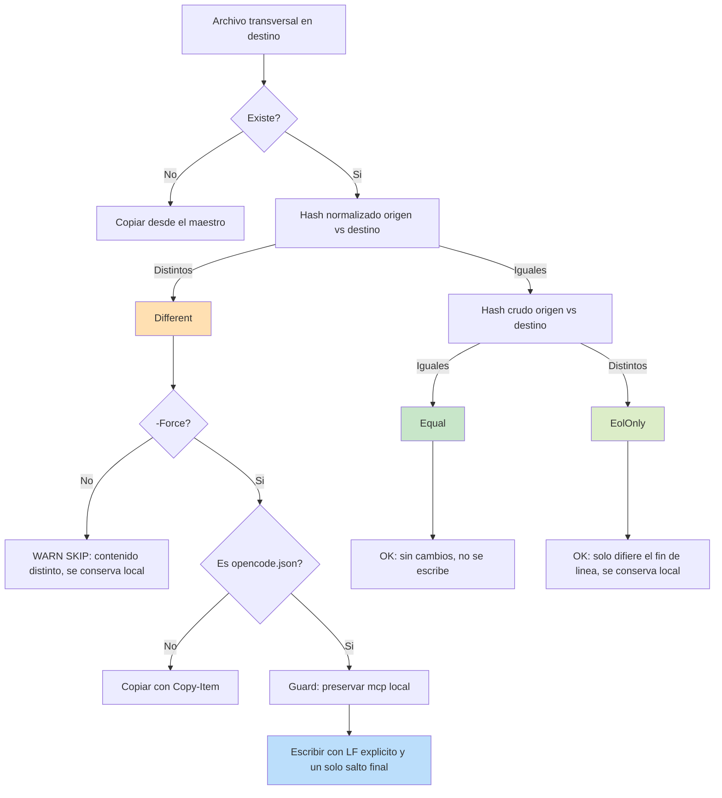
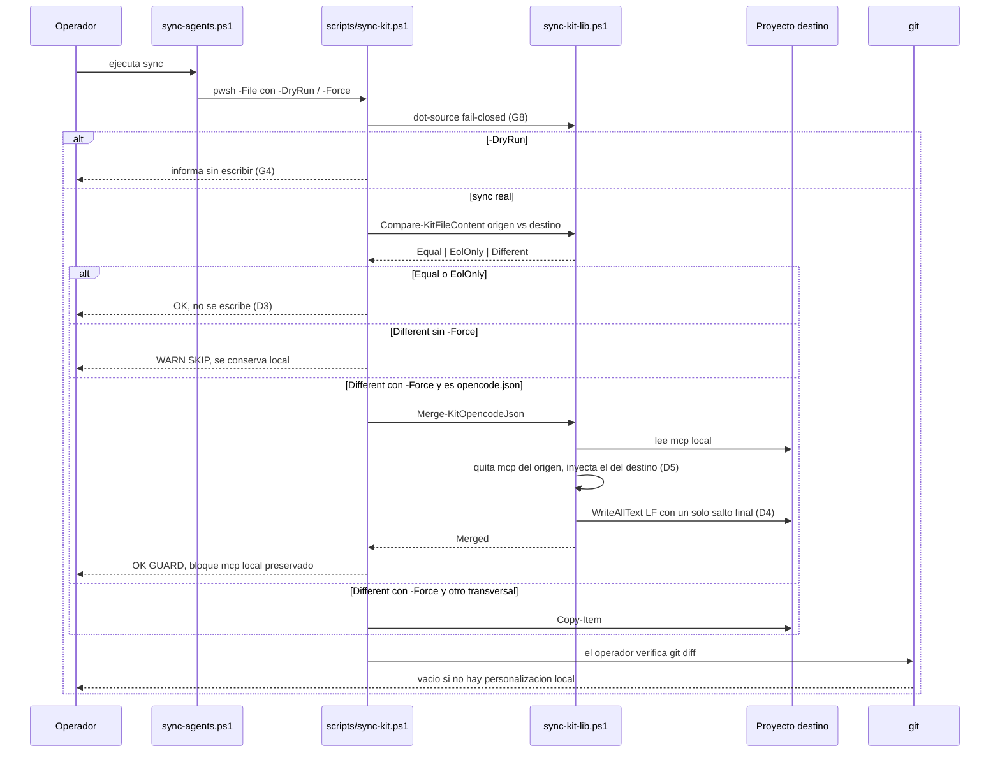

# ADR-0012 — Comparación de transversales por EOL normalizado con veredicto de tres estados

> **Estado**: Aceptado
> **Fecha**: 2026-10-27
> **Decisión**: La decisión "¿difiere este archivo transversal?" se toma comparando **contenido con fin de línea normalizado a nivel de bytes** (`0x0D 0x0A` → `0x0A`), no el hash crudo del archivo. El veredicto tiene **tres estados** —`Equal`, `EolOnly`, `Different`— y solo `Different` habilita la escritura bajo `-Force`. El guard del bloque `mcp` de `opencode.json` **no se toca**.
> **Autor**: `arquitecto` (fase Analyze, spec 029)
> **Fuente del plan**: `Documentacion/Agents_IA_TECH/specs/029-sync-eol-y-force-real/plan.md` (D-03, D-04, D-05, D-06)
> **Sustituye/complementa**: complementa ADR-0006 (resolución de tokens MCP), ADR-0009 (rutas MCP hardcodeadas) y ADR-0010 (forma V2 de `opencode.json`, regla R4)
> **Restricción dura heredada**: el guard del bloque `mcp` es una mitigación deliberada (ADR-0009, ADR-0010 R4). Este ADR no la modifica ni la debilita

---

## Contexto y problema

### El defecto

`scripts/sync-kit.ps1` decide si copiar un archivo transversal comparando `Get-FileHash` sobre **bytes crudos** (L640-649 para la lista de archivos, L589-601 para el guard de `.opencode/.gitignore`). En un checkout Windows con `core.autocrlf=true` y un `.gitattributes` que declara `*.json text eol=lf` y `*.md text eol=lf`, el archivo local queda en CRLF tras haber sido reescrito por PowerShell, mientras el clon del maestro llega en LF. Los dos hashes nunca coinciden, y el sync reporta `[SKIP] <label> - existe y difiere; usa -Force para sobrescribir (se conserva local)` en **cada** corrida.

La comparación mira la representación, no el contenido. Para un sistema cuya función es decidir "¿el destino ya está al día?", esa es la pregunta equivocada.

### Medición del 2026-10-27 en este repo

| Archivo | Índice | Worktree | Atributo | Consecuencia |
|---|---|---|---|---|
| `opencode.json` | `lf` | `crlf` | `text eol=lf` | 2.569 B / 102 CRLF frente a 2.467 B / 0 CRLF del maestro. **Falso positivo permanente** |
| `AGENTS.md` | `lf` | `mixed` | `text eol=lf` | 1 CRLF suelto. **Falso positivo permanente** |
| `.specify/memory/constitution.md` | `lf` | `mixed` | `text eol=lf` | 2 CRLF sueltos. **Falso positivo permanente** |
| `README.md` | `lf` | `lf` | `text eol=lf` | Sin deriva: reporta `[OK]` |
| `.opencode/.gitignore` | `lf` | `crlf` | *sin atributo* | Coincide por casualidad de `core.autocrlf`, no por diseño |

`git diff` y `git status --porcelain` sobre los tres primeros devuelven **vacío / LIMPIO**. La diferencia de 102 bytes en `opencode.json` es exactamente un `\r` por línea. Git normaliza; `Get-FileHash` no.

**El alcance real del defecto son tres archivos, no uno.** La spec lo narraba en singular; la medición lo amplió, y este ADR se escribe contra el alcance medido.

### Por qué ahora

El defecto tiene un segundo efecto, más caro que el ruido: destruye la señal. Cuando `[OK] sin cambios` nunca aparece para `opencode.json`, el operador deja de leer la salida y `[SKIP]` pierde significado. Un sync que no puede distinguir "personalización local real" de "ruido de fin de línea" es un sync en el que no se puede delegar una decisión.

### Tensión de diseño

Hay dos caminos posibles y ambos son defendibles por separado:

1. **Normalizar el criterio** (comparar contenido, no bytes) — resuelve el falso positivo, pero introduce un estado nuevo que el código actual no sabe expresar y que el operador debe entender.
2. **Normalizar el archivo** (reescribir a LF cuando solo difiere el EOL) — deja el criterio simple, pero convierte cada corrida del sync en una escritura sobre archivos que git ya normaliza, y contradice la garantía "si no hay cambio real, no se toca nada".

Este ADR elige (1) y rechaza (2) con el argumento de que el sync **no es un formateador**: su trabajo es decidir, no corregir estilo a espaldas del usuario.

---

## Decisión

Se adopta un criterio de comparación basado en contenido normalizado, con veredicto de tres estados y sin reescritura cuando la única diferencia es el fin de línea.

### D1 — Normalización a nivel de bytes, no de string

La normalización opera sobre `byte[]`: se elimina cada `0x0D` que precede inmediatamente a un `0x0A`. No se usa `Encoding.UTF8.GetString` seguido de `-replace`, por dos razones:

- `GetString` sustituye bytes inválidos por el carácter de reemplazo, de modo que dos binarios distintos podrían normalizarse al mismo string y declararse iguales;
- a nivel de string, un `\r` dentro de una cadena JSON escapada (`"\\r"` en el archivo, que son dos bytes `\` y `r`) es indistinguible del `\r` de fin de línea, y colapsarlo enmascararía un cambio real de contenido.

El BOM **no** se normaliza: se conserva como byte. Un BOM de un solo lado es una diferencia real de codificación, no ruido de EOL.

### D2 — Tres estados con dos hashes

`Compare-KitFileContent` devuelve `'Equal' | 'EolOnly' | 'Different'` con esta secuencia:

1. hash **normalizado** de ambos lados;
2. si difieren → `Different` y se detiene (no se calcula nada más);
3. si coinciden → hash **crudo** de ambos lados: iguales → `Equal`, distintos → `EolOnly`.

Dos estados no alcanzan (`Equal`/`Different` deja el falso positivo en pie o miente sobre la causa) y cuatro sobran. `EolOnly` es la información que el operador necesita para saber que el sistema lo vio y decidió no tocar nada.

### D3 — Efecto de cada estado sobre el archivo

| Veredicto | Mensaje | Escritura |
|---|---|---|
| `Equal` | `[OK] <label> - sin cambios (contenido identico)` | Ninguna |
| `EolOnly` | `[OK] <label> - sin cambios (solo difiere el fin de linea; se conserva local)` | Ninguna |
| `Different` sin `-Force` | `[WARN] [SKIP] <label> - contenido distinto; usa -Force para sobrescribir (se conserva local)` | Ninguna |
| `Different` con `-Force` | `[FILE] <label>` | Copia (o merge, si es `opencode.json`) |

`EolOnly` **no** dispara escritura. Es la garantía de CA-01 y la razón por la que se rechaza la alternativa A-03.

### D4 — La escritura del merge escribe LF explícito

Este ADR incluye un sub-decisión acoplada: cuando el guard del bloque `mcp` reescribe `opencode.json`, el resultado usa LF.

`Set-Content -Encoding UTF8` en PowerShell 7 escribe UTF-8 sin BOM pero **usa `[Environment]::NewLine`** (CRLF en Windows). Es exactamente el mecanismo que reintroduce el defecto en cada merge. La escritura se hace con `[IO.File]::WriteAllText` y `[Text.UTF8Encoding]::new($false)`, con el texto ya normalizado a `\n` y con **exactamente un** `\n` final.

El detalle del salto final no es cosmético: `ConvertTo-Json -Depth 10` sobre el `opencode.json` de este repo produce 2.466 caracteres contra 2.467 del original, porque **pierde el `\n` final**. Sin reponerlo, CA-04 (ausencia de diff espurio) falla por un solo byte.

Sin D4, D1-D3 quedan incompletos: el merge seguiría dejando el archivo en CRLF, y el veredicto `EolOnly` se volvería el estado permanente de `opencode.json` en vez de una condición transitoria.

### D5 — El guard del bloque `mcp` no se toca

Restricción dura, no decisión nueva. `Merge-KitOpencodeJson` reproduce la secuencia actual (quitar `mcp` del origen, inyectar el `mcp` del destino) y **siempre** conserva el `mcp` local. Nunca adopta el `mcp` del maestro, y `-Force` no lo pisa.

La razón está fuera de este ADR y se hereda: las rutas de los MCP son absolutas y por máquina (ADR-0009), y la forma V2 exige `mcp.servers` (ADR-0010 R1, R4). Propagar el `mcp` del maestro rompería los MCP de todos los proyectos consumidores en una sola corrida.

### D6 — Contrato de mensajes observable

Los tres estados se reportan con tres mensajes distintos, no con un mensaje común parametrizado. El mensaje es parte de la interfaz operativa del sync: es lo que el operador lee para decidir si investiga. Un mensaje ambiguo reabre el problema que este ADR cierra.

---

## Alternativas consideradas

| Opción | Idea | Veredicto |
|---|---|---|
| **A-01 — Hash crudo (status quo actual)** | Mantener `Get-FileHash` sobre bytes crudos en las dos comparaciones | ❌ **Rechazada**. Es la causa raíz del defecto: tres archivos transversales quedan silenciados en cada corrida con contenido idéntico. Además el hash crudo no puede expresar la diferencia entre "difiere el contenido" y "difiere el fin de línea", que es justo la información que el operador necesita para decidir |
| **A-02 — Normalizar con git** | `git add --renormalize` o `git hash-object --path` para obtener el blob normalizado | ❌ **Rechazada**. El sync corre también en proyectos consumidores que pueden no ser repositorios git; además escribiría en el índice, es decir, produciría un efecto secundario en una operación que debe ser de solo lectura. Introduce una dependencia externa (git) para una comparación que se resuelve en memoria |
| **A-03 — Reescribir a LF cuando el veredicto es `EolOnly`** | Aprovechar que los bytes son equivalentes y "arreglar" el archivo en la misma corrida | ❌ **Rechazada**. CA-01 exige explícitamente que el archivo **no se reescriba**; el sync no es un formateador. Además generaría una escritura en cada corrida sobre archivos que git ya normaliza al commitear, con el riesgo de tocar el `mtime` de archivos que el usuario no modificó |
| **A-04 — Normalizar también el BOM** | Tratar el BOM como ruido y descartarlo de un solo lado | ❌ **Rechazada**. NFR-04 limita la normalización a `\r\n` → `\n`. Un BOM de un solo lado es una diferencia real de codificación que sí puede romper un parser estricto; enmascararla sería exactamente el tipo de error que este ADR evita |
| **A-05 — Comparar por líneas** | `Compare-Object` sobre `Get-Content` de ambos archivos | ❌ **Rechazada**. Devuelve diferencias por línea, no un veredicto de tres estados; es sensible al encoding y al orden; y es más lento que dos hashes sobre archivos del tamaño de los transversales |
| **A-06 — Comparar strings tras `Get-Content -Raw`** | Normalizar con `-replace` sobre el texto ya leído | ❌ **Rechazada**. Es la variante ingenua de D1: depende del fallback de decodificación y confunde `\r` escapado dentro de JSON con `\r` de fin de línea |
| **A-07 — Arreglar el entorno** | `core.autocrlf=false` y `.gitattributes` para todos los archivos | ❌ **Rechazada como solución única**. Corrige este checkout, no el motor: los proyectos consumidores tienen su propia configuración y el sync debe ser correcto con la que encuentre. Se acepta como mitigación complementaria, no como reemplazo del criterio |
| **A-08 — Cuarto estado "differences only in whitespace"** | Extender la normalización a espacios y tabulaciones | ❌ **Rechazada**. NFR-04 lo prohíbe y sería una normalización que sí enmascara cambios reales de contenido (indentación de YAML, alineación significativa) |

Criterio de elección: **fidelidad al contenido** (solo se considera ruido lo que no cambia un byte significativo), **ausencia de efectos secundarios** (comparar no escribe), **portabilidad sin git** y **observabilidad** (tres mensajes que el operador puede accionar).

---

## Consecuencias

### Positivas

- **El falso positivo desaparece en los tres archivos afectados** (`opencode.json`, `AGENTS.md`, `.specify/memory/constitution.md`) con un solo cambio de criterio. `[OK] sin cambios` vuelve a ser una señal confiable.
- **La salida del sync se vuelve accionable**: `EolOnly` informa al operador que el archivo es funcionalmente idéntico y que no hay nada que hacer; `Different` informa que hay una personalización local real que `-Force` destruiría.
- **La comparación es de solo lectura**, portable y no depende de git ni de red. Funciona igual en un consumidor que no es repositorio.
- **El merge deja de reintroducir el defecto**: `opencode.json` queda en LF y con un único salto final, con lo que `git diff` sobre él queda vacío tras un sync completo.
- **El contrato del guard se vuelve testeable**: al extraerse a la biblioteca, FR-05, CA-03 y CA-06 dejan de estar embebidos en un `foreach` y pasan a ser verificables con Pester.

### Negativas / Trade-offs

- **Aparece un tercer estado que hay que explicar.** `EolOnly` no existía en el vocabulario del sync; el operador y la documentación (spec 002, README) deben incorporarlo. Mitigado por D6: el mensaje explica el estado en la propia línea de salida.
- **El costo por archivo sube de dos a cuatro lecturas** en el caso barato (dos dentro del hash normalizado, dos para el hash crudo cuando los normalizados coinciden). Los transversales son archivos pequeños —el mayor ronda las decenas de KB— así que el efecto es despreciable; se documenta para que nadie lo "optimice" eliminando el hash crudo, que es lo que distingue `Equal` de `EolOnly`.
- **La normalización tiene dos límites aceptados y documentados**: un BOM de un solo lado es `Different`, y un `\r` suelto sin `\n` es `Different`. Ninguno de los dos es ruido; ambos se fijan con test para que un futuro "mejora" no los colapse.
- **`.opencode/.gitignore` no tiene atributo EOL** en `.gitattributes`, de modo que su representación depende de `core.autocrlf` del entorno. El criterio nuevo lo clasificará como `EolOnly` cuando el maestro llegue en LF, y el guard decidirá entonces si lo preserva o lo copia. Queda como decisión explícita a registrar (ver Huecos del analyze, H-10).

### Riesgo residual

- **El cambio vive en un motor marcado `[021-DEPRECATED]`.** El flujo 021 (`scripts/sync-kit-agents.ps1` + `scripts/sync/*`) no está cableado y **conserva dos comparaciones con hash crudo** (`sync-constitutions.ps1` L59-60, `sync-kit-files.ps1` L117-118). Cuando ese flujo se cablee, el defecto reaparece por otra puerta. Condición de salida registrada: esas dos comparaciones deben adoptar el mismo criterio antes de retirar `scripts/sync-kit.ps1`.
- **Existe una copia obsoleta del motor** en `Documentacion/Agents_IA_TECH/specs/015-sync-kit-bootstrap/implementation/sync-kit.ps1` (33.783 B / 608 líneas frente a 37.660 B / 713 del motor vivo). Un lector puede tomar la copia como fuente y "corregir" el archivo equivocado. Registrado como deuda documental (analyze H-09, task derivada T037).
- **CA-06 pide que el bloque `mcp` quede byte-idéntico**, y el merge re-serializa el JSON. La igualdad byte a byte se cumple solo si el destino ya está en la forma canónica de `ConvertTo-Json`. La verificación debe hacerse por igualdad semántica del objeto, no por bytes, salvo en el caso canónico (analyze H-04, task derivada T033).

---

## Guardrails

Restricciones que cualquier implementación debe respetar. Cada una es verificable; ninguna es una recomendación de estilo.

| ID | Guardrail | Verificación |
|---|---|---|
| **G1** | El guard del bloque `mcp` no cambia de comportamiento: el `mcp` local se preserva y el del maestro se descarta. `-Force` no lo pisa | Test de merge con `mcp` local distinto del origen; el resultado conserva el del destino |
| **G2** | La normalización se limita a eliminar `0x0D` inmediatamente anterior a `0x0A`. Prohibido recortar extremos, colapsar líneas vacías, reordenar claves o reformatear | Test de `\r` suelto y test de BOM de un solo lado, ambos con veredicto `Different` |
| **G3** | El BOM se conserva como byte y cuenta como diferencia real | Test con BOM en un solo lado |
| **G4** | `Equal` y `EolOnly` no escriben. `Different` sin `-Force` no escribe. Ningún veredicto produce efecto secundario | Hash del directorio antes/después de comparar, más hash del archivo antes/después de un sync sin `-Force` |
| **G5** | Cero dependencia de `[Environment]::NewLine`, de `Set-Content` y de cualquier cmdlet cuyo fin de línea dependa del host en la ruta de escritura | Verificación estática por AST: ausencia de `[Environment]::NewLine` y de `Set-Content` en la biblioteca y en el motor |
| **G6** | La escritura de `opencode.json` produce 0 ocurrencias de `\r\n` y exactamente un `\n` final | Conteo sobre el archivo resultante, incluido el round-trip del archivo real |
| **G7** | El helper se importa sin efectos secundarios: hacer dot-source no ejecuta sync ni escribe nada | Dot-source en proceso limpio y comparación del directorio |
| **G8** | El helper es fail-closed: si falta, el motor aborta con error explícito en vez de continuar con una comparación degradada | Búsqueda del archivo con `Test-Path` y `throw` con mensaje antes de cualquier uso |
| **G9** | Los tres estados tienen mensajes distintos y no ambiguos entre sí | Aserción sobre los strings del contrato de mensajes |
| **G10** | La escritura LF se aplica **solo** a `opencode.json`. El resto de transversales sigue copiándose con `Copy-Item`, sin reformateo | Aserción de que `WriteAllText` solo aparece en la ruta del merge |

---

## Spec linking

| Requisito | Plan | Tasks | Decisión de este ADR | Test |
|---|---|---|---|---|
| **FR-01** — comparación por contenido con EOL normalizado | C-01, C-03, C-04 | T003, T009, T008 | D1, D2 | T-01..T-06 |
| **FR-02** — tres resultados con mensajes distintos | C-04 + contrato §4 | T008, T011 | D2, D3, D6 | T-01..T-03, contrato de mensajes |
| **FR-03** — `-Force` declarado y propagado | C-02, C-07 | T013, T014, T015, T016 | Fuera del alcance de este ADR (flags, no criterio de comparación) | T-13, T-14 |
| **FR-04** — `opencode.json` escrito en LF | C-05 + `Write-KitJsonFile` | T020, T018 | D4 | T-08, T-12 |
| **FR-05** — guard del bloque `mcp` intacto | C-05 + `Merge-KitOpencodeJson` | T019, T020 | D5 | T-10, T-11 |
| **FR-06** — `-DryRun` sin escrituras | C-02, C-07, L492 intacto | T013, T014, T017 | G4, G7 | T-07, sandbox paso 2 |
| **FR-07** — idéntico en Windows y Linux | D-03, D-06 | T004 | D1, D4 (bytes y `WriteAllText`, sin ramas por plataforma) | T-02, T-04, T-06 |
| **FR-08** — spec 002 y README al día | converge | T022, T023, T024 | D2, D3 (los estados y los mensajes son el contrato a documentar) | Lectura de ambos archivos |
| **NFR-04** — solo `\r\n` → `\n` | D-03 | T004 | D1, G2, G3 | T-05, T-06 |
| **CA-01** — igual con EOL distinto, sin reescribir | C-04 | T004, T012 | D3, A-03 rechazada | T-02, T-04 |
| **CA-02** — distinto real sigue reportando | C-04, C-07 | T004, T026 | D3 | T-03 |
| **CA-03** — 0 CRLF tras el merge | D-06 | T018, T019, T021 | D4, G6 | T-08, T-12 |
| **CA-04** — sin diff espurio | D-06 | T018, T021 | D4 (salto final único) | T-09 |
| **CA-05** — `-DryRun` escribe cero | L492 intacto | T017, T026 | G4 | Sandbox paso 2 |
| **CA-06** — `mcp` local conservado | C-05 | T019, T021 | D5 (con la salvedad de método de H-04) | T-10 |
| **CA-07** — firma y propagación de `-Force` | C-02, C-07 | T015, T016 | Fuera del alcance de este ADR | T-13, T-14 |
| **CA-08** — paridad Windows/Linux | D-03, D-06 | T004 | D1, D4, G5 | T-02, T-04, T-06 más el guardarraíl estático de T030 |
| **CA-09** — spec 002 y README al día | converge | T024 | D6 | Lectura de ambos archivos |
| **ADR-0009 y ADR-0010 R4** | §1.3 | — | **D5** (restricción dura; el guard no se toca) | T-10, T-11 |

Artefactos de la fase: `spec.md`, `plan.md`, `tasks.md` y `analyze.md` de la spec 029, en `Documentacion/Agents_IA_TECH/specs/029-sync-eol-y-force-real/`.

---

## Diagramas (Mermaid)

### Decisión de tres estados

Lectura del diagrama: `EolOnly` es el estado que el criterio anterior no podía producir. Es también el único estado nuevo que el sistema gana, y su efecto sobre el archivo es **ninguno** por diseño (D3).

### Secuencia del sync con el guard del bloque `mcp`

Lectura del diagrama: el guard se evalúa **después** de decidir que hay diferencia real, y solo bajo `-Force`. Esa posición es deliberada: el guard no es una comparación alternativa, es una política de escritura sobre un archivo concreto.

---

## Plan de implementación

### Fase documental (esta fase)

| Orden | Agente | Acción | Estado |
|---|---|---|---|
| 1 | `arquitecto` | Este ADR (contexto, decisión, alternativas, consecuencias, guardrails, spec linking, diagramas, plan) | Hecho el 2026-10-27 |
| 2 | `arquitecto` | `analyze.md` de la spec 029 con matriz de cobertura, huecos y tasks derivadas | Hecho el 2026-10-27 |
| 3 | `arquitecto` | Registro de ADR-0010, ADR-0011 y ADR-0012 en `arquitectura/adr/00-index.md` | Hecho el 2026-10-27 |

### Fase de implementación (delegada)

| Fase | Contenido | Tasks | Agente |
|---|---|---|---|
| **A** — Biblioteca pura | Crear `scripts/sync-kit-lib.ps1` con las cinco funciones (D1, D2, D4, D5) y dot-source fail-closed en el motor | T001, T003 | `plataformador` |
| **B** — Contrato probado antes de cablear | Tests de la biblioteca: seis escenarios de comparación, ausencia de efectos, importación limpia | T002, T004, T005, T006, T007 | `plataformador` |
| **C** — Cableado en el motor | C-03, C-04, C-06, C-08: comparación de transversales y guard de `.opencode/.gitignore` con los tres mensajes | T008, T009, T010, T011 | `plataformador` |
| **D** — Flags efectivos | `[switch]$DryRun` y `[switch]$Force` en la firma más propagación desde el entrypoint | T013, T014, T015, T016, T017 | `plataformador` |
| **E** — Merge y escritura LF | Extraer el merge a la biblioteca y sustituir el `Set-Content` por escritura LF (D4, D5) | T018, T019, T020 | `plataformador` |
| **F** — Verificación end-to-end | Sandbox sobre `$env:TEMP` con `-KitPath`, seis pasos, sin red | T012, T021, T026 | `plataformador` |
| **G** — Documentación del contrato | Spec 002 y README con el criterio normalizado, los tres estados y la nota de que `-Force` no pisa el `mcp` | T022, T023, T024 | `documentador` |
| **H** — Cierre | Suite completa, commit convencional | T025, T029 | `plataformador`, `gitflow` |

### Validación post-implementación

| Criterio | Verificación | Esperado |
|---|---|---|
| VC-01 | `Compare-KitFileContent` con byte-idénticos | `Equal` |
| VC-02 | Destino CRLF, origen LF, mismo contenido | `EolOnly`, sin escritura |
| VC-03 | Destino con una clave extra | `Different` |
| VC-04 | `\r` suelto y BOM de un solo lado | `Different` en ambos |
| VC-05 | Sync sin `-Force` sobre los tres archivos afectados | Tres `[OK] <label> - sin cambios (solo difiere el fin de linea; se conserva local)`, cero escrituras |
| VC-06 | Sync con `-Force` sobre `opencode.json` con `mcp` local | `[GUARD]`, 0 CRLF, un solo salto final, `mcp` semánticamente idéntico |
| VC-07 | `git diff -- opencode.json` tras el sync | Vacío |
| VC-08 | `-DryRun` con hash del directorio antes/después | Idéntico |
| VC-09 | AST de la firma y del entrypoint | `DryRun` y `Force` presentes y propagados |
| VC-10 | Verificación estática de plataforma (G5) | Cero `[Environment]::NewLine` y cero `Set-Content` en la ruta de escritura |

---

*Documentado por `arquitecto` — Spec 029, fase Analyze — 2026-10-27.*
