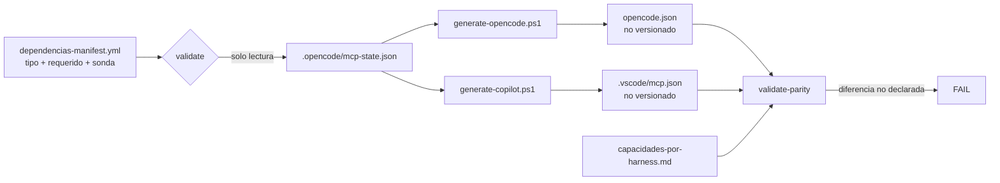

# ADR-0014 — Configuración de arneses generada y aprovisionamiento externo por tipo

- **Estado**: Aceptada
- **Fecha**: 2026-11-07
- **Decide sobre**: cómo se aprovisionan las dependencias externas del kit, cómo se determina si están al día y cómo se produce la configuración de los arneses (`opencode.json`, `.vscode/mcp.json`)
- **Sustituye/complementa**: ADR-0009 (rutas MCP hardcodeadas como workaround) y ADR-0010 R4 (rutas absolutas en archivo versionado). No los deroga: los reubica en un archivo que ya no se versiona
- **Spec relacionada**: `Documentacion/Agents_IA_TECH/specs/038-provisionamiento-externo-y-config-generada/spec.md`

---

## Contexto

El repositorio declaraba un estado que la máquina no cumplía. Los hechos verificados el 2026-11-07:

1. `opencode.json` declara `context-mode` contra `.../context-mode/build/cli.js`. La versión instalada (2.1.0) expone `cli.mjs`, `server.mjs` y `opencode/plugin.js`; no existe `build/` ni `cli.js`. El MCP estaba roto y la configuración lo afirmaba como válido.
2. `dependencias-manifest.yml` declara `context-mode` v1.0.169 (instalado 2.1.0) y `spec-kit` `v0.0.0` con `ultimo_check 2026-09-05`. Nadie ejecuta esa verificación: es texto escrito a mano.
3. ECC, context7, playwright y github existen como servidores configurados y no figuran como dependencia declarada. La declaración y la realidad divergen en ambos sentidos.
4. `git status` no detecta atraso: los tres clones responden `main...origin/main` porque compara contra refs locales. spec-kit está en `1.0.7.dev0` frente al release `v1.3.2`.
5. Conviven dos formas de configuración: `opencode.json` usa `mcp.servers`, mientras `Ensure-OpenCodeMcp`, `Configure-Graphify` y `run-indexing.ps1` escriben la forma plana `mcp.<nombre>`.
6. Los clones de ECC y spec-kit viven dentro de la raíz del workspace y sus `AGENTS.md` se inyectan como instrucciones de la sesión.
7. `MCPs/context-mode.md` §4.2 documenta `.github/hooks/context-mode.json`; `.github/hooks/` no existe.

El patrón común no es "una herramienta no puede": es **capacidad declarada ≠ capacidad instalada**. Los tres primeros hechos y el séptimo son el mismo defecto con distinta superficie.

## Decisión

Se adopta un modelo de **aprovisionamiento por tipo con verificación declaración-contra-realidad**, y la configuración de los arneses deja de mantenerse a mano y pasa a generarse.

### Reglas que se fijan

| Regla | Contenido |
|---|---|
| **R1 — Tipo obligatorio** | Toda dependencia externa declara `tipo_provisionamiento`: `kit-integrado`, `kit-fuente`, `mcp-workspace`, `mcp-build-local` o `entorno`. Tipo ausente o desconocido es FAIL; no se infiere por ruta ni por extensión |
| **R2 — Autoridad de versión por tipo** | `kit-integrado` y `kit-fuente` se comparan por **branch head** (`HEAD` local vs `git ls-remote <url> refs/heads/<rama>`). `mcp-workspace` por registro del gestor de paquetes. `mcp-build-local` por release + verificación del artefacto compilado. `entorno` por runtime. Semver y tags firmados quedan fuera de esta decisión |
| **R3 — `git status` no es sonda** | La actualización se determina por consulta al remoto o al registro. Una comparación contra refs locales no prueba nada |
| **R4 — Estado por workspace** | El resultado de cada sonda se persiste en `.opencode/mcp-state.json`, no versionado, con `tipo`, `requerido`, `comando_resuelto`, `version_instalada`, `version_ultima`, `fuente`, `estado`, `ultimo_check` y, para código de terceros, `rama_seguida`, `ultimo_sha` y `sha_remoto`. Escritura atómica |
| **R5 — Tres verbos separados** | `validate` (solo lectura, exit code), `apply` (instalación/actualización explícita, fail-open a `degraded`), `generate` (escritura de configuración). Ningún verbo hace el trabajo de otro |
| **R6 — Solo se emite lo que resuelve** | `generate` escribe únicamente entradas cuyo binario resuelve en esta máquina. Una dependencia `missing` no se emite y produce WARN. El archivo generado nunca afirma una capacidad inexistente |
| **R7 — Configuración generada, no versionada** | Se versionan plantilla y generador. `opencode.json` y `.vscode/mcp.json` se generan y entran en `.gitignore`. Ambos salen de la misma fuente (manifest + estado) y se comparan con `validate-parity` |
| **R8 — Forma canónica única** | Toda escritura usa `mcp.servers.<nombre>` (ADR-0010 R1). La forma plana `mcp.<nombre>` es legacy y `validate` la reporta como FAIL con ruta y línea |
| **R9 — Rutas absolutas confinadas** | Las rutas absolutas solo pueden existir en el estado no versionado y en los archivos generados no versionados (reubica ADR-0009 y ADR-0010 R4). El manifest y la plantilla usan nombres resolubles o rutas relativas |
| **R10 — Clon externo fuera de la raíz** | Los clones de `kit-integrado` y `kit-fuente` viven fuera de la raíz del workspace. `validate` falla si aparece un `AGENTS.md`, `CLAUDE.md` o `.mcp.json` de ese clon bajo la raíz |
| **R11 — Actualizar no es integrar** | El verbo de actualización solo ejecuta operaciones git sobre el clon. Ningún archivo del clon entra al kit por esta vía: la integración controlada es la spec 039 |
| **R12 — Diferencia declarada, con fuente** | La matriz `capacidades-por-harness.md` declara cada capacidad con estado (`soportado` / `equivalente-distinto` / `soportado-con-limite` / `no-soportado`), fuente, versión verificada, prueba y `spec_responsable`. Se denomina **inconsistencia** a la diferencia verificada entre lo que el kit declara o asume y lo que el arnés confirma. `spec_responsable` es el número de la spec que corrige la inconsistencia; si falta, el validador emite WARN. Diferencia no declarada = FAIL. Una inconsistencia declarada **no** se corrige en la spec que la declara |

## Alternativas consideradas

### A. Seguir versionando `opencode.json` y corregir la ruta a mano

**Rechazada.** Es el estado actual. La ruta absoluta de otra máquina sobrevive porque el archivo es portable por convención, no por construcción. Corregir una entrada no evita la siguiente.

### B. Adoptar `{env:VAR}` para todas las rutas y mantener el archivo versionado

**Rechazada.** Es el workaround que ADR-0009 ya descartó: la sustitución de variables en `command` no es fiable en la versión de OpenCode instalada. Además traslada el problema al entorno de cada máquina sin verificarlo.

### C. Versionar release tags como autoridad de versión

**Rechazada por el usuario (2026-11-07).** No agrega valor hoy: exige que cada dependencia publique releases utilizables y un procedimiento de firma que todavía no existe. Se registra como backlog atado al instalador único del KIT.

### D. Integrar `kit-integrado` con un script de copia

**Rechazada.** La integración de ECC no es una copia: duplica funcionalidades, pisa personalizaciones y arrastra archivos que el arnés carga como instrucciones. Se separa como proceso asistido por IA en la spec 039, con inventario diferencial y libro mayor.

## Guardrails

- `validate` nunca escribe archivos del proyecto, configuración de arneses ni clones. Solo actualiza el estado.
- `generate` nunca emite una entrada sin binario resoluble; nunca inventa claves que el arnés no soporta.
- Ningún script escribe la forma plana `mcp.<nombre>`.
- El manifest es la única fuente de tipos y de `requerido`; no hay defaults silenciosos.
- Un fallo de red o de sonda produce `degraded`/`desconocido` con causa, nunca `ok`.
- Ningún archivo versionado contiene rutas de usuario ni secretos.
- Las cuatro inconsistencias (delegación anidada, hooks de sesión, superficie de subagentes en runtime, frontmatter de Copilot) se declaran en la matriz y se corrigen en specs 040–043, una por inconsistencia.

## Diagrama

## Spec linking

| Artefacto | Relación |
|---|---|
| `specs/038-provisionamiento-externo-y-config-generada/spec.md` | Origen de la decisión. FR-01 a FR-17, NFR-01 a NFR-08, SC-001 a SC-013 |
| `specs/038-.../checklists/requirements.md` | Valida la coherencia de la spec con esta decisión (PC-01, PC-09) |
| `plan.md` (pendiente) | Debe implementar R1–R12 sin agregar tipos ni verbos |
| `tasks.md` (pendiente) | Cada regla debe tener al menos una tarea verificable |
| `specs/039` (backlog B-002) | Consume R10 y R11; no los redefine |
| `specs/040` a `043` (backlog B-005 a B-008) | Consumen R12; cada una corrige una inconsistencia declarada |

## Plan de implementación

1. **Enmienda constitucional v2.1.0** (esta decisión): Art. IV y Art. VI incorporan configuración generada, taxonomía de aprovisionamiento, autoridad branch-head, aislamiento del clon y la regla "capacidad declarada ≠ capacidad instalada".
2. **Esquema del manifest y del estado**: campos de R1, R2, R4 y R12; migración de las dependencias existentes, incluidas ECC, context7, playwright y github.
3. **Sondas y verbos**: `validate` primero (es el gate), luego `apply` y `generate`.
4. **Generadores duales + paridad**: plantilla versionada, dos generadores, validador contra la matriz.
5. **Migración de la forma plana**: `Ensure-OpenCodeMcp`, `Configure-Graphify`, `sync-mcp-graphify.ps1` y `run-indexing.ps1`.
6. **Aislamiento de clones**: mover ECC y spec-kit fuera de la raíz y verificar que la sesión no incorpora sus `AGENTS.md`.
7. **Documento de referencia**: `provisionamiento-externo.md` con la matriz de sondas y comandos por tipo.

## Consecuencias

**Positivas**

- La configuración deja de afirmar capacidades que la máquina no tiene.
- La detección de atraso es de red y por SHA, no por refs locales.
- La sesión deja de recibir instrucciones de repositorios de terceros.
- Una limitación de arnés se documenta una vez y se valida, en lugar de reaparecer como bug.
- Los clones externos quedan aislados del contexto del agente.

**Negativas y costos**

- `opencode.json` deja de ser un artefacto revisable en el diff: se audita la plantilla y el generador.
- Requiere red para `validate`; sin red el estado es `desconocido`, no `ok`.
- La migración de la forma plana toca cuatro scripts y exige regresión sobre `validate-agents-skills.ps1`.
- El estado por workspace agrega un archivo más que puede desincronizarse si se edita a mano; el generador no confía en él sin verificar el binario.

**Riesgos**

| Riesgo | Mitigación |
|---|---|
| El generador pisa personalizaciones de `opencode.json` | Solo gestiona `mcp.servers`; el resto se preserva desde la plantilla |
| La matriz se llena con supuestos | Fuente y versión obligatorias; sin evidencia la fila no entra |
| Mover los clones rompe rutas cableadas | Búsqueda de referencias antes del movimiento; el estado registra ruta anterior y nueva |
| Un `apply` introduce una versión que rompe el arnés | `apply` explícito; `generate` omite lo que no resuelve; rollback por tipo documentado |
