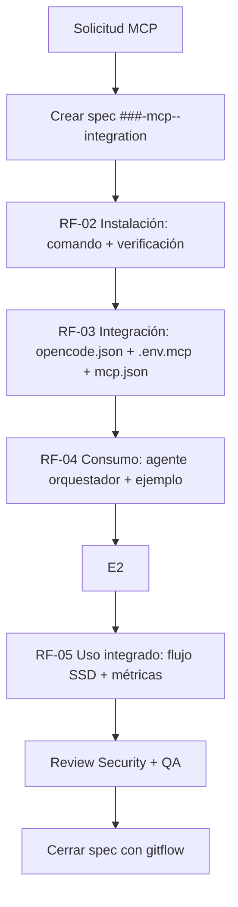

# Feature Specification: [000-mcp-integration-standard] — Estándar de integración de MCPs en el kit Agents_IA_TECH

**Origen**: Kit Agents_IA_TECH interno — Estándar de gobernanza MCP

**Feature Branch**: `000-mcp-integration-standard`

**Created**: 2026-09-28

**Status**: Draft

**Scope**: Meta-spec que define el flujo obligatorio para integrar CUALQUIER MCP externo en la solución.

---

## Problema

Cada nuevo MCP se está especificando de forma ad-hoc. No existe un estándar documentado que indique **qué** se debe crear, **en qué orden** y **con qué artefactos** para instalarlo, integrarlo, consumirlo y usarlo de forma integrada.

Esto genera:
- Duplicación de trabajo
- Specs incompletos o con enfoque de desarrollo en lugar de uso
- Inconsistencia entre `.opencode/`, `.vscode/`, `opencode.json` y el bootstrap

**Impacto**: Retrabajo, specs que no se pueden cerrar y deuda de integración.

---

## Objetivo

Definir un estándar SSD único para la integración de MCPs externos como *proyect_ext*:
1. Instalar
2. Integrar
3. Consumir
4. Usar de forma integrada

Todas las integraciones de MCPs deben seguir este estándar.

---

## Requisitos Funcionales

### RF-01 — Spec de integración por MCP

Cada MCP requiere una spec individual bajo `Documentacion/Agents_IA_TECH/specs/###-mcp-<nombre>-integration/` con los artefactos spec-kit mínimos:
- `spec.md`
- `plan.md`
- `tasks.md`
- `checklists/requirements.md`

**Criterios de aceptación**:
- La spec describe instalación, integración, consumo y uso; NO desarrolla el MCP.
- La spec referencia el estándar 000.

### RF-02 — Instalación

La spec DEBE documentar:
- Fuente de instalación (npm / pip / uv / binario)
- Comando exacto de instalación
- Prerrequisitos y verificación post-instalación

**Criterios de aceptación**:
- Comando verificable reproduceable.
- Script de verificación incluido en `quickstart.md`.

### RF-03 — Integración en el kit

La spec DEBE documentar integración en:
- `opencode.json` en **forma V2**: la entrada vive bajo `mcp.servers.<nombre>` con `{ "type": "local", "command": [<ruta absoluta>, ...] }`
- `mcp.timeout` con `startup` / `catalog` / `execution` explícitos
- `.vscode/mcp.json` bajo su clave `servers` (formato propio de VS Code, no el de OpenCode)

**Criterios de aceptación**:
- El campo `enabled` **no se usa**: el schema V2 no lo admite en `Mcp.LocalConfigEncoded` y tiene `additionalProperties: false`. Para deshabilitar se usa `disabled: true`.
- Los servidores cuelgan de `mcp.servers`, nunca sueltos bajo `mcp`.
- Rutas absolutas con forward slashes y entry-point JS directo (ADR-0009, bug OpenCode #5299). No usar `{env:...}` dentro de `mcp.command`.
- Idempotente y fail-open.
- Validado contra `https://opencode.ai/config.json` con `jsonschema` antes de darse por terminada.

### RF-04 — Consumo por agentes (EDITAR las definiciones, no solo documentar)

> **Documentar el consumo no es integrar el MCP. Un MCP que ningún agente declara no se usa: es una implementación incompleta.**

La spec DEBE:
1. Documentar cómo los agentes consumen el MCP: agente orquestador, parámetros de entrada/salida, ejemplos de uso.
2. **Editar la sección "Uso de MCPs" de cada agente afectado**, agregando la línea del MCP con el nombre real de sus herramientas.
3. Replicar el cambio en los **dos arneses**: `.github/agents/<nombre>.agent.md` y `.opencode/agents/<nombre>.md`, con bloques idénticos.
4. Declarar el MCP en el transversal si aplica a todos los agentes, o en la lista por rol si es específico.

**Reparto vigente** (detalle y tabla por rol en la spec 020, RF-05):

| MCP | Dónde se declara |
|---|---|
| `context-mode`, `codebase-memory-mcp`, `markitdown`, `graphify`, `tokenslayer` | transversal: los 16 agentes |
| `context7` | `Agent-SSD`, `analista_tecnico`, `api-developer`, `arquitecto`, `documentador`, `frontend-developer`, `pensador`, `plataformador`, `qa-senior`, `upgrade_framework` |
| `github` | `api-developer`, `devops`, `frontend-developer`, `gitflow`, `plataformador`, `security-auditor` |
| `playwright` | `devops`, `frontend-developer`, `qa-senior` |

**Criterios de aceptación**:
- Al menos un ejemplo de llamada real con agente, documentado en `quickstart.md`.
- Cada agente afectado tiene la línea del MCP en su bloque "Uso de MCPs".
- 0 desajustes entre `.github/agents/` y `.opencode/agents/` para el mismo agente.

### RF-05 — Uso integrado

La spec DEBE documentar uso integrado en flujo SSD:
- Dónde entra el MCP en Plan → Documentar → Implementar
- Impacto en calidad / observabilidad

**Criterios de aceptación**:
- Mapa de flujo con el MCP incluido.
- Criterios de éxito medibles.

### RF-07 — Verificación anti-huérfano (obligatoria antes de cerrar)

> Ninguna integración de MCP se cierra sin cruzar la configuración contra las definiciones de agente.

Al cerrar una spec de integración se DEBE ejecutar el cruce y adjuntar el resultado:

| Comprobación | Criterio de cierre |
|---|---|
| Cobertura | Todo MCP de `opencode.json` aparece en al menos un bloque "Uso de MCPs" de agente |
| Sin huérfanos | Ningún agente declara un MCP que no esté en `opencode.json` |
| Paridad de arneses | Bloques MCP idénticos entre `.github/agents/` y `.opencode/agents/`, 0 desajustes |
| Integridad | Frontmatter intacto, UTF-8 sin BOM, finales de línea preservados |
| Uso real | Al menos una ejecución del agente que **llama** el MCP, no solo lo declara |

**Regla de interpretación**: si el cruce da cero agentes para un MCP instalado, **el defecto está en los agentes**, no en el MCP. La corrección es editar los agentes, no retirar el MCP.

### RF-06 — Gobernanza y trazabilidad

Todas las specs de MCP deben:
- Referenciar `007-mcp-token-resolution` para patrón de tokens
- Referenciar este estándar 000
- Seguir conventional commits al cerrar

**Criterios de aceptación**:
- `spec.md` incluye sección Dependencias → `000-mcp-integration-standard`.

---

## Requisitos No Funcionales

- **RNF-01**: No se desarrolla el MCP, solo se usa.
- **RNF-02**: Contenido completo, sin placeholders.
- **RNF-03**: Paridad `.github/` ↔ `.opencode/`.
- **RNF-04**: Fail-open en ausencia de herramienta.

---

## Flujo estándar de integración MCP

---

## Dependencias

- `007-mcp-token-resolution` — patrón de tokens y `.env.mcp`
- `scripts/plataformador-bootstrap.ps1` — `Ensure-OpenCodeMcp`, `Resolve-McpCommand`, `Ensure-McpEnvFile`
- `Documentacion/Agents_IA_TECH/specs/006-post-platforming-speckit/spec.md`

---

## Criterios de Éxito

- **SC-001**: Cada MCP de la lista tiene spec cerrada siguiendo este estándar.
- **SC-002**: `opencode.json` versionado sin rutas absolutas.
- **SC-003**: Bootstrap activa el MCP con `enabled: true` si está instalado.
- **SC-004**: `quickstart.md` permite validar instalación y consumo en <5 min.
- **SC-005**: Cobertura de agentes = 100%. Todo MCP registrado es declarado por al menos un agente, con 0 desajustes entre arneses.
- **SC-006**: Evidencia de uso real: al menos una ejecución de agente por MCP que llame la herramienta y devuelva resultado.

---

## Lista de MCPs pendientes

1. Context7 MCP — 008
2. GitHub MCP
3. TestSprite MCP
4. Playwright MCP
5. Semgrep MCP
6. Pieces MCP
7. Perplexity MCP
8. Sentry MCP

Cada uno se implementará con spec individual siguiendo este estándar.
