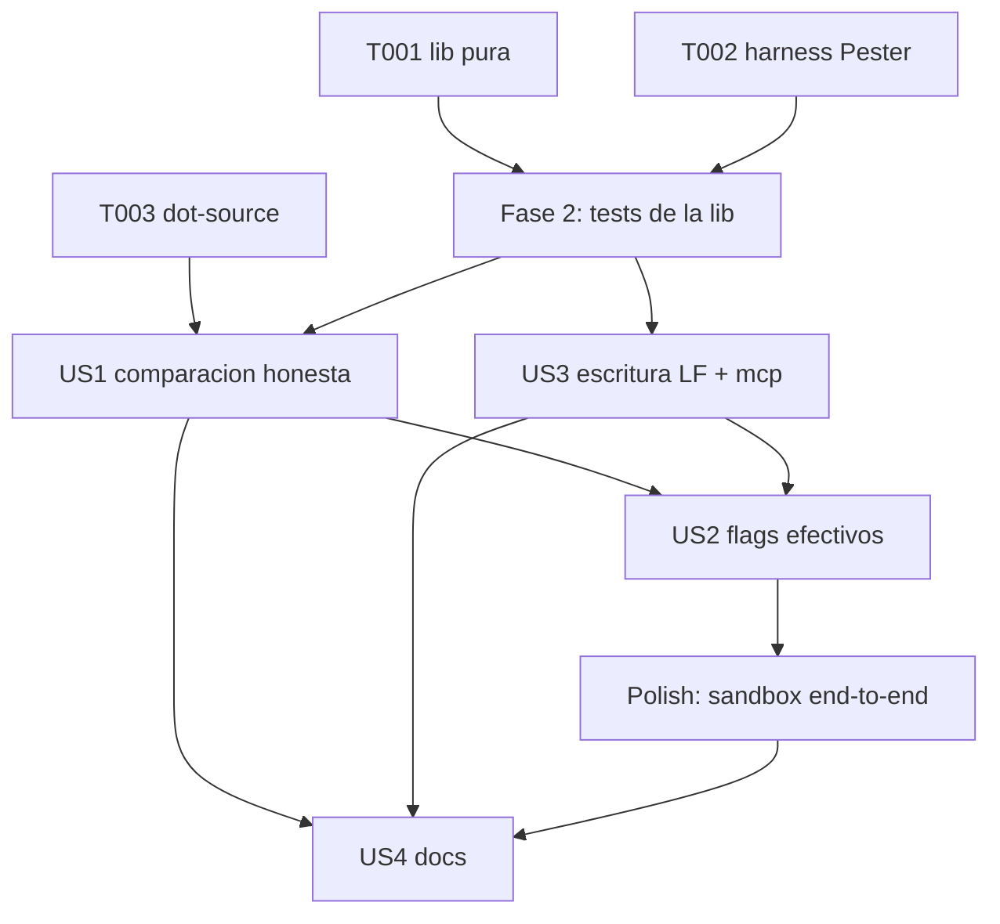

# Tasks 029 - Sync honesto: EOL normalizado y `-Force` efectivo

**Spec**: `../spec.md`
**Plan**: `../plan.md`
**Fecha**: 2026-10-27
**Constitution**: nivel 2 `Documentacion/Agents_IA_TECH/.specify/constitution.md` v2.1.0 (PASS)
**Actualizacion**: 2026-10-28 - Fase 8 incorporada con T030..T037 (derivadas de Analyze aprobadas por el usuario). T038 descartada con evidencia; ver encabezado de Fase 8.

## Nota de generacion

`setup-tasks.ps1 -Json` **no se uso**: resuelve `FEATURE_DIR` por branch, igual que `setup-plan.ps1`, y escribe en `<repo>/specs/<branch>/`. En este proyecto los artefactos viven en `Documentacion/<App>/specs/`, fuera de esa resolucion. El formato de abajo sigue el template de Spec Kit adaptado al patron del proyecto (specs 021, 026): numeracion `TNNN`, fases, y paths absolutos relativos a la raiz.

`data-model.md`, `contracts/`, `research.md` y `quickstart.md` **no existen** y no se generan: el plan §10 documenta por que (sin entidades, sin contrato externo, incognitas cerradas por medicion). Las tasks no los referencian.

## Mapa de historias

La spec del proyecto no usa "user stories": usa FR/CA. Se agrupan en 4 historias trazables.

| Historia | Prioridad | FR | CA | Objetivo |
|---|---|---|---|---|
| **US1** Comparacion honesta | P1 | FR-01, FR-02, FR-07 | CA-01, CA-02, CA-08 | El sync distingue contenido igual, igual-salvo-EOL y distinto, y lo dice |
| **US2** Flags efectivos | P1 | FR-03, FR-06 | CA-05, CA-07 | `-Force` y `-DryRun` declarados y propagados, no por dynamic scoping |
| **US3** Escritura LF y `mcp` intacto | P1 | FR-04, FR-05 | CA-03, CA-04, CA-06 | El merge escribe LF y nunca adopta el `mcp` del maestro |
| **US4** Documentacion al dia | P2 | FR-08 | CA-09 | Spec 002 y README describen el criterio y los tres resultados |

## Grafo de dependencias

Orden real de edicion: T001..T003 comparten `scripts/sync-kit-lib.ps1` y `scripts/sync-kit.ps1`, asi que **no son paralelas entre si**. US1, US2 y US3 editan **el mismo archivo** (`scripts/sync-kit.ps1`) y por eso son **secuenciales**, aunque sus tests sean independientes. US4 toca solo documentacion y puede ir en paralelo con el polish tecnico. La Fase 8 (T030..T037) hereda estas restricciones; su orden interno de ejecucion esta en su encabezado.

**Restriccion de tier**: ninguna task de las fases 1-5, 7 y 8 puede ejecutarla el `pensador` (`scripts/` y `tests/` estan fuera de su whitelist, Art. VII), **salvo T033**, que toca solo `Documentacion/`. T030, T031, T032, T034 y T036 se delegan a `plataformador`; T035 (junto con US4) y T037 a `documentador`.

---

## Fase 1 - Setup

- [ ] T001 Crear `scripts/sync-kit-lib.ps1` con las cinco funciones del plan §3 (`Get-KitNormalizedBytes`, `Get-KitContentHash`, `Compare-KitFileContent`, `Write-KitJsonFile`, `Merge-KitOpencodeJson`), header `#requires -Version 7.0` y nota de que la unica normalizacion permitida es `\r\n` -> `\n` (NFR-04). Sin efectos secundarios al importarse.
- [ ] T002 [P] Crear `tests/sync-kit-lib.Tests.ps1` con el patron de `tests/upgrade_framework.Tests.ps1`: `#requires -Version 7.0`, dot-source de `scripts/sync-kit-lib.ps1`, helpers en el scope del script. **Sin `BeforeAll`** (no existe en Pester 3.4.0) y con operadores `Should Be` posicionales.
- [ ] T003 Editar `scripts/sync-kit.ps1` (C-01 del plan): dot-source fail-closed de la lib con `Join-Path $PSScriptRoot "sync-kit-lib.ps1"`, `Test-Path` y `throw` explicito si falta. Debe ejecutarse antes de cualquier llamada a las funciones de la lib.

## Fase 2 - Foundational: contrato de la lib (bloquea US1 y US3)

Objetivo: que la semantica de comparacion este probada **antes** de cablearla en el motor.

- [ ] T004 En `tests/sync-kit-lib.Tests.ps1`, cubrir `Compare-KitFileContent` con T-01..T-06 del plan §7: byte-identicos -> `Equal`; LF vs CRLF -> `EolOnly`; contenido distinto -> `Different`; EOL mixto -> `EolOnly`; BOM de un solo lado -> `Different`; `\r` suelto -> `Different`.
- [ ] T005 En `tests/sync-kit-lib.Tests.ps1`, cubrir T-07: la comparacion no crea, modifica ni borra archivos (hash del directorio temporal antes/despues debe coincidir).
- [ ] T006 Correr `Invoke-Pester tests/sync-kit-lib.Tests.ps1` y ajustar `scripts/sync-kit-lib.ps1` hasta verde. Ningun test de la fase 2 puede quedar en rojo antes de pasar a US1.
- [ ] T007 En `tests/sync-kit-lib.Tests.ps1`, cubrir T-15: dot-source de la lib en un proceso limpio no produce salida ni escrituras.

## Fase 3 - US1: comparacion honesta (P1)

Objetivo: el operador distingue personalizacion real de ruido de EOL.

- [ ] T008 [US1] Editar `scripts/sync-kit.ps1` (C-04): reemplazar el par de `Get-FileHash` de L640-649 por `Compare-KitFileContent` y los tres mensajes de la seccion 4 del plan. **Prohibido `switch`**: usar `if/elseif/else` con `continue` explicito a nivel `foreach` (RP-02). El `continue` debe seguir evitando la copia en los tres casos.
- [ ] T009 [US1] Editar `scripts/sync-kit.ps1` (C-03): aplicar `Compare-KitFileContent` al guard de `.opencode/.gitignore` (L589-601). Solo `Different` activa el guard hold; `EolOnly` emite `Write-Info` y deja seguir el `robocopy` como hoy.
- [ ] T010 [US1] Editar `scripts/sync-kit.ps1` (C-06): eliminar los `Get-FileHash` sin `-LiteralPath` de L641-642 al quedar cubiertos por el helper.
- [ ] T011 [US1] Editar `scripts/sync-kit.ps1` (C-08): actualizar el bloque `# Uso:` (L20-27) documentando los tres resultados y que `-Force` no pisa el `mcp` local.
- [ ] T012 [US1] Verificar en sandbox que `opencode.json`, `AGENTS.md` y `.specify/memory/constitution.md` reportan `[OK] ... solo difiere el fin de linea` en lugar de `[SKIP]`, sin `-Force` y sin reescribir (CA-01).

## Fase 4 - US2: flags efectivos (P1)

Objetivo: `-Force` y `-DryRun` dejan de depender del dynamic scoping.

- [ ] T013 [US2] Editar `scripts/sync-kit.ps1` (C-02): agregar `[switch]$DryRun` y `[switch]$Force` al `param` de `Sync-TransversalKit` (L453-458), con comentario de que reemplazan el acceso implicito al scope del script.
- [ ] T014 [US2] Editar `scripts/sync-kit.ps1` (C-07): pasar `-DryRun:$DryRun -Force:$Force` en la llamada de L712. **Sin esto, T013 convierte `-Force` en no-op silencioso** (RP-01).
- [ ] T015 [US2] Agregar a `tests/sync-kit-lib.Tests.ps1` T-13: por AST (`[System.Management.Automation.Language.Parser]::ParseFile` sobre `scripts/sync-kit.ps1`), la `FunctionDefinitionAst` `Sync-TransversalKit` declara los parametros `DryRun` y `Force`.
- [ ] T016 [US2] Agregar T-14: por AST, el `CommandAst` `Sync-TransversalKit` del entrypoint incluye los argumentos `-DryRun` y `-Force`.
- [ ] T017 [US2] Verificar en sandbox CA-05: con `-DryRun`, el hash del directorio destino es identico antes y despues de la corrida.

## Fase 5 - US3: escritura LF y `mcp` intacto (P1)

Objetivo: el merge no reintroduce el defecto ni toca el `mcp` local.

- [ ] T018 [US3] Agregar a `tests/sync-kit-lib.Tests.ps1` T-08 y T-09: `Write-KitJsonFile` produce 0 ocurrencias de `\r\n` y exactamente un `\n` final, y el round-trip de un `opencode.json` real da contenido identico al original normalizado (CA-03, CA-04).
- [ ] T019 [US3] Agregar T-10, T-11 y T-12: `Merge-KitOpencodeJson` con `mcp` local devuelve `Merged` y conserva el `mcp` del destino; sin `mcp` local devuelve `NoLocalMcp` y **la funcion** no escribe (ojo: el llamador cae entonces a `Copy-Item` y copia el `mcp` del maestro — comportamiento preexistente, ver SR-02 en `threat-model.md`, fuera de alcance por FA-01); el resultado tiene 0 `\r\n` (CA-06, FR-05).
- [ ] T020 [US3] Editar `scripts/sync-kit.ps1` (C-05): reemplazar el merge inline de L651-671 por la llamada a `Merge-KitOpencodeJson`, mapeando `'Merged'` -> `Write-OK` del guard, `'Error'` -> `Write-Warn` "se conserva el local sin sobrescribir" y `'NoLocalMcp'` -> caer a `Copy-Item`. El `continue` en `Merged`/`Error` se mantiene.
- [ ] T021 [US3] Verificar en sandbox CA-03/CA-04/CA-06: tras `-Force` con `mcp` local, el bloque `mcp` es identico, hay 0 CRLF y `git diff -- opencode.json` queda vacio en el repo real.

## Fase 6 - US4: documentacion al dia (P2)

- [ ] T022 [P] [US4] Actualizar `Documentacion/Agents_IA_TECH/specs/002-script-plataforming-sync-kit/spec.md`: criterio de comparacion normalizado, los tres resultados y la nota de que `-Force` no pisa el `mcp` local (FR-08).
- [ ] T023 [P] [US4] Actualizar la seccion "Politica merge-no-mirror" de `README.md` con el mismo criterio y los tres mensajes observables (FR-08).
- [ ] T024 [US4] Verificar CA-09 por lectura de ambos archivos: ninguno queda con el criterio viejo (hash crudo) ni describe `-Force` como sobrescritura total de `opencode.json`.

## Fase 7 - Polish y transversal

- [ ] T025 Correr la suite completa `Invoke-Pester tests/` y confirmar que `upgrade_framework.Tests.ps1` sigue verde (NFR-02: cero regresiones). **BLOQUEADA al 2026-10-29**: `tests/upgrade_framework.Tests.ps1` tiene 4 errores de parseo (L566 here-string sin cerrar, L562, L561, L225) desde `e53bb29`; Pester aborta antes de ejecutar. No hay suite que correr hasta resolver DD-08.
- [ ] T026 Verificacion end-to-end de los 6 pasos del plan §7 sobre `$env:TEMP` con `-KitPath`, cubriendo CA-01..CA-06 sin red.
- [ ] T027 [P] Aplicar DD-06 (opcional, cosmetico): emitir `[MERGE] opencode.json` en lugar de `[FILE]` cuando la ruta del guard aplica, para que el mensaje no prometa una copia completa.
- [x] T028 [P] Registrar en `Documentacion/Agents_IA_TECH/pendientes-implementacion.md` las tasks T001..T027 con responsable y estado, y las deudas DD-01..DD-06 con su disparador.
- [ ] T029 Commit con conventional commits via `gitflow`: `fix(sync): compare transversal files with normalized EOL and make -Force explicit`.

## Fase 8 - Cierre ampliado: derivadas de Analyze (T030..T037)

Incorporadas por decision del usuario el 2026-10-28 a partir de `analyze.md` §10. `T038` **no se incorpora**: la propagacion de `scripts/sync-kit-lib.ps1` no necesita manifiesto (`scripts/` viaja con `robocopy /E` en L637 del motor y se procesa antes que los archivos raiz, L563-574). El riesgo residual (exit code de `robocopy` nunca verificado) quedo registrado como DD-07 en el backlog.

**Orden de ejecucion** (pisa el orden por ID, segun la nota de secuenciacion de `analyze.md` §10):
1. T031, T032 y T036 se ejecutan **antes** de T008 y T009: fijan el contrato de mensajes y la linea base que US1 va a modificar (TDD: test primero, rojo, y T008/T009 lo ponen verde).
2. T035 se ejecuta **despues** de T020, porque describe el criterio ya implementado.
3. T030, T033 y T034 se ejecutan al cierre, antes de T025..T029.
4. T037 es documental y puede correr en paralelo con el polish tecnico.

- [x] T030 Guardarrail estatico de paridad Windows/Linux (CA-08, FR-07, H-01, H-13). En `tests/sync-kit-lib.Tests.ps1`, por AST sobre `scripts/sync-kit.ps1` y `scripts/sync-kit-lib.ps1`: cero apariciones de `[Environment]::NewLine`; literales `\r\n` solo en la ruta de normalizacion de `Get-KitNormalizedBytes` y en los tests; `[IO.File]::WriteAllText` solo dentro de `Write-KitJsonFile`. Es la verificacion estatica de CA-08: no hay entorno Linux en el repo ni en CI.
- [ ] T031 Test del contrato de mensajes y anti-`switch` (FR-02, H-03, RP-02, H-12). En `tests/sync-kit-lib.Tests.ps1`: los tres strings exactos del plan §4 existen en el bloque de transversales de `scripts/sync-kit.ps1` y ninguna sentencia `switch` dentro de `Sync-TransversalKit` (AST). Ejecutar antes de T008: nace rojo y T008 lo pone verde.
- [ ] T032 Politica explicita de `EolOnly` en el guard de `.opencode/.gitignore` (FR-01, NFR-02, H-10). Decision ya fijada por C-03/T009: `EolOnly` no activa el guard hold y el `robocopy` sigue (gana el maestro); solo `Different` conserva el local. En `tests/sync-kit-lib.Tests.ps1`, test con fixtures temporales que fije esa decision y documente en el propio test por que `.gitignore` no tiene atributo EOL en `.gitattributes` (E-08 de `analyze.md`). Ejecutar antes de T009.
- [ ] T033 Enmienda documental de CA-06 (SR-09, H-04). Asignada a `pensador` y no a `plataformador` como proponia Analyze, porque toca solo `Documentacion/` (Art. VII). Reescribir CA-06 en `spec.md` como: bloque `mcp` **semanticamente identico** (comparacion profunda del objeto) + archivo en LF; igualdad byte a byte solo exigible cuando el destino ya esta en la forma canonica de `ConvertTo-Json`. Sincronizar plan §7 (T-12) y las tasks T019/T021. Registrar la enmienda con fecha y referencia a `threat-model.md` SR-09.
- [ ] T034 Decision y test del fallback `NoLocalMcp` (FR-05, NFR-02, SR-02, FA-01). En `tests/sync-kit-lib.Tests.ps1`: test que fije que `Merge-KitOpencodeJson` devuelve `NoLocalMcp` sin escribir cuando el destino no tiene `mcp`, y comentario en `scripts/sync-kit-lib.ps1` documentando que el llamador cae a `Copy-Item` y copia el `mcp` del maestro (comportamiento preexistente que SR-02 demostro; fuera de alcance por FA-01; la rama `$null -eq $srcJson` es inalcanzable con el `catch` actual).
- [ ] T035 Anclar T022 y T023 a secciones concretas (FR-08, CA-09, H-06). T022 y T023 de este mismo archivo pasan a citar: spec 002 L75 (criterio "coinciden con la fuente del kit"), L78, FR-011 (L112) y README L60-70 (L63 "Hash + SKIP sin `-Force`"). El `documentador` debe ademas resolver el arrastre de FR-010 (spec 002 L111, `enabled: true` contra ADR-0010 R3) al editar spec 002. Ejecutar despues de T020.
- [ ] T036 [P] Cobertura base del motor (NFR-02, H-02). Nuevo `tests/sync-kit.Tests.ps1` con el patron de `tests/upgrade_framework.Tests.ps1` (Pester 3.4.0, sin `BeforeAll`): tres tests contra fixtures en `$env:TEMP` que ejerciten `Find-OrphanKitFiles` (deteccion de huerfanos), el guard de `.opencode/.gitignore` y la exclusion de `.opencode/config.json` del `robocopy`. Es la linea base que NFR-02 exige y hoy no existe. **Revertida de `[x]` a `[ ]` el 2026-10-29**: se habia marcado apoyandose en `tests/upgrade_framework.Tests.ps1`, y la verificacion independiente midio que esa suite tiene **4 errores de parseo** (L566 here-string `@"` sin cerrar, L562, L561, L225) desde el commit `e53bb29`, por lo que Pester aborta en el parseo y **nunca se ejecuto**. Marcar esta task contra una suite que no corre viola Art. IX. Bloqueada por DD-08. Ejecutar antes de T008.
- [ ] T037 [P] Banner de obsoleto en la copia del motor (H-09). En `Documentacion/Agents_IA_TECH/specs/015-sync-kit-bootstrap/implementation/sync-kit.ps1` (33.783 B / 608 lineas vs 37.660 B / 713 del motor vivo): encabezado con banner `[OBSOLETO - no usar]`, puntero a `scripts/sync-kit.ps1`, fecha y razon. El retiro del archivo queda condicionado a aprobacion explicita del usuario: esta task no borra nada.

---

## Criterio de historia independiente (MVP)

| Historia | Se puede verificar sola | Como |
|---|---|---|
| US1 | Si | Sandbox: el archivo con EOL distinto reporta `EolOnly` y no se reescribe |
| US2 | Si | AST de la firma + sandbox `-DryRun` con hashes iguales |
| US3 | Si | Tests de `Merge-KitOpencodeJson` + `git diff` vacio tras `-Force` |
| US4 | Si | Lectura de spec 002 y README |

**MVP recomendado**: US1 + US2 + US3 son un solo incremento indivisible (comparten `scripts/sync-kit.ps1` y sin los tres el sync sigue mintiendo o `-Force` deja de funcionar). US4 es documental y puede cerrarse despues sin dejar el codigo incoherente, pero CA-09 exige hacerlo antes de marcar la spec cerrada.

## Oportunidades de paralelismo

| Bloque | Tasks | Por que son paralelas |
|---|---|---|
| Setup | T001 y T002 | Archivos distintos (`scripts/sync-kit-lib.ps1` vs `tests/sync-kit-lib.Tests.ps1`) |
| Docs | T022 y T023 | `specs/002/spec.md` vs `README.md` |
| Cierre | T027 y T028 | Codigo cosmetico vs backlog |
| Derivadas | T036 y T037 | Archivo de tests nuevo vs `Documentacion/` |

Todo lo que edita `scripts/sync-kit.ps1` (T003, T008..T011, T013, T014, T020) es **secuencial**: mismo archivo, mismo motor.

## Validacion de formato

- [x] Toda task empieza con `- [ ]` y un ID `TNNN` secuencial (T001..T037). Excepcion documentada: T031, T032 y T036 se ejecutan antes de T008/T009 (encabezado de Fase 8)
- [x] Las tasks con `[P]` son solo las que tocan archivos distintos sin dependencia pendiente
- [x] Las tasks de historia llevan `[US1]`..`[US4]`; Setup, Foundational y Polish no llevan etiqueta
- [x] Toda task nombra el archivo o el artefacto concreto sobre el que se trabaja
- [x] Cada task es ejecutable sin contexto adicional: referencia el cambio (C-0x), el test (T-xx) o el criterio (CA-xx) del plan
- [x] Las 37 tasks cubren los 8 FR y **los 9 CA**: CA-08 via T030 (guardarrail estatico; no hay Linux en repo ni CI, y sin el test seria un argumento de inspeccion), CA-06 via T033 (enmienda a igualdad semantica, SR-09), FR-02 via T031 y NFR-02 via T036. La cobertura previa (8/9 CA) queda documentada en `analyze.md` §5

## Riesgos de ejecucion a vigilar

| ID | Vigilar en | Task |
|---|---|---|
| RP-01 | Declarar `[switch]$Force` sin propagarlo rompe `-Force` en silencio | T013 -> T014 -> T016 |
| RP-02 | `continue` dentro de `switch` sale del `switch`, no del `foreach` | T008 + T031 (asercion AST) |
| RP-04 | `ConvertTo-Json` pierde el `\n` final y genera diff espurio | T018 |
| RP-07 | Los numeros de linea pueden haber derivado (motor DEPRECATED) | T003, T008, T009, T020 |
| RP-05 | La propagacion de `sync-kit-lib.ps1` no tiene verificacion end-to-end; `robocopy /E` sobre `scripts/` (L637) la cubre por diseno, pero su exit code nunca se verifica (DD-07) | T003 + sandbox T026 |
