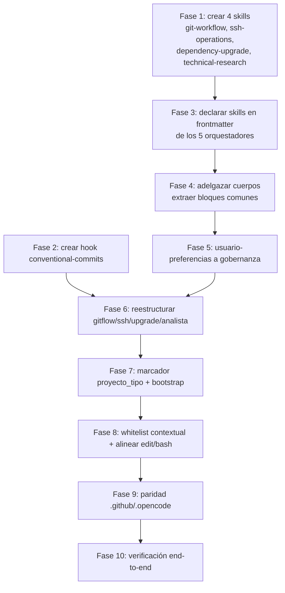

# Plan 030 — Separación Agentes / Skills y Whitelist Contextual

| Campo | Valor |
|---|---|
| **Spec** | [`spec.md`](./spec.md) |
| **Fecha** | 2026-10-29 |
| **Constitution** | `Documentacion/Agents_IA_TECH/.specify/constitution.md` v2.1.0 |
| **Artefacto de fase** | Plan técnico |

---

## 1. Resumen ejecutivo

La medición del 2026-10-29 sobre los 13 agentes dio un resultado inequívoco:

| Dato medido | Valor |
|---|---|
| Agentes que declaran skills en frontmatter | **1 de 13** (`developer`, 6 skills) |
| Agentes con 0 skills declaradas | **12 de 13** |
| Bloques comunes repetidos en todos los cuerpos | 4 (Rol Scrum, Uso de MCPs, Ciclo de vida, Rol Scrum MCP) |
| Agentes con "Skills que utilizas" en prosa | 3 (`Agent-SSD`, `arquitecto`, `security-auditor`, `documentador`) |
| Secciones duplicadas entre dos agentes | 5 (`usuario-preferencias` ↔ `ssh-connection-agent`) |
| Cuerpo del agente mejor formado | `developer`: 22 líneas + 6 skills |
| Cuerpo del agente peor formado | `pensador`: 504 líneas + 0 skills |

**Diagnóstico**: el KIT no separa agentes de skills. Las capacidades están embebidas en el cuerpo de los agentes en lugar de declararse como skills que el agente invoca.

**Estrategia**: extraer las capacidades embebidas a skills, dejar los agentes como orquestadores delgados, y declarar explícitamente qué skills invoca cada uno.

---

## 2. Principio arquitectónico que rige el plan

> **Un agente decide; una skill ejecuta.**

| Capa | Naturaleza | Quién la invoca | Ejemplos |
|---|---|---|---|
| **Gobernanza** | Reglas obligatorias, se cumplen siempre | Nadie: son transversales | `usuario-preferencias` (forma de trabajar) + Constitution |
| **Orquestador** | Decide cuándo, interpreta resultado, responde por él | Usuario o delegación | `pensador`, `arquitecto`, `security-auditor`, `Agent-SSD` |
| **Ejecutor** | Materializa un artefacto | Orquestador | `developer` (código), `documentador` (documentación) |
| **Operación** | Actúa sobre infraestructura viva | Usuario explícito | `solucionador` |
| **Skill** | Procedimiento fijo, sin criterio | El agente que la carga | `speckit-*`, `git-workflow`, `ssh-operations` |
| **Hook / Flow** | Automatismo | El sistema | `conventional-commits` |

**Test objetivo aplicado a cada agente**:

> ¿Qué skills invoca, y qué decide él?
> Si no invoca skills y su cuerpo describe procedimiento → es una skill.
> Si decide y responde por el resultado → es un agente.

---

## 3. Cambios propuestos

### C-01 · Crear skill `git-workflow`

**Origen**: `gitflow.md` (140 L de cuerpo).

**Evidencia**: sus secciones son `Repository Setup`, `Branch Management`, `Committing`, `Pushing`, `Reverting`, `Rebasing & History`, `PR Workflow`. Es procedimiento git puro, sin criterio.

**Contenido de la skill**: los 7 bloques de operación git + los comandos PowerShell para Windows + la nota obligatoria de conventional commits.

**Qué queda del agente `gitflow`**: si se retira, el hook de conventional commits cubre el disparador. Si se conserva, queda como agente delgado que invoca `git-workflow` y decide cuándo commitear.

### C-02 · Crear skill `ssh-operations`

**Origen**: `ssh-connection-agent.md` (85 L) + la mitad SSH de `usuario-preferencias.md`.

**Evidencia**: 5 secciones duplicadas entre ambos archivos:
| Sección en `usuario-preferencias` | Sección en `ssh-connection-agent` |
|---|---|
| `## SSH Policy` | `## Connection Policy` |
| `## Server Configuration` | `## Server Configuration` |
| `## SSH Connection Procedure` | `## Connection Procedure (Mandatory)` |
| `## Session Management Rules` | `## Session Management` |
| `## Agent Roles` | `## Agent Roles` |

**Acción**: el procedimiento SSH se consolida en la skill `ssh-operations`. `usuario-preferencias` conserva solo la **política** (qué está permitido, qué no) y pierde el **procedimiento** (cómo se hace).

### C-03 · Crear skill `dependency-upgrade`

**Origen**: `upgrade_framework.md` (103 L).

**Evidencia**: secciones `Responsabilidades`, `Flujo de Trabajo`, `Herramientas Disponibles`. Es el procedimiento de actualización de dependencias externas desde `proyect_ext/`.

**Ajuste**: el procedimiento se muda a la skill; el disparador `-ForceUpgradeTools` del bootstrap lo invoca.

### C-04 · Crear skill `technical-research`

**Origen**: `analista_tecnico.md` (82 L).

**Evidencia**: `Herramientas del pipeline`, `Enfoque`, `Triggers`. El agente no produce artefacto propio: alimenta a otros. Es procedimiento de investigación.

**Ajuste**: el procedimiento se muda a la skill. Si el `pensador` necesita investigación, la invoca directamente en vez de delegar en un agente.

### C-05 · Declarar skills en frontmatter de los orquestadores

**Problema medido**: `arquitecto`, `security-auditor`, `documentador` y `Agent-SSD` tienen sección `## Skills que utilizas` en **prosa**, sin declararlas en frontmatter. El runtime no las carga.

**Acción**: agregar el bloque `skills:` al frontmatter de cada uno, con las skills que ya mencionan en prosa:

| Agente | Skills a declarar |
|---|---|
| `arquitecto` | `architecture-decision-records`, `hexagonal-architecture`, `api-design`, `coding-standards` |
| `security-auditor` | `security-review`, `security-scan`, `threat-modeling` |
| `documentador` | `knowledge-ops`, `documentation-lookup`, `coding-standards` |
| `Agent-SSD` | `speckit-specify`, `speckit-plan`, `speckit-tasks`, `speckit-analyze`, `speckit-converge`, `speckit-implement` |
| `pensador` | las mismas 6 `speckit-*` + `architecture-decision-records` |

### C-06 · Crear hook `conventional-commits`

**Origen**: secciones de `gitflow.md` sobre formato de commit y nota obligatoria.

**Evidencia**: es una regla que **no requiere decisión**. Un commit cumple el formato o no lo cumple.

**Acción**: hook que verifica el formato del mensaje antes de commitear. `gitflow` (o quien commitee) recibe validación automática en vez de tener que recordar 140 líneas de procedimiento.

### C-07 · Reestructurar `usuario-preferencias` como gobernanza

**Origen**: `usuario-preferencias.md` (64 L).

**Decisión del usuario (literal)**: *"es mi forma de hacer las cosas, cómo quiero organizar los proyectos, documentación y cómo se debe trabajar incluso el flujo de cómo crear las cosas"*.

**Acción**:
- Conserva: `Git Preferences`, `Documentation Format`, `Agent Roles` y la **política** SSH
- Pierde: el **procedimiento** SSH (va a C-02)
- Se reubica como capa de gobernanza, por encima de los agentes

**Decisión pendiente del usuario** (ver sección 8): ¿reemplaza o complementa a la Constitution?

### C-08 · Eliminar los bloques comunes repetidos

**Problema medido**: 4 bloques idénticos en los 13 cuerpos (`Rol Scrum`, `Uso de MCPs`, `Ciclo de vida de specs`, `Rol Scrum: Integración MCP`).

**Acción**: extraerlos a un único lugar de referencia. Candidatos:
- `Uso de MCPs` → ya está en `AGENTS.md`; el agente lo hereda
- `Ciclo de vida de specs` → ya tiene marcador `<!-- LIFECYCLE-GLOSSARY-v1 -->`; es transversal
- `Rol Scrum` → puede ir a gobernanza

**Reducción estimada**: los 13 cuerpos pierden ~40-60 líneas cada uno de texto repetido.

### C-09 · Marcador `proyecto_tipo` y whitelist contextual

**Base**: el `spec.md` original de esta spec (FR-01..FR-11), que se conserva.

**Ajuste por C-01..C-08**: la whitelist ya no es solo "contextual por proyecto" — ahora también depende de **la capa del agente**:

| Capa | Escritura |
|---|---|
| Gobernanza | No escribe: son reglas |
| Orquestador | Solo su artefacto de fase (o ninguno, si delega) |
| Ejecutor | Su dominio (kit: workspace / consumidor: `src/`, `tests/`) |
| Operación | Sistemas, no paths |

### C-10 · Alinear `edit` y `bash` del `pensador`

**Problema medido**: es el único agente con `edit: deny` + `bash: "*": allow`. Esa asimetría es el agujero por el que se evadió el límite el 2026-10-29 rompiendo `scripts/sync-kit.ps1`.

**Acción**: el `bash` del `pensador` pasa a allowlist por comando. Se excluyen los que mutan archivos (`Set-Content`, `Out-File`, `Add-Content`, `New-Item`, `Remove-Item`, `[IO.File]::WriteAll*`).

---

## 4. Mapa de agentes resultante

| Agente actual | Destino | Capa resultante |
|---|---|---|
| `pensador` | **Queda** — delgado, con skills declaradas | Orquestador |
| `Agent-SSD` | **Queda** — declarar los 6 `speckit-*` | Orquestador |
| `arquitecto` | **Queda** — declarar 4 skills | Orquestador |
| `security-auditor` | **Queda** — declarar 3 skills | Orquestador |
| `documentador` | **Queda** — declarar 3 skills | Ejecutor |
| `developer` | **Queda** — es el modelo a seguir | Ejecutor |
| `solucionador` | **Queda** — con skills de operación | Operación |
| `plataformador` | **Queda** — fragmentar en skills (ver §8) | Plataforma |
| `gitflow` | **Se muda a skill** `git-workflow` + hook | — |
| `ssh-connection-agent` | **Se muda a skill** `ssh-operations` | — |
| `upgrade_framework` | **Se muda a skill** `dependency-upgrade` | — |
| `analista_tecnico` | **Se muda a skill** `technical-research` | — |
| `usuario-preferencias` | **Pasa a gobernanza** | Gobernanza |

**Resultado**: de 13 agentes a **8 agentes + 5 skills nuevas + 1 capa de gobernanza + 1 hook**.

---

## 5. Diseño del marcador y la whitelist contextual

Se conserva íntegro el diseño del `spec.md` original:

| Elemento | Decisión | Fundamento |
|---|---|---|
| Marcador | `proyecto_tipo` en `.bootstrap-state.json` | Archivo existente, ya ignorado por git |
| Detección | Reusar `plataformador-bootstrap.ps1` L1867-1884 | Criterio ya en producción |
| Anti-fuga | El marcador no se propaga | `.gitignore` L34 lo ignora (verificado con `git check-ignore`) |
| Fail-closed | Sin detección → `consumidor` + WARN | El valor seguro es el restrictivo |

**Adición por el replanteo**: la whitelist efectiva se resuelve por `(capa, proyecto_tipo)`, no solo por tier.

---

## 6. Orden de ejecución

**Nota**: Fase 9 (paridad) no es una fase al final — es una **condición de cada fase**. Se ejecuta en paralelo a F1-F8, o la paridad queda rota.

---

## 7. Riesgos

| ID | Riesgo | Impacto | Mitigación |
|---|---|---|---|
| **RP-01** | Al mudar `gitflow` a skill se pierde el disparador de commits | Los commits dejan de ocurrir | El hook `conventional-commits` lo reemplaza; verificar antes de retirar |
| **RP-02** | La skill `ssh-operations` queda huérfana si nadie la declara | Se pierde la capacidad SSH | `solucionador` y `plataformador` deben declararla |
| **RP-03** | `usuario-preferencias` como gobernanza duplica la Constitution | Dos fuentes de verdad | Decisión pendiente (§8) |
| **RP-04** | Extraer bloques comunes deja agentes sin contexto | Los agentes operan sin reglas | Verificar que la referencia sea alcanzable por el runtime |
| **RP-05** | 26 archivos modificados = alto riesgo de asimetría entre harnesses | Divergencia `.github` ↔ `.opencode` | Verificación de paridad por fase, no al final |
| **RP-06** | Los skills nuevos no se cargan si la ruta es incorrecta | Los agentes quedan sin capacidades | Verificar con `skills=` no vacío tras cada cambio |
| **RP-07** | `plataformador` fragmentado pierde el contexto del bootstrap | Bootstrap roto | Fragmentar con cuidado; el bootstrap es crítico |
| **RP-08** | El `developer` en kit pierde permisos por un ajuste mal aplicado | No se puede implementar nada | CA específico: `developer` escribe en `scripts/` del kit |

---

## 8. Decisiones pendientes del usuario

| # | Decisión | Opciones | Por qué no la tomo yo |
|---|---|---|---|
| **D-01** | `usuario-preferencias` como gobernanza: ¿reemplaza o complementa a la Constitution? | (a) Complementa, la Constitution manda · (b) Reemplaza la sección de constraints · (c) Se fusiona en la Constitution | Define la jerarquía de reglas del KIT |
| **D-02** | `plataformador` (473 L): ¿se fragmenta? | (a) Sí, en skills + orquestador delgado · (b) No, queda como agente grande | Es el segundo agente más grande y toca el bootstrap |
| **D-03** | `gitflow`: ¿se retira o queda delgado? | (a) Se retira, el hook cubre todo · (b) Queda como agente que invoca la skill | Depende de si quieres control humano en los commits |
| **D-04** | `Agent-SSD` y `pensador`: ¿se mantiene la división? | (a) Sí, uno ejecuta y otro gobierna · (b) Se fusionan | Define si el pipeline tiene uno o dos orquestadores |

---

## 9. Trazabilidad

| Cambio | FR del spec | Evidencia |
|---|---|---|
| C-01 | FR-12, FR-13 | `gitflow.md` 140 L de procedimiento |
| C-02 | FR-12, FR-14 | 5 secciones duplicadas entre 2 agentes |
| C-03 | FR-12 | `upgrade_framework.md` 103 L de flujo |
| C-04 | FR-12 | `analista-tecnico.md` 82 L sin criterio |
| C-05 | FR-13 | 4 agentes con skills en prosa, 0 en frontmatter |
| C-06 | FR-15 | Formato de commit = regla sin decisión |
| C-07 | FR-16 | Decisión literal del usuario |
| C-08 | FR-17 | 4 bloques idénticos en 13 cuerpos |
| C-09 | FR-01..FR-11 | Spec original |
| C-10 | FR-09 | Evasión del 2026-10-29 |

---

## 10. Artefactos que NO se generan

| Artefacto | Por qué no |
|---|---|
| `data-model.md` | No hay entidades ni modelo de datos: es reestructuración de configuración |
| `contracts/` | No hay contrato externo: los agentes son Markdown |
| `research.md` | Las incógnitas se cerraron por medición directa (secciones 1 y 2) |
| `quickstart.md` | No hay comando de entrada nuevo; el pipeline existente no cambia |

---

## 11. Spec linking

| Artefacto | Ruta relativa |
|---|---|
| Spec | [`spec.md`](./spec.md) |
| Tasks | [`tasks.md`](./tasks.md) |
| Analyze | [`analyze.md`](./analyze.md) |
| Threat model | [`threat-model.md`](./threat-model.md) |
| ADR esperado | `../../arquitectura/adr/adr-0013-agentes-orquestadores-skills.md` |
| Constitution | [`../../.specify/constitution.md`](../../.specify/constitution.md) |
| Backlog | [`../../pendientes-implementacion.md`](../../pendientes-implementacion.md) |

---

*Planificado por `pensador` — Spec 030, fase Plan — 2026-10-29.*
