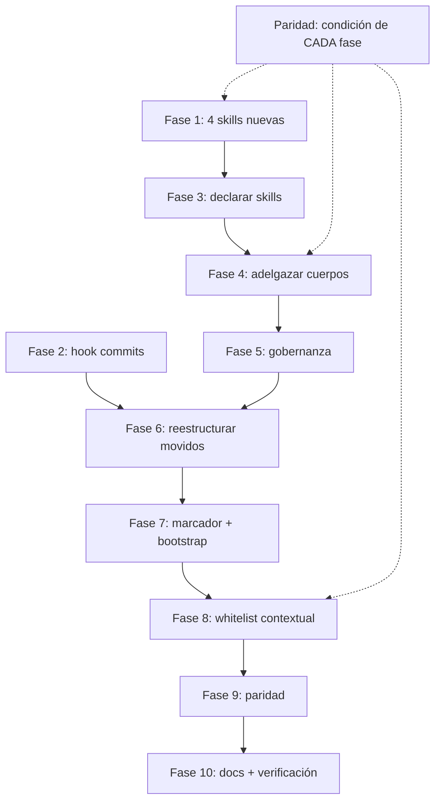

# Tasks 030 — Separación Agentes / Skills y Whitelist Contextual

**Spec**: [`spec.md`](./spec.md)
**Plan**: [`plan.md`](./plan.md)
**Fecha**: 2026-10-29
**Constitution**: nivel 2 `Documentacion/Agents_IA_TECH/.specify/constitution.md` v2.1.0

## Nota de generación

Los artefactos viven en `Documentacion/<App>/specs/` (convención del proyecto, Art. X), no en `<repo>/specs/`. Por eso no se usan `setup-tasks.ps1` ni `setup-plan.ps1`: resuelven `FEATURE_DIR` por branch y escriben fuera de la convención.

`data-model.md`, `contracts/`, `research.md` y `quickstart.md` **no existen** y no se generan: el plan §10 documenta por qué (sin entidades, sin contrato externo, incógnitas cerradas por medición).

## Asignación de agentes — resuelta contra la capa, no por intuición

> **Regla aplicada (FR-08 del spec original)**: el dueño de una task se resuelve por la **capa del agente** y el **path objetivo**, no por el nombre del agente.
>
> **Contexto**: este proyecto es KIT (sin `src/`, Art. X) → el tier Ejecutor (`developer`) tiene el **workspace completo**. Las skills y los agentes viven en `.github/` y `.opencode/`, ambos dentro de su whitelist en kit.

| Capa | Agente | Task de este plan |
|---|---|---|
| Orquestador | `pensador` | T-spec, T-plan, T-analyze, T-converge, T-backlog |
| Orquestador | `arquitecto` | T-ADR-0013 |
| Ejecutor (kit) | `developer` | Skills nuevas, hooks, frontmatter, cuerpos, marcador, whitelist |
| Orquestador | `documentador` | Docs transversales en `Documentacion/` |

**No se asigna ninguna task a `plataformador`.** Su capa es Plataforma (nivelación e instalación), no la construcción de agentes y skills del propio kit.

---

## Fase 1 — Skills nuevas (bloquea Fase 3)

- [ ] T001 Crear `.opencode/skills/git-workflow/SKILL.md` con el contenido de `gitflow.md`: 7 bloques de operación git (Repository Setup, Branch Management, Committing, Pushing, Reverting, Rebasing & History, PR Workflow) + comandos PowerShell para Windows. Header con frontmatter estándar de skill (`name`, `description`). (FR-12)
- [ ] T002 [P] Crear `.opencode/skills/ssh-operations/SKILL.md` consolidando `ssh-connection-agent.md` + la mitad procedimental de `usuario-preferencias.md`: Connection Policy, Connection Procedure, Session Management, Server Configuration, Preferred Procedures. (FR-12, FR-14)
- [ ] T003 [P] Crear `.opencode/skills/dependency-upgrade/SKILL.md` con el flujo de `upgrade_framework.md`: Responsabilidades, Flujo de Trabajo, Herramientas Disponibles, integración con `pensador`. (FR-12)
- [ ] T004 [P] Crear `.opencode/skills/technical-research/SKILL.md` con `analista_tecnico.md`: Herramientas del pipeline, Enfoque, Guardrails (ADR-0001). (FR-12)
- [ ] T005 Verificar que `.opencode/skills/` es la ruta correcta para skills del kit. **Si las skills son globales** (según `AGENTS.md`: "compartidas desde el workspace master"), confirmar la ruta real y ajustar T001-T004. Reportar la ruta verificada.

## Fase 2 — Hook conventional-commits

- [ ] T006 Crear el hook de conventional commits: verifica el formato del mensaje antes de commitear, sin requerir que un agente recuerde 140 líneas de procedimiento. Determinar el mecanismo disponible en OpenCode (hook, git hook local, o validación en el comando de commit). Reportar cuál se eligió y por qué. (FR-15)

## Fase 3 — Declaración de skills en frontmatter (bloquea Fase 4)

- [ ] T007 Agregar bloque `skills:` al frontmatter de `Agent-SSD.md`: los 6 `speckit-*`. Hoy los describe en prosa (`## Skills que utilizas (6 speckit)`) sin declararlos. (FR-13)
- [ ] T008 [P] Agregar bloque `skills:` a `arquitecto.md`: `architecture-decision-records`, `hexagonal-architecture`, `api-design`, `coding-standards`. (FR-13)
- [ ] T009 [P] Agregar bloque `skills:` a `security-auditor.md`: `security-review`, `security-scan`, `threat-modeling`. (FR-13)
- [ ] T010 [P] Agregar bloque `skills:` a `documentador.md`: `knowledge-ops`, `documentation-lookup`, `coding-standards`. (FR-13)
- [ ] T011 Agregar bloque `skills:` a `pensador.md`: los 6 `speckit-*` + `architecture-decision-records`. (FR-13)
- [ ] T012 Verificar con `Select-String` que los 5 agentes tienen `skills=` no vacío en frontmatter. Reportar el conteo real por agente. (verificación de FR-13)

## Fase 4 — Adelgazamiento de cuerpos

- [ ] T013 Extraer el bloque `Rol Scrum` de los 13 cuerpos a `Documentacion/Agents_IA_TECH/gobernanza/rol-scrum.md` (o el lugar que corresponda) y reemplazar en cada agente por una línea de referencia. (FR-17)
- [ ] T014 [P] Extraer el bloque `Uso de MCPs` de los 13 cuerpos. Ya está en `AGENTS.md`; verificar que el agente lo hereda y eliminar la duplicación del cuerpo. (FR-17)
- [ ] T015 [P] Verificar que los bloques `Ciclo de vida de specs` y `Rol Scrum: Integración MCP` (marcadores `LIFECYCLE-GLOSSARY-v1` y `MCP-ROLE-v1`) tienen su fuente única y eliminar la repetición de los cuerpos. (FR-17)
- [ ] T016 Adelgazar `pensador.md` de 504 L al mínimo: rol, pipeline, delegación, plan, escalado. **Extraer** el Constitution Wizard (11 pasos) a skill `constitution-wizard`, y el bloque `Flujo post-plataformado → speckit` a referencia. (FR-18)
- [ ] T017 Adelgazar `solucionador.md` (175 L): su cuerpo describe super poderes en prosa. Reducirlo a rol + skills de operación (SSH, navegador, DB, logs). (FR-18)
- [ ] T018 Verificar la reducción real de líneas por agente y reportar la tabla antes/después. (verificación de FR-18)

## Fase 5 — Gobernanza

- [ ] T019 Reestructurar `usuario-preferencias.md`: conservar `Git Preferences`, `Documentation Format`, `Agent Roles` y la **política** SSH; ceder el **procedimiento** SSH a la skill `ssh-operations`. (FR-16, FR-14)
- [ ] T020 Reubicar `usuario-preferencias` como capa de gobernanza. **Depende de D-01** (ver sección de decisiones pendientes): si complementa a la Constitution, se ubica como referencia; si la reemplaza, se fusiona. (FR-16)

## Fase 6 — Reestructuración de agentes movidos

- [ ] T021 Reestructurar `gitflow.md`: queda como agente delgado que invoca `git-workflow` y decide **cuándo** commitear, o se retira si el hook cubre todo. **Depende de D-03**. (FR-12, FR-15)
- [ ] T022 Reestructurar `ssh-connection-agent.md`: procedimiento a la skill; si no conserva criterio propio, se retira y la skill pasa a ser invocada por `solucionador` y `plataformador`. (FR-12, FR-14)
- [ ] T023 Reestructurar `upgrade_framework.md`: procedimiento a la skill; el disparador `-ForceUpgradeTools` del bootstrap la invoca. (FR-12)
- [ ] T024 Reestructurar `analista_tecnico.md`: procedimiento a la skill; el `pensador` la invoca directamente en vez de delegar en un agente. (FR-12)

## Fase 7 — Marcador y bootstrap

- [ ] T025 Agregar la clave `proyecto_tipo` a `.bootstrap-state.json` con valores `kit` | `consumidor`. (FR-01)
- [ ] T026 Implementar la detección reusando el criterio de `scripts/plataformador-bootstrap.ps1` L1867-1884 (comparación de `git remote get-url origin` normalizado contra el `RepoUrl` del maestro). **Prohibido** inventar criterio nuevo. (FR-02)
- [ ] T027 Implementar el fail-closed: si el tipo no se determina, persistir `consumidor` con WARN visible. (FR-03, NFR-04)
- [ ] T028 Verificar la anti-fuga: confirmar con `git check-ignore` que `.bootstrap-state.json` sigue ignorado y que el marcador no se propaga. (FR-07)
- [ ] T029 Verificar que `scripts/plataformador-bootstrap.ps1` mantiene `Parser::ParseFile` con 0 errores tras el cambio. (NFR-03)

## Fase 8 — Whitelist contextual

- [ ] T030 Ajustar el frontmatter de `developer.md`: en kit, workspace completo. Declarar el bloque `permission` explícito (hoy no declara nada y hereda el global). (FR-05, FR-19)
- [ ] T031 Ajustar el frontmatter de `pensador.md`: alinear `edit` y `bash`. El `bash: "*": allow` pasa a **allowlist por comando** — permitir solo lo necesario (git de lectura, comandos de consulta, ejecución de speckit), NO enumerar lo prohibido. **Corrección de Analyze (SR-01)**: la versión anterior de esta task enumeraba comandos prohibidos (`Set-Content`, `Out-File`, ...), y el threat model midió **9 vías de escritura que la lista omitía**; enumerar lo prohibido es un conjunto abierto y falla por construcción. (FR-09, C-10)
- [ ] T031b Implementar la **materialización del perfil** al instalar en un consumidor: el bootstrap lee `Documentacion/<App>/gobernanza/perfiles-whitelist.md` (T044) y ESCRIBE el bloque `permission` en el frontmatter de cada agente del consumidor. **Rediseño de Analyze (SR-02)**: la versión anterior de esta task escribía el acotamiento solo en el frontmatter, que tiene **vida de un sync** — el sync pisa el `.md` en la corrida siguiente y el límite se pierde. La materialización es un paso explícito del bootstrap, y el perfil vive en `Documentacion/` que el sync nunca toca. (FR-06, FR-21)
- [ ] T031c Implementar el verificador de divergencia: comparar el frontmatter real del consumidor contra el perfil estático y reportar diferencias con WARN. (FR-21, verificación)
- [ ] T031d Implementar la **re-validación del marcador al leer**: si `proyecto_tipo` declara `kit` sin que `Test-IsMasterCheckout` lo confirme, tratarlo como `consumidor` + WARN. (FR-02b, SR-03)
- [ ] T031e Hacer el perfil del consumidor de solo lectura para los agentes y detectar su edición. (FR-22, SR-03)
- [ ] T031f Insertar en `pensador.md` la **secuencia de resolución `task → agente dueño`** (FR-08): leer `proyecto_tipo` → determinar el path objetivo → consultar la tabla → asignar al tier dueño → registrar en backlog. Prohibido asignar por intuición o por nombre de agente. (FR-08, deriva de H-01)
- [ ] T031g Insertar en `pensador.md` la **regla de escalado obligatoria** (FR-09): ante `Permission denied`, detenerse, identificar el tier dueño, delegar, y reportar. Prohibido reintentar por vía alternativa (shell, script auxiliar, comando inline). (FR-09, deriva de H-02)
- [ ] T031h Ejecutar el gate `Parser::ParseFile` sobre `scripts/sync-kit.ps1` y confirmar 0 errores. Es el archivo que originó esta spec y su gate no tenía task. (CA-10, deriva de H-05)
- [ ] T032 Ajustar `usuario-preferencias.md`: tier Documental sin `permission` declarado. Alinear con su capa de gobernanza. (FR-16, FR-19)
- [ ] T033 Ajustar `gitflow.md`, `ssh-connection-agent.md` si quedan: sin `permission` declarado hoy. Alinear con su capa resultante. (FR-19)
- [ ] T034 Verificar que ningún agente del tier Documental queda con `edit: deny` + `bash: allow`. Aplicar el mismo chequeo que reveló el defecto del `pensador`. (FR-09)

## Fase 9 — Paridad entre harnesses

> Esta fase **no es terminal**: es condición de cada fase anterior. Se ejecuta en paralelo.

- [ ] T035 Espejar en `.github/agents/` cada cambio hecho en `.opencode/agents/`: los 5 frontmatters de T007-T011, los cuerpos de T013-T024, y los permisos de T030-T033. (FR-10)
- [ ] T036 Espejar los skills nuevos donde corresponda según la ruta verificada en T005. (FR-10)
- [ ] T037 Verificar la paridad: diff de las secciones afectadas en los 13 pares de agentes. Reportar cualquier divergencia. (FR-10, CA-09)

## Fase 10 — Documentación y verificación

- [ ] T038 Crear `Documentacion/Agents_IA_TECH/specs/030-whitelist-contextual-por-tipo-proyecto/analyze.md` vía delegación a `arquitecto` + `security-auditor` en la fase Analyze del pipeline. (fase posterior)
- [ ] T039 Crear ADR-0013 registrando la decisión: agentes como orquestadores, capacidades en skills, whitelist contextual por capa y tipo de proyecto. (FR-12..FR-19)
- [ ] T040 Actualizar el `00-index.md` de ADRs con ADR-0013. (FR-19)
- [ ] T041 Ampliar Art. X de la constitution para declarar la expansión del tier Implementador en el kit. (FR-11)
- [ ] T042 Verificación end-to-end: (a) `developer` escribe en `scripts/` del kit; (b) simular consumidor en `$env:TEMP` y confirmar que recibe `proyecto_tipo: consumidor` y el frontmatter acotado de T031b; (c) confirmar que ningún agente del kit hereda el permiso ampliado al consumidor. (CA-04, CA-05, CA-03, FR-06)
- [ ] T043 Registrar el resultado en `pendientes-implementacion.md` con las filas 030-T* y las decisiones pendientes D-01..D-04. (proceso)
- [ ] T053 Verificar CA-01: el `.bootstrap-state.json` del kit contiene `"proyecto_tipo": "kit"` tras correr el bootstrap. (CA-01)
- [ ] T054 Verificar CA-02: un consumidor de prueba recibe `"proyecto_tipo": "consumidor"` en sandbox sobre `$env:TEMP`. (CA-02)
- [ ] T055 Verificar CA-06: ante `Permission denied`, la definición del `pensador` en ambos harnesses contiene la regla de delegación y NO contiene ninguna instrucción de reintento por vía alternativa. (CA-06)
- [ ] T056 Verificar CA-07: la definición del `pensador` en ambos harnesses contiene la secuencia de resolución `task → agente dueño` de FR-08, y no asigna por nombre de agente. (CA-07)
- [ ] T057 Verificar CA-08: el Art. X de la constitution declara la expansión del tier Implementador en el kit. (CA-08)
- [ ] T058 Verificar CA-11: `scripts/plataformador-bootstrap.ps1` mantiene `Parser::ParseFile` con 0 errores tras todos los cambios de esta spec. (CA-11)
- [ ] T059 Verificar CA-12: en sandbox sin `origin` configurado, el marcador queda en `consumidor` con WARN visible. (CA-12)

---

## Decisiones pendientes del usuario (bloquean tasks específicas)

| # | Decisión | Bloquea | Estado |
|---|---|---|---|
| **D-01** | `usuario-preferencias` vs Constitution | T020 | ⬜ Pendiente |
| **D-02** | `plataformador` (473 L) ¿se fragmenta? | tarea no creada | ⬜ Pendiente |
| **D-03** | `gitflow` ¿se retira o queda delgado? | T021 | ⬜ Pendiente |
| **D-04** | `Agent-SSD` + `pensador` ¿se fusionan? | T007, T011 | ✅ **Resuelta en Analyze**: NO se fusionan. Uno orquesta el ciclo (`pensador`), el otro la ejecución de herramienta (`Agent-SSD`). Evidencia: `Agent-SSD` conserva `tier: Documental extendido` (ADR-0005) |

---

## Fase 0 — Correcciones derivadas de Analyze (antes de Fase 1)

Estas tasks corrigen defectos detectados en la fase Analyze. Se ejecutan primero.

- [ ] T044 Crear `Documentacion/Agents_IA_TECH/gobernanza/perfiles-whitelist.md`: perfil `kit` y perfil `consumidor`, qué capa escribe qué, y la regla de precedencia `tier ∩ capa`. Fuente de verdad estática y versionada, legible sin ejecutar nada. (FR-20)
- [ ] T045 Verificar que cada skill nombrada en el frontmatter existe con `Test-Path` en `.opencode/skills/` y `.github/skills/`. **Corrección H-04**: `threat-modeling` no existe; decidir si crearla o sustituirla, y reportar la elección. (FR-13)
- [ ] T046 Declarar la regla de precedencia `tier ∩ capa` en Art. VII y Art. X de la constitution, además del ADR-0013. (FR-19, H-09)
- [ ] T047 Corregir en `AGENTS.md` el conteo de agentes: dice "11" en un lugar y "14" en otro; la medición da **13** por harness. (H-07)
- [ ] T048 Resolver la duplicación de skills entre harnesses: hay **21 skills en `.opencode/skills/` y 21 en `.github/skills/`**, contra Art. IV que dice que las skills no se duplican por proyecto. (H-10)
- [ ] T049 Alinear la lista de skills de `Agent-SSD`: su prosa menciona `speckit-constitution`, que no está en la lista de FR-13 (`speckit-implement`). Determinar cuál es la correcta. (H-11)
- [ ] T050 Corregir la afirmación de cobertura en `tasks.md` (ver sección de validación de formato). (H-06)
- [ ] T051 Verificar la supervivencia del perfil al sync: re-ejecutar el sync en sandbox y confirmar que el perfil estático (T044) no se pisa y que la materialización (T031b) se puede regenerar. (FR-21, SR-02)
- [ ] T052 Revisar el riesgo de regresión de ADR-0005: si T030-T033 agrupan por "tier Documental", `Agent-SSD` puede perder `src/*/.specify/**`. Agregar CA específico. (SR-06)

---

## Grafo de dependencias

## Validación de formato

- [x] Toda task empieza con `- [ ]` y un ID `TNNN` secuencial (T001..T052)
- [x] Las tasks con `[P]` tocan archivos distintos sin dependencia pendiente
- [x] Toda task nombra el archivo o artefacto concreto
- [x] Cada task es ejecutable sin contexto adicional: referencia el FR, el C o el CA
- [ ] **Cobertura real: 22 de 22 FR y 12 de 12 CA.** Corregido el 2026-10-29 tras el hallazgo H-06 de Analyze: la versión anterior afirmaba cubrir los 19 FR cuando la cobertura medida era **18/19 FR y 10/12 CA**. FR-08 y CA-10 no tenían task; se agregaron como T031f y T031h. Las correcciones de Analyze agregaron FR-02b, FR-20, FR-21 y FR-22.

## Riesgos a vigilar durante la ejecución

| ID | Vigilar en | Task |
|---|---|---|
| RP-01 | Retirar `gitflow` antes de que el hook funcione deja los commits sin disparador | T006 antes de T021 |
| RP-05 | 26 archivos modificados: la paridad se rompe si se deja para el final | T035-T037 en cada fase |
| RP-06 | Un skill mal ruteado no carga y el agente queda sin capacidades | T005 antes de T001-T004 |
| RP-07 | Fragmentar `plataformador` mal rompe el bootstrap | D-02 |
| RP-08 | Un ajuste erróneo de permisos deja a `developer` sin poder implementar en el kit | T030 + T042 |
