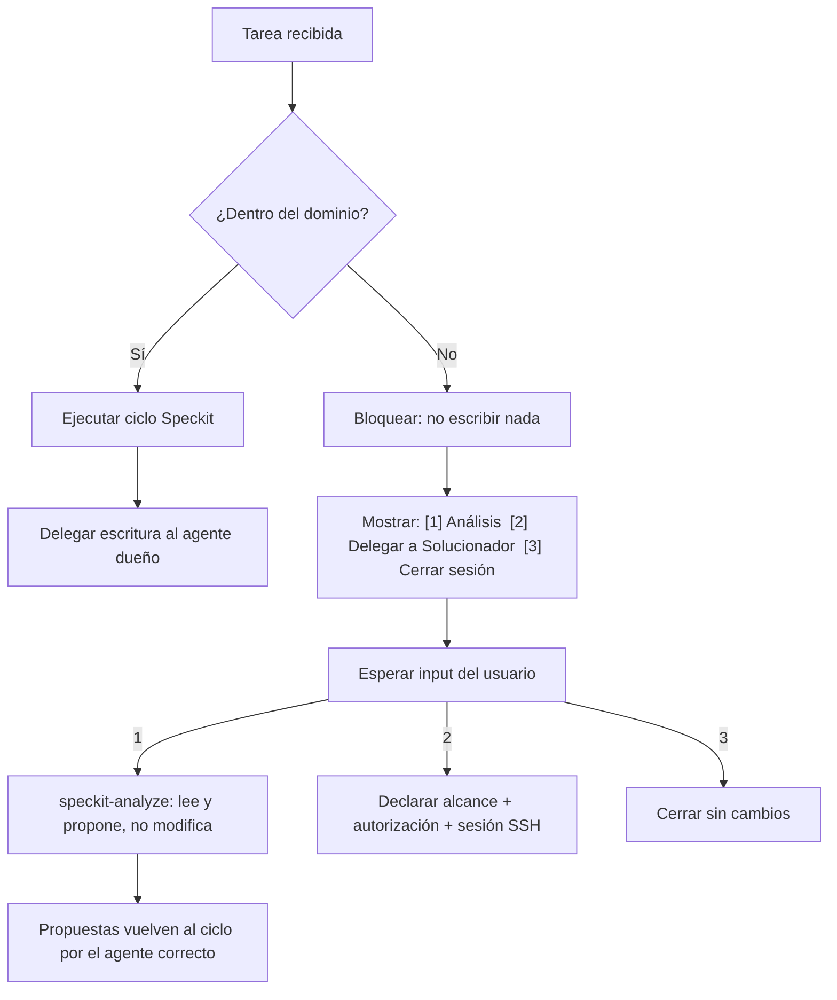
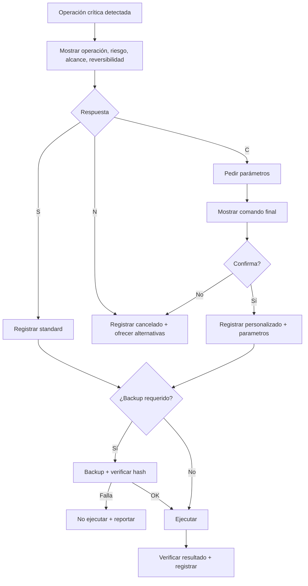
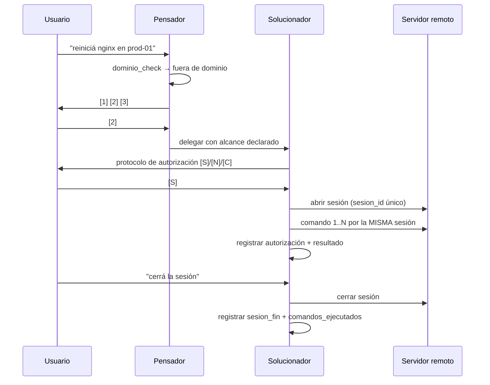

# Spec 031 — Permisos, Dominio y Delegación de Agentes

| Campo | Valor |
|---|---|
| **Slug** | `031-permisos-y-dominio-de-agentes` |
| **App** | `Agents_IA_TECH` (proyecto kit, sin `src/` — Art. X) |
| **Fecha** | 2026-10-31 |
| **Estado** | Cerrado — flujo SSD+Speckit completo (spec → plan → tasks → analyze → threat-model) |
| **Constitution aplicable** | `Documentacion/Agents_IA_TECH/.specify/constitution.md` v2.1.0 + Art. X |
| **Artefactos hermanos** | `plan.md`, `tasks.md`, `analyze.md`, `threat-model.md` (todos generados y verificados) |
| **Specs relacionados** | `026-agente-developer-unico`, `030-whitelist-contextual-por-tipo-proyecto`, `024-hooks-gobernanza-determinismo` |
| **Absorbe los borradores** | 034 (comportamiento), 035 (delegación), 037 (permisos). Se unifican en 031 porque comparten un único artefacto: el contrato de agente. |
| **Specs hermanos registrados** | 032 (actualización de Knowledge Base) y 033 (refresh de conocimiento MCP) — ver §15 |

---

## 1. Problema

Cada agente decide hoy su propio alcance. No existe un contrato escrito que diga **qué puede escribir, qué puede leer, cuándo debe delegar y cuándo debe pedir autorización**. El resultado son cuatro fallos observados en vivo.

### 1.1 Reescrituras destructivas por falta de contrato

El 2026-10-31, al agregar `dominio_check` a `pensador.agent.md`, se reescribió el archivo completo con `write`. Se perdieron secciones enteras que ya existían: Constitution Check, Constitution Wizard (11 pasos), Pipeline Speckit, Contexto Previo MCPs, matriz de delegación fase→agente y ciclo de vida de specs.

El validador lo midió sin ambigüedad:

| Momento | FAIL | WARN |
|---|---:|---:|
| Estado con los archivos reescritos | 94 | 60 |
| Tras restaurar desde HEAD y aplicar cambios quirúrgicos | 83 | 60 |
| Tras corregir `tier`, skills inexistentes y crear `threat-modeling` | **68** | **57** |

Ningún agente advirtió "esto está destruyendo contenido". El contrato faltaba: un agente documental puede editar `.github/agents/`, pero nadie le prohíbe **borrar** lo que no entiende.

### 1.2 Frontmatter inválido que el validador sí detecta y la IA no

Tres agentes quedaron con `tier` fuera de la lista canónica de `AGENTS.md`:

| Archivo | Valor inválido | Valor canónico |
|---|---|---|
| `.github/agents/pensador.agent.md` | `Analitico` | `Documental` |
| `.github/agents/security-auditor.agent.md` y `.opencode/agents/security-auditor.md` | `security-auditor` | `Documental` |
| `.github/agents/usuario-preferencias.agent.md` y `.opencode/agents/usuario-preferencias.md` | `Documental (gobernanza)` | `Documental` |

Un campo mal escrito rompe la whitelist contextual de 030, porque la whitelist se calcula como `tier_base ∩ modificador_capa`.

### 1.3 Skills declaradas que no existen

`security-auditor` declaraba `threat-modeling` y `developer`/`solucionador` declaraban `testing`. Ninguno de los tres resuelve a un `SKILL.md`:

- `testing` es una **categoría** con 14 subdirectorios, no una skill.
- `threat-modeling` no existía en ningún arnés.

La skill `threat-modeling` ya fue creada en ambos arneses (`.github/skills/seguridad/threat-modeling/SKILL.md` y `.opencode/skills/seguridad/threat-modeling/`), y `testing` se reemplazó por `tdd-workflow` + `verification-loop`. VAL-05 pasó de FAIL a OK.

### 1.4 Operaciones críticas sin protocolo único

No existe una regla escrita y verificable para `reboot`, borrado de base de datos, `pip install --force` o `rm -rf`. Cada agente improvisa: uno pregunta, otro ejecuta, otro documenta distinto. Tampoco existe política de sesión SSH: se abren conexiones nuevas por comando, se pierden credenciales, no queda rastro en el audit log.

### 1.5 Delegación ambigua

El `pensador` puede escribir en `Documentacion/` y en los arneses, pero no tiene prohibido explícito tocar `src/`. Tampoco tiene un procedimiento para cuando la tarea cae fuera de su dominio: hoy la ejecuta o la abandona, sin preguntar.

---

## 2. Objetivo

Que todo agente opere bajo un **contrato único, versionado y verificable** que defina:

1. Su **dominio de escritura** (rutas permitidas según tier y `proyecto_tipo`).
2. Sus **operaciones prohibidas** absolutas y las que requieren autorización escrita.
3. Su **procedimiento de delegación** cuando la tarea no es suya.
4. Su **protocolo de autorización** para operaciones críticas, con opción estándar, cancelación y **configuración personalizada**.
5. Su **política de sesión SSH**: una sesión por servidor, reutilizable, auditada y cerrada solo por el usuario.

### 2.1 Criterio de éxito global

| Métrica | Objetivo | Medición |
|---|---|---|
| `VAL-03` (claves obligatorias) | 0 violaciones | `pwsh -File scripts/validate-agents-skills.ps1 -Quiet` |
| `VAL-04` (tier canónico) | 0 violaciones | ídem |
| `VAL-05` (skills resuelven) | 0 violaciones | ídem |
| `VAL-07` (cobertura MCP) | 0 violaciones | ídem |
| `VAL-08` en agentes núcleo (`pensador`, `solucionador`, `developer`, `security-auditor`) | 0 violaciones | ídem |
| `VAL-08` global | 0 violaciones (nivelación completa, §12 CA-09) | ídem |
| Paridad de contenido `.github/` ↔ `.opencode/` | 100% en secciones de contrato | `tests/agents-parity.Tests.ps1` (a crear) |

---

## 3. Alcance

### 3.1 Dentro del alcance

- Contrato de los 13 agentes del kit y su réplica en los 13 de `.opencode/agents/`.
- Frontmatter: `tier` canónico, `description`, `skills` resolubles, `tools`.
- Secciones de Regla 2: introducción, skills, enfoque, MCPs, idioma, constraints.
- Protocolo de autorización crítica con `[S]` / `[N]` / `[C]`.
- Política de sesión SSH reutilizable y su registro en `.bootstrap-audit.log`.
- `dominio_check` del `pensador` y reglas de delegación hacia `developer` y `solucionador`.
- Validador `scripts/validate-agents-skills.ps1` como fuente de verdad de la conformidad.

### 3.2 Fuera del alcance

- **Actualización de la Knowledge Base** tras cada spec → spec 032.
- **Refresh de conocimiento de MCPs** (índices y BD de `codebase-memory-mcp`) → spec 033.
- **Ejecución real de comandos SSH**: este spec define contrato y registro, no un cliente SSH nuevo.
- **Permisos del harness** (`permission.edit`, `permission.bash` en `opencode.json`): los materializa el bootstrap (spec 030, FR-21). Acá se define el contrato que esos permisos deben reflejar.
- **UI o TUI**: no aplica, el kit no tiene interfaz propia.
- **Capacidad de navegador en agentes** (`playwright`, skill `browser-qa`): declarada en `developer` según D-08 (decisión B). El MCP se mantiene registrado y cubierto.

---

## 4. Glosario

| Término | Definición |
|---|---|
| **Dominio** | Conjunto cerrado de rutas y operaciones que un agente puede ejecutar sin pedir permiso. |
| **Tier** | Categoría canónica de `AGENTS.md`: `Documental`, `Documental extendido`, `Implementador`, `Tooling`, `Plataforma`. |
| **Operación crítica** | Acción irreversible o de alto impacto: `reboot`, borrado de datos, instalación de servicios, `rm -rf`, `pip install --force`. |
| **Autorización escrita** | Respuesta explícita del usuario en la sesión, registrada en `.bootstrap-audit.log` con `autorizacion_escrita: true`. |
| **Sesión SSH** | Conexión única a un servidor, reutilizada para todos los comandos de una tarea, cerrada solo por orden del usuario. |
| **Fail-closed** | Ante duda, ausencia de registro o error de verificación, la operación **no** se ejecuta. |
| **Prohibición absoluta** | Operación que no se ejecuta ni con autorización: pérdida total de datos, `rm -rf /`, formateo. |

---

## 5. Roles y dominios

| Agente | Tier | Escribe en | NO escribe en | Puede leer | SSH |
|---|---|---|---|---|---|
| `pensador` | Documental | `Documentacion/<App>/`, `.github/`, `.opencode/`, `.doc_agents/`, `README.md` | `src/`, `scripts/`, `tests/`, infraestructura | Todo el proyecto | Solo lectura, para diagnóstico; delega la acción |
| `Agent-SSD` | Documental extendido | `src/<App>/.specify/`, `Documentacion/<App>/specs/`, arneses, `.doc_agents/`, `README.md` | Código de aplicación | Todo | No |
| `arquitecto` | Documental | `Documentacion/<App>/arquitectura/`, `specs/adr/` | `src/`, `scripts/` | Todo | No |
| `documentador` | Documental | `Documentacion/<App>/`, `README.md` | `src/`, `scripts/` | Todo | No |
| `security-auditor` | Documental | `Documentacion/<App>/seguridad/` | `src/`, `scripts/` | Todo | No |
| `usuario-preferencias` | Documental | `Documentacion/<App>/gobernanza/` | `src/`, `scripts/` | Todo | No |
| `developer` | Implementador | `src/<App>/`, `tests/` (en el kit: el workspace del kit) | `Documentacion/` ajeno, infraestructura remota | Todo | No |
| `gitflow` | Tooling | Estado de git (ramas, commits, PRs) | Código de aplicación | Todo | No |
| `solucionador` | Plataforma | Servidores y configuraciones remotas; `Documentacion/bitacoras/` | Código sin autorización | Todo | **Sí, sesión única con autorización** |
| `plataformador` | Plataforma | Configuración de entorno, `dependencias-manifest.yml`, `opencode.json` | Código de aplicación ajeno | Todo | Solo lectura |
| `upgrade_framework` | Plataforma | `proyect_ext/<repo>/`, `dependencias-manifest.yml`, docs de dependencias | Código de aplicación, agentes del kit | Todo | No |
| `analista_tecnico` | Documental | `Documentacion/<App>/` (índices, memoria de análisis), `README.md` | `src/`, `scripts/` | Todo | No |
| `ssh-connection-agent` | Plataforma | Bitácoras de sesión en `Documentacion/<App>/bitacoras/` | Código remoto: lo ejecuta el `solucionador` | Todo | **Sí: fija el procedimiento de sesión única; la acción la autoriza el `solucionador`** |

**Regla transversal**: ningún agente escribe en `Documentacion/<OtraApp>/`. Cada app es aislada.

---

## 6. Matriz de permisos por operación

| Operación | Quién | Autorización | Registro |
|---|---|---|---|
| Leer código, docs, logs | Todos | No | — |
| Escribir docs/specs/ADRs | Documentales + `Agent-SSD` | No | Commit |
| Escribir código y tests | `developer` | No (dentro de su dominio) | Commit + tests |
| Crear/modificar agente o skill | `plataformador`, `pensador` (con aprobación) | Aprobación del usuario | `VAL-*` en verde |
| Reiniciar un servicio | `solucionador` | Escrita por sesión | `autorizacion_escrita: true` |
| `reboot` / reiniciar servidor | `solucionador` | Escrita + ventana de mantenimiento | ídem |
| `systemctl install`, `apt/dnf install`, `pip install --force` | `solucionador` | Escrita + motivo | ídem |
| Borrar datos, `DROP`/`TRUNCATE`, borrar BD | `solucionador` | Escrita + **backup verificado** | ídem + `backup_previo: true` |
| `rm -rf` sobre rutas de proyecto | `solucionador` | Escrita + backup | ídem |
| `rm -rf /`, formateo, pérdida total de datos | **Nadie** | **Prohibido siempre** | Bloqueo + reporte |

### 6.1 Prohibiciones absolutas (sin excepción)

1. `rm -rf /` o cualquier borrado recursivo sobre la raíz del sistema.
2. Formateo o particionado de discos.
3. Borrado de base de datos sin backup verificado (y aun con backup, requiere autorización escrita).
4. `pip install --force` global, `--break-system-packages` o equivalente.
5. Escribir credenciales, claves privadas o tokens en el repositorio.
6. Crear accesos sin contraseña (`authorized_keys`, claves nuevas) sin autorización explícita.
7. Desactivar el audit log o el validador para "avanzar más rápido".

---

## 7. Historias de usuario

### US-01 — Dominio explícito y bloqueo fuera de alcance

**Como** usuario, **quiero** que el `pensador` se detenga cuando la tarea no es suya y me pregunte qué hacer, **para** no perder contenido ni ejecutar cambios que no entiende.

**Escenarios**

1. **Dentro de dominio**: pido actualizar una spec → el `pensador` la escribe en `Documentacion/` sin preguntar.
2. **Fuera de dominio**: pido editar `src/app/main.py` → el `pensador` bloquea y muestra `[1] Análisis [2] Delegar a Solucionador [3] Cerrar sesión`.
3. **Excepción temporal**: elijo `[2]` con alcance "solo este servidor, solo esta sesión" → se registra en el audit log y no se reutiliza en la tarea siguiente.

### US-02 — Delegación con agente correcto

**Como** usuario, **quiero** que cada tarea se asigne al agente con la skill adecuada, **para** que el resultado respete la arquitectura y las normas.

**Escenarios**

1. Código nuevo → delega a `developer`, nunca lo escribe el `pensador`.
2. ADR o threat model → delega a `arquitecto` / `security-auditor`.
3. Operación en servidor → delega a `solucionador` con autorización.
4. El plan de cada tarea indica **agente ejecutor**, artefacto y criterio de aceptación.

### US-03 — Autorización de operación crítica con opción personalizada

**Como** usuario, **quiero** autorizar, cancelar o **ajustar** una operación crítica, **para** no quedar atrapado entre "sí" y "no".

**Escenarios**

1. `[S]` estándar → ejecuta con reglas por defecto y registra `autorizacion_tipo: standard`.
2. `[N]` cancelar → no ejecuta, registra `cancelado` y ofrece alternativas.
3. `[C]` personalizada → pide parámetros, muestra el comando final y **vuelve a confirmar** antes de ejecutar.
4. Sin `autorizacion_escrita: true` en el audit log → no ejecuta (fail-closed).

### US-04 — Recuperación de desastre ofrecida siempre

**Como** usuario, **quiero** que antes de una operación destructiva se me ofrezca backup y rollback, **para** poder volver atrás.

**Escenarios**

1. Operación destructiva → ofrece `[R] Backup y luego ejecutar`.
2. Backup falla la verificación → no ejecuta y reporta.
3. Rollback declarado antes de tocar nada; queda en el registro.

### US-05 — Una sesión SSH por servidor

**Como** usuario, **quiero** reutilizar la misma sesión mientras trabajo, **para** no repetir credenciales ni abrir conexiones por comando.

**Escenarios**

1. Primer comando abre sesión y registra `sesion_inicio`.
2. Los siguientes comandos usan la misma conexión.
3. La sesión sigue abierta aunque pasen horas; se cierra solo cuando lo ordeno.
4. Al cerrar se registran `sesion_fin`, `comandos_ejecutados` y resultado.

### US-06 — Paridad entre arneses

**Como** usuario, **quiero** el mismo comportamiento en Copilot y en OpenCode, **para** no tener dos kits distintos.

**Escenarios**

1. Toda sección de contrato (dominio, permisos, delegación, idioma, MCPs) existe en ambos arneses.
2. El validador detecta divergencias de skills y de frontmatter.
3. Un cambio en un arnés sin el otro es un FAIL de revisión.

### US-07 — Agentes que siempre usan skills y SSD

**Como** usuario, **quiero** que todos los agentes ejecuten el ciclo SSD + Speckit con sus skills, **para** que documentación, código y arquitectura queden alineados.

**Escenarios**

1. Ninguna escritura de código ocurre fuera de `speckit-implement`.
2. Ningún análisis ocurre sin `speckit-analyze` y su threat model cuando hay impacto de seguridad.
3. Toda skill declarada en frontmatter existe y se usa en la sección de skills del cuerpo.

---

## 8. Requisitos funcionales

| ID | Requisito | Verificación |
|---|---|---|
| **FR-01** | Todo agente declara `tier` con un valor de la lista canónica de `AGENTS.md`. | VAL-04 = 0 |
| **FR-02** | Todo agente declara `description` no vacía. | VAL-03 = 0 |
| **FR-03** | Toda skill declarada resuelve a un `SKILL.md` existente en `.opencode/skills`. | VAL-05 = 0 |
| **FR-04** | Todo agente contiene las secciones de Regla 2: introducción, skills, enfoque, MCPs, idioma, constraints. | VAL-08 = 0 |
| **FR-05** | Todo MCP de `opencode.json` está declarado en la sección de MCPs de al menos un agente. | VAL-07 = 0 |
| **FR-06** | El `pensador` no escribe en `src/`, `scripts/` ni `tests/` bajo ninguna circunstancia. | Inspección + test de contrato |
| **FR-07** | El `pensador` ejecuta `dominio_check` antes de ejecutar o delegar. | Sección presente en ambos arneses |
| **FR-08** | Fuera de dominio, el `pensador` bloquea y presenta exactamente `[1] Análisis`, `[2] Delegar a Solucionador`, `[3] Cerrar sesión`, y espera respuesta. | Test de contrato sobre el texto |
| **FR-09** | La excepción de dominio autorizada vale solo para la sesión/momento y no se persiste. | Redacción explícita en ambos arneses |
| **FR-10** | Toda escritura de código se delega a un agente Implementador. | Matriz §5 + revisión de tasks |
| **FR-11** | Toda operación de servidor se delega a `solucionador`. | Matriz §5 |
| **FR-12** | Toda operación crítica requiere autorización escrita registrada antes de ejecutarse (fail-closed). | Registro en `.bootstrap-audit.log` |
| **FR-13** | El protocolo de autorización ofrece `[S]` estándar, `[N]` cancelar y `[C]` personalizada. | Texto en ambos `solucionador` |
| **FR-14** | La opción `[C]` exige parámetros concretos y una segunda confirmación con el comando final. | Texto + registro `parametros` |
| **FR-15** | Antes de operación destructiva se ofrece backup y se declara rollback. | Texto + registro `backup_previo` |
| **FR-16** | `rm -rf /`, formateo y pérdida total de datos están prohibidos incluso con autorización. | Texto + bloqueo |
| **FR-17** | Se usa una sola sesión SSH por servidor y tarea, reutilizada para todos los comandos. | Registro `sesion_id` único |
| **FR-18** | La sesión SSH se mantiene hasta que el usuario ordene cerrarla. | Registro `sesion_fin` |
| **FR-19** | Las credenciales las provee el usuario y no se persisten sin instrucción explícita registrada. | Texto + ausencia en repo |
| **FR-20** | Todo cambio en un arnés se replica en el otro. | VAL-01, VAL-06 + revisión |
| **FR-21** | Todo agente declara los MCPs que usa, con el nombre de sus herramientas. | VAL-07 |
| **FR-22** | Todo agente declara idioma y respeta `Documentacion/<App>/idioma.md`. | VAL-08 (idioma) |
| **FR-23** | Toda escritura destructiva de un agente documental sobre archivos existentes exige preservar el contenido previo (edición quirúrgica, no reescritura). | Revisión de diff |
| **FR-24** | El validador es de solo lectura y su exit code es 1 si hay algún FAIL. | `tests/validate-agents-skills.Tests.ps1` |

---

## 9. Requisitos no funcionales

| ID | Requisito |
|---|---|
| **NFR-01** | **Determinismo**: el contrato vive en archivos versionados; dos ejecuciones del validador sobre el mismo árbol dan el mismo resultado. |
| **NFR-02** | **Portabilidad**: funciona en cualquier máquina y en cualquier proyecto consumidor; no depende de rutas absolutas ni de `C:<sep>Proyectos\...`. |
| **NFR-03** | **Idempotencia**: aplicar el contrato dos veces no cambia el resultado. |
| **NFR-04** | **Trazabilidad**: toda operación crítica deja registro con timestamp, agente, operación, alcance y resultado. |
| **NFR-05** | **Fail-closed**: ante error de verificación o registro ausente, se bloquea. |
| **NFR-06** | **Bajo costo**: el validador corre en menos de 5 segundos sobre 26 agentes y 88 skills por arnés. |
| **NFR-07** | **Legibilidad**: cada sección de contrato se entiende sin contexto externo; sin placeholders ni secciones vacías. |

---

## 10. Modelo de datos

### 10.1 Registro de autorización en `.bootstrap-audit.log`

```json
{
  "timestamp": "2026-10-31T14:32:07-03:00",
  "agente": "solucionador",
  "operacion": "reiniciar_servidor",
  "alcance": "host:prod-01 / servicio:nginx",
  "riesgo": "indisponibilidad",
  "autorizacion_escrita": true,
  "autorizacion_tipo": "personalizado",
  "parametros": { "ventana": "22:00-22:15", "backup": true },
  "backup_previo": true,
  "backup_hash": "sha256:...",
  "rollback": "systemctl start nginx + restore /etc/nginx/nginx.conf.bak",
  "resultado": "exito"
}
```

Campos obligatorios: `timestamp`, `agente`, `operacion`, `alcance`, `riesgo`, `autorizacion_escrita`, `autorizacion_tipo`, `resultado`. Si `riesgo` implica pérdida de datos, `backup_previo` y `backup_hash` también son obligatorios.

### 10.2 Registro de sesión SSH

```json
{
  "sesion_id": "prod-01-solucionador-20261031-1430",
  "host": "prod-01",
  "agente": "solucionador",
  "sesion_inicio": "2026-10-31T14:30:00-03:00",
  "sesion_fin": "2026-10-31T17:05:00-03:00",
  "comandos_ejecutados": 23,
  "autorizaciones": 2,
  "resultado": "exito"
}
```

`sesion_id` es único por host, agente y momento de apertura. Todos los comandos de la tarea comparten ese `sesion_id`; un `sesion_id` distinto para el mismo host en la misma tarea es una violación de FR-17.

---

## 11. Flujos

### 11.1 `dominio_check`



### 11.2 Autorización crítica



### 11.3 Sesión SSH única



---

## 12. Criterios de aceptación

| ID | Criterio | Verificación concreta |
|---|---|---|
| **CA-01** | VAL-03 sin violaciones. | `pwsh -File scripts/validate-agents-skills.ps1 -Quiet` → `FAIL` de VAL-03 ausente |
| **CA-02** | VAL-04 sin violaciones. | ídem |
| **CA-03** | VAL-05 sin violaciones. | ídem |
| **CA-04** | VAL-07 sin violaciones (`playwright` declarado por algún agente). **Cumplido por D-08 (decisión B)**: `playwright` declarado en `developer` junto a la skill `browser-qa`. | ídem |
| **CA-05** | `pensador` y `solucionador` con VAL-08 = 0 en ambos arneses. | Filtro del reporte por archivo |
| **CA-06** | `dominio_check` presente y con las 3 opciones exactas en ambos `pensador`. | `Select-String` sobre ambos archivos |
| **CA-07** | Protocolo `[S]/[N]/[C]` presente en ambos `solucionador`. | ídem |
| **CA-08** | Prohibiciones absolutas presentes en ambos `solucionador`. | ídem |
| **CA-09** | VAL-08 global = 0 (nivelación de los 26 agentes). | Reporte completo |
| **CA-10** | Paridad de secciones de contrato entre arneses. | `tests/agents-parity.ps1` → exit code 0, 13 agentes × 2 arneses con cuerpo, tier, descripción y skills idénticos |
| **CA-11** | El validador no escribe archivos. | `git status` no muestra cambios nuevos tras ejecutar `scripts/validate-agents-skills.ps1` |
| **CA-12** | Un cambio de contrato en un arnés sin el otro es detectado. | Fixture negativo en `tests/agents-parity.ps1`: divergencia unilateral detectada |

**Estado medido al cierre del ciclo Speckit**: CA-01, CA-02, CA-03, CA-04, CA-05, CA-06, CA-07, CA-08, CA-09, CA-10, CA-11 y CA-12 cumplidos. `analyze.md` y `threat-model.md` generados y verificados (sin placeholders, sin secciones vacías). Validador: `OK: 8 | WARN: 1 | FAIL: 0`, exit code 0. Test de contrato: exit code 0, fixture negativo detecta divergencia. `git status` limpio de escrituras del validador.

**Nivelación ejecutada (CA-09)**: 13 agentes × 2 arneses. Los cuerpos de `.github/agents/<n>.agent.md` y `.opencode/agents/<n>.md` son ahora **idénticos línea por línea**; solo difiere el frontmatter nativo de cada arnés (`tools`/`user-invocable` en Copilot; `mode`/`temperature`/`permission` en OpenCode). `tier`, `description` y el conjunto de `skills` son iguales en ambos lados para los 13 agentes.

**Deuda saldada respecto de la medición previa**: 38 violaciones de VAL-08 repartidas en 4 agentes (`security-auditor` 6+6, `usuario-preferencias` 5+5, `plataformador` 4+4, `upgrade_framework` 4+4) y 1 de VAL-03 (`ssh-connection-agent` en `.opencode` sin `description`).

---

## 13. Casos borde

| Caso | Comportamiento esperado |
|---|---|
| El usuario responde `[2]` y luego cancela la autorización | No se abre sesión SSH; se registra `cancelado`; se vuelve al menú de dominio. |
| El backup no se puede verificar | No se ejecuta la operación; se reporta el hash esperado vs. obtenido. |
| La sesión SSH cae por red | Se reabre con el **mismo** `sesion_id` y se registra la reconexión; no cuenta como sesión nueva. |
| El usuario pide `rm -rf /` explícitamente | Se bloquea igual; se registra el intento y se explica que es prohibición absoluta. |
| Un agente documental necesita editar un archivo existente | Edición quirúrgica; prohibido reescribir el archivo completo (FR-23). |
| Proyecto consumidor sin `src/` | El contrato se hereda igual; `proyecto_tipo` decide la whitelist efectiva (spec 030). |
| `opencode.json` agrega un MCP nuevo | VAL-07 falla hasta que un agente lo declare; se corrige el agente, no se retira el MCP. |
| Dos agentes reclaman la misma operación | Gana el más específico según §5; el otro delega. |

---

## 14. Riesgos

| ID | Riesgo | Prob. | Impacto | Mitigación |
|---|---|---|---|---|
| R-01 | Reescritura destructiva de agentes al editarlos | Alta | Alto | FR-23 + `edit` quirúrgico + validador antes/después |
| R-02 | Deriva entre arneses | Alta | Medio | VAL-01/VAL-06 + CA-10 |
| R-03 | Autorización "verbal" sin registro | Media | Alto | Fail-closed (FR-12) |
| R-04 | Sesiones SSH zombies | Media | Medio | `sesion_fin` obligatorio (FR-18) |
| R-05 | Nivelación incompleta de VAL-08 | Alta | Medio | CA-09 como gate de cierre |
| R-06 | El contrato queda solo en prosa y no se verifica | Media | Alto | Cada FR tiene verificación asociada |

---

## 15. Dependencias y specs hermanos

| Spec | Relación |
|---|---|
| **026 — agente developer único** | Define que `developer` es el implementador único; 031 fija su dominio. |
| **030 — whitelist contextual** | Define `whitelist_efectiva = tier_base ∩ modificador_capa`; 031 garantiza que el `tier` sea válido. |
| **024 — hooks de gobernanza** | Aporta el mecanismo de hooks; 031 define qué hooks (`dominio_check`, pre/post sesión) son obligatorios. |
| **032 — actualización de Knowledge Base** | Registrado, no implementado. Actualiza CodeBase y Context tras spec validada. |
| **033 — refresh de conocimiento MCP** | Registrado, no implementado. Actualiza índices y BD de los MCP en la primera ejecución del día. |

---

## 16. Plan de verificación

```powershell
# 1. Conformidad estructural de agentes y skills (solo lectura)
pwsh -NoProfile -File scripts/validate-agents-skills.ps1

# 2. Resumen para gate de CI
pwsh -NoProfile -File scripts/validate-agents-skills.ps1 -Quiet
# Esperado al cierre de 031: FAIL: 0 | exit code 0

# 3. Contrato de dominio y autorización en ambos arneses
Select-String -Path .github/agents/pensador.agent.md, .opencode/agents/pensador.md -Pattern 'dominio_check'
Select-String -Path .github/agents/solucionador.agent.md, .opencode/agents/solucionador.md -Pattern 'autorizacion_escrita'

# 4. El validador no debe ensuciar el árbol
git status --short scripts/ .github/ .opencode/
```

---

## 17. Trazabilidad con la Constitución

| Artículo | Cómo lo cumple 031 |
|---|---|
| Art. III — Test-First | Cada FR tiene verificación; CA-09 bloquea el cierre sin nivelación. |
| Art. IV/VII — Simplicidad | Un contrato único en lugar de reglas por agente; sin capa nueva de runtime. |
| Art. V — Seguridad | Protocolo de autorización, prohibiciones absolutas, backup verificado. |
| Art. IX — Integration-First | Verificación contra archivos reales y el validador, no supuestos. |
| Art. X — Kit sin `src/` | El dominio del kit se declara explícitamente para cada tier. |

---

## 18. Decisiones registradas

| ID | Decisión | Motivo |
|---|---|---|
| **D-01** | `pensador` nunca escribe código; delega siempre. | El usuario lo fijó: su rol es analítico y de orquestación. |
| **D-02** | La excepción de dominio vale solo para la sesión/momento. | Evita que una autorización puntual se convierta en permiso permanente. |
| **D-03** | `[C]` exige segunda confirmación con el comando final. | La configuración personalizada puede introducir riesgo no previsto. |
| **D-04** | Prohibición absoluta no admite autorización. | Pérdida total de datos no es reversible ni auditable. |
| **D-05** | Sesión SSH única, cerrada solo por el usuario. | El usuario trabaja en sesiones largas; reconectar por comando rompe el contexto y multiplica credenciales. |
| **D-06** | `threat-modeling` se crea como skill real. | El `security-auditor` la declaraba; retirarla habría dejado sin base el Art. V. |
| **D-07** | Se absorben los borradores 034/035/037 en 031. | Comparten el mismo artefacto y el mismo validador; separarlos generaba contradicciones. |
| **D-08** | **Decisión B (2026-10-31)**: `playwright` se declara **ahora** en `developer`, junto a la skill `browser-qa`, como capacidad de navegador del agente. No se crea excepción versionada ni se retira el MCP. | El usuario eligió declarar el MCP en lugar de diferirlo: la capacidad de navegador es transversal al único escritor de código y cierra VAL-07 sin excepciones. Reemplaza el diferimiento propuesto en la primera redacción. No confundir con la deuda **DD-08** de la spec 029 (suite de tests que no compila). |
