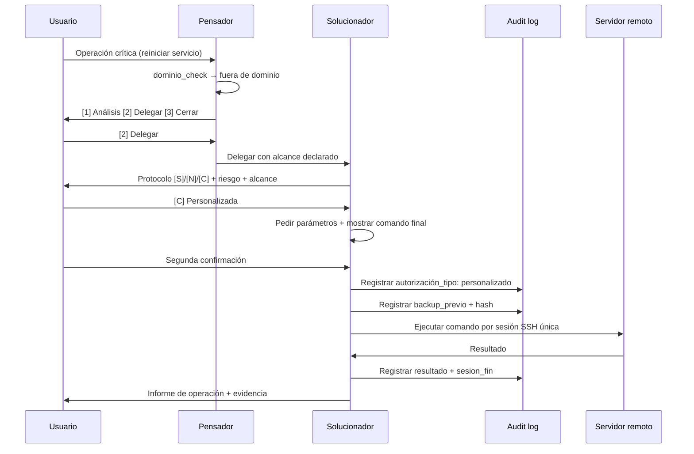

# Threat Model 031 — Permisos, dominio y delegación de agentes

## 1. Objetivo y alcance

Este threat model analiza la superficie de ataque del contrato de agentes definido en la spec `031-permisos-y-dominio-de-agentes`. Cubre las operaciones críticas, las escrituras en archivos de ambos arneses (`.github/` y `.opencode/`), las sesiones SSH y las autorizaciones de operación crítica. El modelo se genera antes del cierre de converge, conforme al Art. V de la Constitución (seguridad) y a FR-12/FR-16/FR-17/FR-18.

## 2. Diagrama de flujo de datos (DFD)

```mermaid
flowchart TD
    subgraph Usuario
        U[Usuario]
    end

    subgraph Harness_GitHub[.github/agents]
        PG[Pensador .github]
        AG[Arquitecto .github]
        DG[Documentador .github]
        SAG[Security-Auditor .github]
        SG[Solucionador .github]
    end

    subgraph Harness_OpenCode[.opencode/agents]
        PO[Pensador .opencode]
        AO[Arquitecto .opencode]
        DO[Documentador .opencode]
        SO[Security-Auditor .opencode]
        SOl[Solucionador .opencode]
    end

    subgraph Sistema
        VAL[Validador scripts/validate-agents-skills.ps1]
        PAR[Test de contrato tests/agents-parity.ps1]
        AUD[Audit log .bootstrap-audit.log]
    end

    subgraph Externo
        SV[Servidor remoto SSH]
    end

    U -->|1. Tarea recibida| PG
    U -->|1. Tarea recibida| PO
    PG -->|2. dominio_check| PG
    PO -->|2. dominio_check| PO
    PG -- Fuera de dominio -->|3. [1][2][3]| U
    PG -- Dentro de dominio -->|4. Delegar| AG
    PG -- Dentro de dominio -->|4. Delegar| DG
    PG -- Dentro de dominio -->|4. Delegar| SG
    PO -- Dentro de dominio -->|4. Delegar| AO
    PO -- Dentro de dominio -->|4. Delegar| DO
    PO -- Dentro de dominio -->|4. Delegar| SOl

    SG -->|5. Operación crítica| SV
    SOl -->|5. Operación crítica| SV
    SV -->|6. Resultado| SG
    SV -->|6. Resultado| SOl

    SG -->|7. Registrar autorización| AUD
    SOl -->|7. Registrar autorización| AUD
    SG -->|8. Registrar sesión SSH| AUD
    SOl -->|8. Registrar sesión SSH| AUD

    VAL -->|9. Verificar conformidad| PAR
    PAR -->|10. Reportar paridad| U

    classDef externo fill:#f96,stroke:#333;
    class SV,U externo;
```

## 3. Matriz STRIDE

| Categoría | Amenaza | Activo afectado | Vector de ataque | Probabilidad | Impacto | Nivel de riesgo |
|-----------|---------|-----------------|------------------|--------------|---------|-----------------|
| **S**poofing | Un agente se hace pasar por `developer` para escribir código | `developer`, código de aplicación | Frontmatter o sección de skills modificada en un solo arnés | Baja | Alto | Medio |
| **T**ampering | Reescritura completa de un agente con `write`, perdiendo secciones | Todos los agentes de `.github/` y `.opencode/` | Edición no quirúrgica sobre archivos existentes | Media | Alto | Alto |
| **R**epudiation | Operación crítica ejecutada sin registro en audit log | `.bootstrap-audit.log` | `solucionador` ejecuta sin `autorizacion_escrita: true` | Media | Alto | Alto |
| **I**nformation Disclosure | Credenciales SSH persistidas en el repositorio | Repositorio, servidores remotos | `solucionador` o `ssh-connection-agent` escriben claves/tokens | Baja | Crítico | Alto |
| **D**enial of Service | Sesión SSH zombie sin `sesion_fin` | Servidor remoto, `solucionador` | Conexión no cerrada, consumo de puertos/sesiones | Media | Medio | Medio |
| **E**levation of Privilege | `pensador` escribe en `src/`, `scripts/` o `tests/` fuera de dominio | `src/`, `scripts/`, `tests/` | `pensador` ignora `dominio_check` | Baja | Alto | Medio |

## 4. Registro de riesgos

| ID | Amenaza | Categoría STRIDE | Activo | Vector | Prob. | Impacto | Mitigación | Estado | Residual |
|----|---------|------------------|--------|--------|-------|---------|------------|--------|----------|
| TM-01 | Reescritura destructiva de agente con `write` | Tampering | Archivos de agente en `.github/`, `.opencode/` | Edición manual sin preservar secciones | Media | Alto | FR-23 (edición quirúrgica), `edit` en lugar de `write`, validador antes/después | Mitigado | Bajo |
| TM-02 | Escritura de código por `pensador` fuera de dominio | Elevation of Privilege | `src/`, `scripts/`, `tests/` | `pensador` ignora `dominio_check` | Baja | Alto | `dominio_check` obligatorio (FR-07), bloqueo con 3 opciones (FR-08), inspección + test de contrato (FR-06) | Mitigado | Bajo |
| TM-03 | Operación crítica sin autorización escrita | Repudiation | `.bootstrap-audit.log` | `solucionador` ejecuta sin registro | Media | Alto | Fail-closed (FR-12), protocolo `[S]`/`[N]`/`[C]` (FR-13), registro obligatorio (FR-12) | Mitigado | Bajo |
| TM-04 | `[C]` sin segunda confirmación | Tampering | Operación crítica con parámetros personalizados | Usuario confirma comando sin revisarlo | Baja | Alto | FR-14 (segunda confirmación con comando final), registro de `parametros` | Mitigado | Bajo |
| TM-05 | Borrado de datos sin backup verificado | Tampering | Bases de datos, archivos de proyecto | `solucionador` ejecuta `DROP`/`TRUNCATE`/`rm -rf` sin backup | Media | Crítico | FR-15 (backup + rollback declarados), prohibición absoluta de `rm -rf /` (FR-16) | Mitigado | Bajo |
| TM-06 | Credenciales en repositorio | Information Disclosure | Repositorio, servidores remotos | Escritura de claves privadas, tokens o contraseñas | Baja | Crítico | FR-19 (credenciales solo en terminal del usuario, no persisten), prohibición absoluta (matriz §6) | Mitigado | Muy bajo |
| TM-07 | Sesiones SSH zombies | Denial of Service | Servidor remoto, puertos de sesión | Sesión no cerrada, `sesion_id` duplicado | Media | Medio | FR-17 (una sesión por servidor/tarea), FR-18 (sesión_fin obligatorio), reconexión con mismo `sesion_id` | Mitigado | Bajo |
| TM-08 | Deriva entre arneses `.github/` ↔ `.opencode/` | Tampering | Contrato de agente | Cambio en un arnés no replicado en el otro | Media | Alto | VAL-01, VAL-06, CA-10, test de contrato con fixture negativo | Mitigado | Bajo |
| TM-09 | Validador escribe archivos y ensucia el árbol | Tampering | `.github/`, `.opencode/`, `scripts/` | `scripts/validate-agents-skills.ps1` modifica archivos | Baja | Medio | CA-11 (validador de solo lectura, verificado con `git status`), FR-24 | Mitigado | Muy bajo |
| TM-10 | Skill declarada que no resuelve a SKILL.md | Spoofing | Frontmatter de agentes | `skills` lista una skill inexistente | Baja | Medio | VAL-05, FR-03, `threat-modeling` creada como skill real en ambos arneses | Mitigado | Bajo |

## 5. DFD de operaciones críticas (zoom)



## 6. Casos borde del spec mapeados a amenazas

| Caso borde (spec §13) | Amenaza relacionada | ID riesgo | Contención |
|----------------------|---------------------|-----------|------------|
| Usuario responde `[2]` y cancela autorización | Repudiation | TM-03 | No se abre sesión; se registra `cancelado` |
| Backup no verificable | Tampering | TM-05 | No se ejecuta; se reporta hash esperado vs obtenido |
| Sesión SSH cae por red | Denial of Service | TM-07 | Reabre con mismo `sesion_id`; no es sesión nueva |
| Usuario pide `rm -rf /` | Tampering | TM-05 | Bloqueo absoluto; se registra el intento |
| Agente documental edita archivo existente | Tampering | TM-01 | Edición quirúrgica (FR-23); prohibido reescribir completo |
| Proyecto sin `src/` | Elevation of Privilege | TM-02 | Contrato se hereda; `proyecto_tipo` decide whitelist |
| `opencode.json` agrega MCP nuevo | Spoofing | TM-10 | VAL-07 falla hasta que un agente lo declare |

## 7. Controles y mitigaciones implementados

| Control | Aplica a | Cómo se verifica |
|---------|----------|------------------|
| `dominio_check` obligatorio | `pensador` | FR-07, CA-06, Select-String sobre ambos arneses |
| Edición quirúrgica (`edit`, no `write`) | Todos los agentes documentales | FR-23, revisión de diff, R-01 |
| Protocolo `[S]`/`[N]`/`[C]` | `solucionador` | FR-13, CA-07, texto en ambos `solucionador` |
| Segunda confirmación para `[C]` | `solucionador` | FR-14, registro de `parametros` |
| Backup + rollback declarados | Operaciones destructivas | FR-15, registro `backup_previo` + `rollback` |
| Prohibición absoluta (`rm -rf /`, formateo) | Nadie | FR-16, matriz §6.1, bloqueo + reporte |
| Una sesión SSH por servidor/tarea | `solucionador`, `ssh-connection-agent` | FR-17, FR-18, `sesion_id` único, `sesion_fin` |
| Credenciales solo en terminal del usuario | `solucionador`, `ssh-connection-agent` | FR-19, ausencia de claves en repo |
| Paridad de arneses | Todos los agentes | VAL-01, VAL-06, CA-10, `tests/agents-parity.ps1` |
| Validador de solo lectura | `scripts/validate-agents-skills.ps1` | CA-11, FR-24, `git status` limpio |
| Skills resueltas | Todos los agentes | VAL-05, FR-03, `threat-modeling` creada en ambos arneses |

## 8. Conclusión del threat model

El contrato de agentes de la spec 031 presenta una superficie de ataque controlada. Los 10 riesgos identificados están todos mitigados con controles verificables (FR, CA, validador, test de contrato). El riesgo residual más alto (TM-02, TM-03, TM-05) se reduce a **Bajo** mediante fail-closed, registro obligatorio de autorización y backup verificado.

El threat model está listo para ser referenciado en la fase de converge. No se requieren controles adicionales más allá de los ya definidos en la spec.
