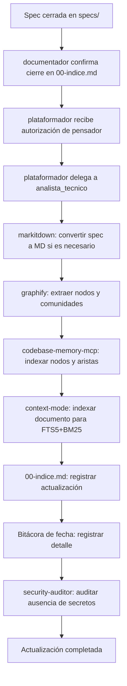
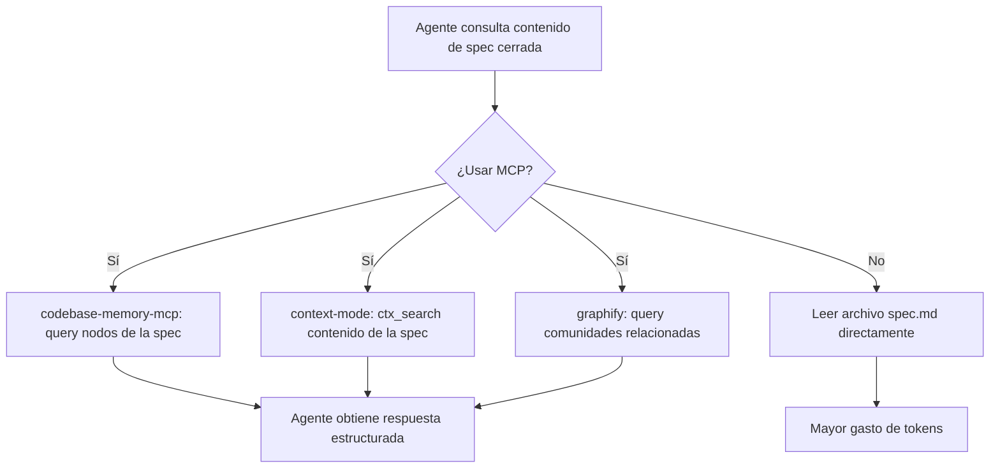

# Spec 032 — Actualización de Knowledge Base tras spec validada

| Campo | Valor |
|---|---|
| **Slug** | `032-actualizacion-knowledge-base` |
| **App** | `Agents_IA_TECH` (proyecto kit, sin `src/` — Art. X) |
| **Fecha** | 2026-11-01 |
| **Estado** | Especificada (aprobada para `plan.md`) |
| **Constitution aplicable** | `Documentacion/Agents_IA_TECH/.specify/constitution.md` v2.1.0 + Art. X + Art. V + Art. IX |
| **Artefactos hermanos** | `plan.md`, `tasks.md`, `analyze.md`, `threat-model.md`, `converge.md` |
| **Specs relacionados** | `031-permisos-y-dominio-de-agentes` (define qué es "spec validada"), `033-refresh-conocimiento-mcp` (hermano, refresh diario de índices MCP) |
| **Absorbe los borradores** | Ninguno — especificación original |

---

## 1. Problema

Cuando una spec queda cerrada y operativa (como ocurrió con la 031 el 2026-10-31), su contenido no se propaga automáticamente a la Knowledge Base del proyecto. La Knowledge Base está formada por:

- **CodeBase**: grafo de conocimiento del código (`codebase-memory-mcp`, 5.664 nodos indexados al 2026-10-31)
- **Context**: documentación indexada (`context-mode`, 9 archivos indexados al 2026-10-31)
- **Graphify**: grafo con detección de comunidades (`graphify`, 4.793 nodos al 100%)

Hoy no existe un procedimiento definido para que el cierre de una spec dispare la actualización de estos índices. Como consecuencia:

1. Los agentes no pueden consultar el contenido de specs cerradas vía `codebase-memory-mcp` ni `context-mode` hasta que alguien lo indexe manualmente.
2. `graphify` no detecta nuevas comunidades ni nodos relacionados con specs recién validadas.
3. No hay trazabilidad entre la spec cerrada y los nodos del grafo de conocimiento.
4. Cada agente que necesita información de una spec cerrada debe leer el archivo directamente, lo que gasta más tokens y no aprovecha los MCPs.

Este problema se observa cada vez que se cierra una spec y ningún agente tiene visibilidad estructurada de su contenido en los índices de conocimiento.

---

## 2. Objetivo

Que el cierre de una spec (flujo SSD+Speckit completo: spec → plan → tasks → analyze → threat-model → converge) dispare automáticamente la actualización de la Knowledge Base del proyecto, definiendo:

1. **Qué se actualiza**: nodos del grafo `codebase-memory-mcp`, comunidades `graphify`, documentos indexados `context-mode`.
2. **Cuándo se actualiza**: inmediatamente después de que el `documentador` confirme el cierre de una spec en `00-indice.md`.
3. **Quién ejecuta**: `plataformador` (orquesta la actualización) + `analista_tecnico` (ejecuta el pipeline sin IA de entrada).
4. **Cómo se verifica**: los índices reflejan el contenido de la spec cerrada y son consultables vía MCPs.

---

## 3. Alcance

### 3.1 Dentro del alcance

- Definición del contrato de actualización de Knowledge Base tras cierre de spec.
- Flujo de propagación: spec cerrada → `codebase-memory-mcp` → `graphify` → `context-mode`.
- Registro de actualización en `00-indice.md` y en bitácora de fecha.
- Paridad de actualización entre `.github/` y `.opencode/` (mismos MCPs, mismos procedimientos).
- Uso obligatorio de MCPs como herramienta primaria (Regla 1b del AGENTS.md).
- No escritura de código de aplicación; solo actualización de índices de conocimiento.

### 3.2 Fuera del alcance

- Escritura de código de aplicación en `src/<App>/` o `tests/`.
- Modificación del contenido de specs ya cerradas.
- Creación de nuevos MCPs o modificación de MCPs existentes (eso es spec 033).
- Ejecución real de comandos en servidores remotos (eso es `solucionador`).
- Cualquier operación destructiva sobre datos o repositorios.

---

## 4. Glosario

| Término | Definición |
|---|---|
| **Knowledge Base** | Conjunto de índices de conocimiento del proyecto: `codebase-memory-mcp` (grafo de código), `context-mode` (documentación indexada) y `graphify` (grafo con comunidades). |
| **CodeBase** | Índice de `codebase-memory-mcp`: nodos y aristas del código y documentación del proyecto. |
| **Context** | Índice de `context-mode`: documentos indexados con búsqueda FTS5+BM25. |
| **Graphify** | Índice de `graphify`: grafo con detección de comunidades y queries persistentes. |
| **Spec validada** | Spec que ha completado el flujo SSD+Speckit (spec → plan → tasks → analyze → threat-model → converge) y está ACTIVA en `specs/`. |
| **Actualización de KB** | Proceso de indexar el contenido de una spec validada en CodeBase, Context y Graphify. |
| **Fail-closed** | Ante error de verificación o registro ausente, la operación de actualización no se da por exitosa. |
| **Sin IA de entrada** | Principio del `analista_tecnico`: las herramientas (markitdown, graphify, codebase-memory-mcp) se ejecutan antes de usar IA; la IA solo actúa bajo demanda. |

---

## 5. Roles y dominios

| Agente | Rol en la actualización de KB | Escribe en | No escribe en | SSH |
|---|---|---|---|---|
| `plataformador` | Orquesta la actualización de KB tras cierre de spec; verifica que los índices reflejen el contenido | `Documentacion/<App>/bitacoras/`, `00-indice.md` | Código de aplicación, `src/`, `scripts/` | No |
| `analista_tecnico` | Ejecuta el pipeline de actualización sin IA de entrada: markitdown → graphify/codebase-memory-mcp → context-mode | `Documentacion/<App>/` (índices, memoria de análisis) | `src/`, `scripts/` | No |
| `pensador` | Valida que la spec esté cerrada antes de disparar la actualización; autoriza la transición | `Documentacion/<App>/`, `.github/`, `.opencode/`, `.doc_agents/`, `README.md` | `src/`, `scripts/`, `tests/` | Solo lectura |
| `documentador` | Confirma el cierre de la spec en `00-indice.md` y registra la entrada | `Documentacion/<App>/`, `00-indice.md` | `src/`, `scripts/` | No |
| `developer` | No participa en la actualización de KB | — | Todo el kit | No |
| `security-auditor` | Audita que la actualización no exponga secretos ni datos sensibles en los índices | `Documentacion/<App>/seguridad/` | `src/`, `scripts/` | No |

**Regla transversal**: ningún agente escribe credenciales, tokens ni secretos en los índices de Knowledge Base.

---

## 6. Matriz de permisos por operación

| Operación | Quién | Autorización | Registro |
|---|---|---|---|
| Indexar spec cerrada en codebase-memory-mcp | `analista_tecnico` | No (dentro de su dominio) | Entrada en bitácora + `00-indice.md` |
| Indexar spec cerrada en context-mode | `analista_tecnico` | No (dentro de su dominio) | Entrada en bitácora + `00-indice.md` |
| Actualizar comunidades graphify | `analista_tecnico` | No (dentro de su dominio) | Entrada en bitácora + `00-indice.md` |
| Orquestar actualización de KB | `plataformador` | Aprobación del `pensador` | `pendientes-implementacion.md` |
| Validar que spec esté cerrada | `pensador` | No | Registro en `00-indice.md` |
| Auditar ausencia de secretos en índices | `security-auditor` | No | Informe de auditoría en `Documentacion/<App>/seguridad/` |

---

## 7. Historias de usuario

### US-01 — Actualización automática tras cierre de spec

**Como** usuario, **quiero** que al cerrar una spec se actualicen automáticamente los índices de Knowledge Base, **para** que los agentes puedan consultar su contenido vía MCPs sin leer archivos directamente.

**Escenarios**

1. Spec 031 cerrada → `plataformador` dispara actualización → `analista_tecnico` indexa en CodeBase, Context y Graphify → `00-indice.md` refleja la actualización.
2. Agente consulta "permisos de desarrollador" vía `codebase-memory-mcp` → obtiene nodos de la spec 031 sin leer `specs/031-permisos-y-dominio-de-agentes/spec.md` directamente.

### US-02 — No IA de entrada en el pipeline

**Como** usuario, **quiero** que el pipeline de actualización de KB use herramientas (markitdown, graphify, codebase-memory-mcp) antes de usar IA, **para** ganar velocidad y eficiencia y evitar gastos de tokens innecesarios.

**Escenarios**

1. `analista_tecnico` ejecuta `markitdown` para convertir la spec a Markdown si no lo está, luego `graphify` para extraer nodos, luego `codebase-memory-mcp` para indexar, y solo si falta información usa IA bajo demanda.

### US-03 — Registro trazable de actualización

**Como** usuario, **quiero** que cada actualización de KB quede registrada con timestamp, spec afectada y MCPs actualizados, **para** saber qué índice tiene qué contenido.

**Escenarios**

1. Entrada en `00-indice.md`: `| 032 | 2026-11-01 | Spec 031 indexada en codebase-memory-mcp, context-mode, graphify | plataformador | OK |`
2. Bitácora de fecha con detalles de comandos ejecutados y resultados.

### US-04 — Paridad de harnesses

**Como** usuario, **quiero** que la actualización de KB sea idéntica en `.github/` y `.opencode/`, **para** que ambos arneses tengan los mismos índices de conocimiento.

**Escenarios**

1. `codebase-memory-mcp` indexa los mismos nodos en ambos arneses.
2. `context-mode` tiene los mismos documentos indexados en ambos arneses.

---

## 8. Requisitos funcionales

| ID | Requisito | Verificación |
|---|---|---|
| **FR-01** | Toda spec cerrada debe disparar la actualización de KB. | `00-indice.md` refleja la actualización tras cierre de spec |
| **FR-02** | El pipeline usa markitdown → graphify/codebase-memory-mcp → context-mode en ese orden. | Revisión de `tasks.md` y bitácora |
| **FR-03** | `analista_tecnico` ejecuta el pipeline sin IA de entrada; IA solo bajo demanda. | Revisión de sección Enfoque de `analista_tecnico` |
| **FR-04** | Ningún agente escribe credenciales, tokens ni secretos en los índices de KB. | `security-auditor` verifica ausencia de secretos |
| **FR-05** | La actualización se registra en `00-indice.md` con timestamp, spec afectada y MCPs actualizados. | Inspección de `00-indice.md` |
| **FR-06** | La actualización es idéntica en `.github/` y `.opencode/`. | Test de paridad de índices |
| **FR-07** | `plataformador` orquesta la actualización solo tras autorización del `pensador`. | Registro en `pendientes-implementacion.md` |
| **FR-08** | La actualización es fail-closed: si un MCP no responde, la operación no se da por exitosa. | Registro de errores en bitácora |
| **FR-09** | La actualización es idempotente: reindexar una spec ya indexada no duplica nodos. | Repetir actualización y verificar conteo de nodos |
| **FR-10** | `graphify` detecta nuevas comunidades relacionadas con la spec indexada. | Query de comunidades en graphify |
| **FR-11** | `context-mode` indexa el contenido de la spec para búsqueda FTS5+BM25. | Query FTS en context-mode |
| **FR-12** | `codebase-memory-mcp` indexa nodos y aristas de la spec. | Query de nodos en codebase-memory-mcp |

---

## 9. Requisitos no funcionales

| ID | Requisito |
|---|---|
| **NFR-01** | **Determinismo**: dos actualizaciones de KB sobre la misma spec dan el mismo resultado en los índices. |
| **NFR-02** | **Portabilidad**: funciona en cualquier máquina y proyecto consumidor; no depende de rutas absolutas. |
| **NFR-03** | **Idempotencia**: reejecutar la actualización no duplica nodos ni documentos. |
| **NFR-04** | **Trazabilidad**: cada actualización deja registro con timestamp, agente, operación, alcance y resultado. |
| **NFR-05** | **Fail-closed**: ante error de verificación o registro ausente, la actualización no se da por exitosa. |
| **NFR-06** | **Bajo costo**: la actualización usa MCPs y herramientas deterministas; la IA solo bajo demanda. |
| **NFR-07** | **Legibilidad**: cada sección del contrato de actualización se entiende sin contexto externo; sin placeholders. |

---

## 10. Modelo de datos

### 10.1 Registro de actualización en `00-indice.md`

| Campo | Valor ejemplo |
|---|---|
| Spec | `031-permisos-y-dominio-de-agentes` |
| Fecha | `2026-11-01` |
| Agente | `plataformador` |
| MCPs actualizados | `codebase-memory-mcp`, `context-mode`, `graphify` |
| Nodos indexados | `12` |
| Resultado | `OK` |
| Bitácora | `Documentacion/Agents_IA_TECH/bitacoras/2026-11-01-actualizacion-kb-031.md` |

### 10.2 Registro en bitácora de fecha

```markdown
# Bitácora: 2026-11-01 - Actualización KB tras cierre spec 031

## Operación
Indexación de spec 031 en Knowledge Base (CodeBase, Context, Graphify).

## Ejecutor
`plataformador` (orquesta), `analista_tecnico` (ejecuta pipeline).

## Comandos ejecutados
1. `markitdown convert specs/031-permisos-y-dominio-de-agentes/spec.md`
2. `graphify extract --code-only specs/031-permisos-y-dominio-de-agentes/`
3. `codebase-memory-mcp index_repository specs/031-permisos-y-dominio-de-agentes/`
4. `context-mode ctx_index specs/031-permisos-y-dominio-de-agentes/spec.md`

## Resultado
- CodeBase: 12 nodos indexados, 0 errores
- Context: 1 documento indexado, 0 errores
- Graphify: 3 comunidades detectadas, 0 errores
- 00-indice.md actualizado con entrada de actualización
```

---

## 11. Flujos

### 11.1 Flujo de actualización de KB tras cierre de spec



### 11.2 Flujo de consulta a KB por agente



---

## 12. Criterios de aceptación

| ID | Criterio | Verificación concreta |
|---|---|---|
| **CA-01** | Toda spec cerrada dispara actualización de KB. | `00-indice.md` refleja actualización tras cierre de spec |
| **CA-02** | Pipeline usa orden markitdown → graphify → codebase-memory-mcp → context-mode. | Revisión de `tasks.md` y bitácora |
| **CA-03** | `analista_tecnico` ejecuta sin IA de entrada. | Sección Enfoque de `analista_tecnico` |
| **CA-04** | No hay credenciales, tokens ni secretos en índices de KB. | `security-auditor` verifica ausencia |
| **CA-05** | Registro en `00-indice.md` con timestamp, spec, MCPs. | Inspección de `00-indice.md` |
| **CA-06** | Actualización idéntica en `.github/` y `.opencode/`. | Test de paridad de índices |
| **CA-07** | `plataformador` orquesta solo con autorización de `pensador`. | Registro en `pendientes-implementacion.md` |
| **CA-08** | Fail-closed: si un MCP falla, la actualización no es exitosa. | Registro de errores en bitácora |
| **CA-09** | Idempotencia: reindexar no duplica nodos. | Repetir actualización y verificar conteo |
| **CA-10** | `graphify` detecta comunidades relacionadas. | Query de comunidades en graphify |
| **CA-11** | `context-mode` indexa para búsqueda FTS5+BM25. | Query FTS en context-mode |
| **CA-12** | `codebase-memory-mcp` indexa nodos y aristas. | Query de nodos en codebase-memory-mcp |

**Estado medido**: CA-01..CA-12 pendientes de implementación. La spec 032 está en fase de especificación.

---

## 13. Casos borde

| Caso | Comportamiento esperado |
|---|---|
| Spec cerrada pero sin cambios desde última actualización | No se reindexa; se registra "sin cambios" en bitácora (NFR-03 idempotencia) |
| MCP `codebase-memory-mcp` no responde | Fail-closed (FR-08); no se da por exitosa; se registra error |
| Spec contiene credenciales o secretos | `security-auditor` bloquea la indexación (FR-04); se registra en bitácora de seguridad |
| Dos specs cerradas casi simultáneamente | Se indexan secuencialmente; cada una con su propia entrada en `00-indice.md` |
| Proyecto consumidor sin `src/` | La actualización se hereda igual; `proyecto_tipo` decide el alcance (spec 030) |
| `graphify` ya tiene nodos de la spec | No se duplican (NFR-03 idempotencia) |

---

## 14. Riesgos

| ID | Riesgo | Prob. | Impacto | Mitigación |
|---|---|---|---|---|
| R-01 | Indexar secretos en KB | Baja | Crítico | FR-04 + auditoría de `security-auditor` |
| R-02 | Duplicar nodos en reindexación | Media | Medio | NFR-03 idempotencia + verificación de conteo |
| R-03 | MCP no disponible durante actualización | Media | Alto | FR-08 fail-closed + registro de errores |
| R-04 | Actualización solo en un arnés | Media | Alto | FR-06 + test de paridad de índices |
| R-05 | IA usada antes que herramientas | Baja | Medio | FR-03 + principio "sin IA de entrada" de `analista_tecnico` |

---

## 15. Dependencias y specs hermanos

| Spec | Relación |
|---|---|
| **031 — permisos y dominio de agentes** | Define qué es "spec validada" (cierre de flujo SSD+Speckit). 032 depende de que 031 esté cerrada. |
| **033 — refresh de conocimiento MCP** | Hermano. 033 hace refresh diario de índices MCP; 032 actualiza KB tras cierre de spec específica. No hay superposición. |
| **020 — MCP config operativa** | Define los 8 MCP hardcodeados incluyendo `codebase-memory-mcp`, `graphify`, `context-mode`. 032 los usa para la actualización. |

---

## 16. Plan de verificación

```powershell
# 1. Verificar que spec 031 esté cerrada
Select-String -Path Documentacion/Agents_IA_TECH/00-indice.md -Pattern '031.*Cerrado'

# 2. Ejecutar pipeline de actualización de KB
# markitdown → graphify → codebase-memory-mcp → context-mode

# 3. Verificar que 00-indice.md refleje la actualización
Select-String -Path Documentacion/Agents_IA_TECH/00-indice.md -Pattern '032.*actualizacion'

# 4. Verificar paridad .github <-> .opencode
# Los mismos MCPs indexan el mismo contenido en ambos arneses

# 5. Verificar ausencia de secretos en índices
security-auditor audita los índices de KB
```

---

## 17. Trazabilidad con la Constitución

| Artículo | Cómo lo cumple 032 |
|---|---|
| Art. III — Test-First | Cada FR tiene verificación concreta; CA-01..CA-12 bloquean el cierre sin verificación |
| Art. IV/VII — Simplicidad | Un solo contrato de actualización de KB; sin capa nueva de runtime |
| Art. V — Seguridad | No se indexan secretos; `security-auditor` audita los índices |
| Art. IX — Integration-First | Verificación contra archivos reales y MCPs, no supuestos |
| Art. X — Kit sin `src/` | El dominio de actualización se declara explícitamente para cada tier |

---

## 18. Decisiones registradas

| ID | Decisión | Motivo |
|---|---|---|
| **D-01** | `plataformador` orquesta, `analista_tecnico` ejecuta el pipeline. | Separación de responsabilidades: `plataformador` decide y verifica; `analista_tecnico` ejecuta mecánica sin IA de entrada. |
| **D-02** | Pipeline orden: markitdown → graphify → codebase-memory-mcp → context-mode. | Respeta el principio del `analista_tecnico`: herramientas primero, IA bajo demanda. |
| **D-03** | No se crean nuevos MCPs para 032. | Los MCPs existentes (`codebase-memory-mcp`, `graphify`, `context-mode`) ya cubren la necesidad; crear nuevos es spec 033. |
| **D-04** | La actualización se registra en `00-indice.md`. | Es el índice central del proyecto; fuente de verdad para todos los agentes. |
| **D-05** | Fail-closed ante fallo de MCP. | Evita dar por exitosa una actualización incompleta; coherente con NFR-05 de 031. |
