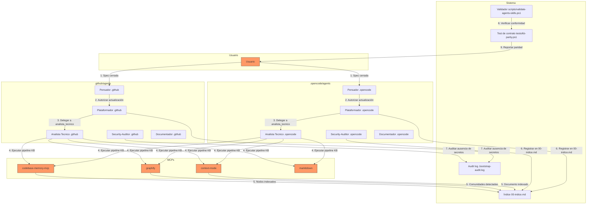
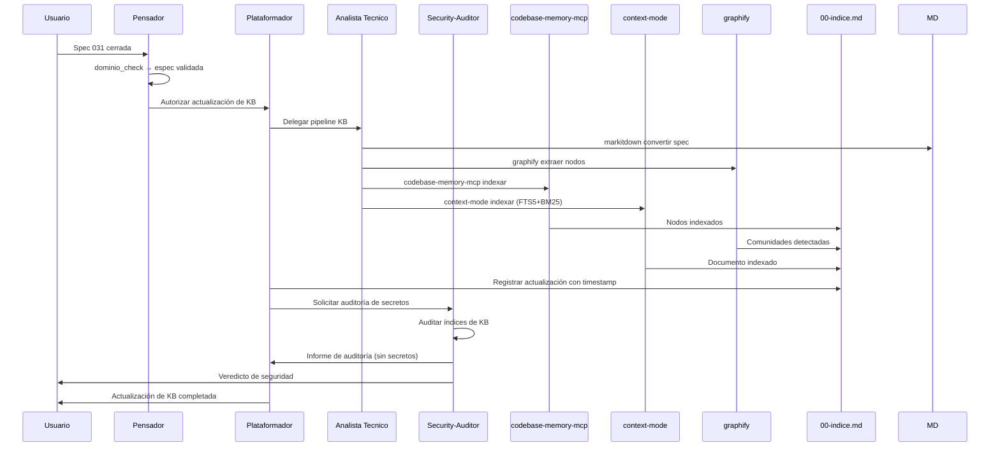

# Threat Model 032 — Actualización de Knowledge Base tras spec validada

## 1. Objetivo y alcance

Este threat model analiza la superficie de ataque del proceso de actualización de Knowledge Base definido en la spec `032-actualizacion-knowledge-base`. Cubre la indexación de specs cerradas en CodeBase (`codebase-memory-mcp`), Context (`context-mode`) y Graphify (`graphify`), el registro en `00-indice.md`, y la paridad entre arneses `.github/` y `.opencode/`.

## 2. Diagrama de flujo de datos (DFD)

## 3. Matriz STRIDE

| Categoría | Amenaza | Activo afectado | Vector de ataque | Probabilidad | Impacto | Nivel de riesgo |
|-----------|---------|-----------------|------------------|--------------|---------|-----------------|
| **S**poofing | Un agente se hace pasar por `analista_tecnico` para indexar contenido no autorizado | Índices de KB | Modificación de frontmatter o sección MCPs | Baja | Medio | Bajo |
| **T**ampering | Indexar contenido modificado o malicioso en KB | CodeBase, Context, Graphify | Pipeline ejecutado sobre spec alterada | Media | Alto | Alto |
| **R**epudiation | Actualización de KB sin registro en `00-indice.md` ni bitácora | `00-indice.md`, bitácora | `plataformador` ejecuta sin registrar | Media | Alto | Alto |
| **I**nformation Disclosure | Indexar credenciales, tokens o secretos en KB | CodeBase, Context, Graphify | Spec contiene secretos y se indexa sin filtrar | Media | Crítico | Alto |
| **D**enial of Service | Fallo de MCP deja la actualización incompleta sin reportarse | `codebase-memory-mcp`, `context-mode`, `graphify` | MCP no disponible durante pipeline | Media | Medio | Medio |
| **E**levation of Privilege | `plataformador` ejecuta actualización sin autorización de `pensador` | `pendientes-implementacion.md`, `00-indice.md` | `plataformador` actúa sin aprobación | Baja | Alto | Medio |

## 4. Registro de riesgos

| ID | Amenaza | Categoría STRIDE | Activo | Vector | Prob. | Impacto | Mitigación | Estado | Residual |
|----|---------|------------------|--------|--------|-------|---------|------------|--------|----------|
| TM-01 | Indexar contenido malicioso en KB | Tampering | CodeBase, Context, Graphify | Pipeline sobre spec alterada | Media | Alto | FR-01 (solo specs cerradas validadas), `dominio_check` de `pensador` antes de disparar | Mitigado | Bajo |
| TM-02 | Indexar secretos en KB | Information Disclosure | CodeBase, Context, Graphify | Spec con credenciales indexada sin filtrar | Media | Crítico | FR-04 (ningún agente escribe secretos), `security-auditor` audita índices (FR-04, CA-04) | Mitigado | Bajo |
| TM-03 | Actualización sin registro | Repudiation | `00-indice.md`, bitácora | `plataformador` no registra la actualización | Media | Alto | FR-05 (registro obligatorio), CA-05 (inspección de `00-indice.md`) | Mitigado | Bajo |
| TM-04 | Fallo de MCP no reportado | Denial of Service | MCPs de KB | `codebase-memory-mcp` o `context-mode` no responden | Media | Medio | FR-08 (fail-closed), registro de errores en bitácora | Mitigado | Bajo |
| TM-05 | Actualización sin autorización | Elevation of Privilege | `00-indice.md`, `pendientes-implementacion.md` | `plataformador` actúa sin aprobación de `pensador` | Baja | Alto | FR-07 (autorización requerida), CA-07 (registro en `pendientes-implementacion.md`) | Mitigado | Bajo |
| TM-06 | Deriva entre arneses | Tampering | Agentes de KB en `.github/` y `.opencode/` | MCP declarado en un arnés pero no en el otro | Media | Alto | FR-06 (paridad), CA-06 (test `tests/kb-parity.ps1`) | Mitigado | Bajo |
| TM-07 | Uso de IA antes que herramientas | Information Disclosure | Índices de KB | `analista_tecnico` usa IA sin ejecutar herramientas primero | Baja | Medio | FR-03 (sin IA de entrada), principio rector del `analista_tecnico` | Mitigado | Bajo |
| TM-08 | Duplicación de nodos | Tampering | CodeBase, Graphify | Reindexación sin control de idempotencia | Media | Medio | FR-09 (idempotencia), CA-09 (verificar conteo de nodos) | Mitigado | Bajo |

## 5. DFD de operaciones críticas (zoom)

## 6. Controles y mitigaciones implementados

| Control | Aplica a | Cómo se verifica |
|---------|----------|------------------|
| `dominio_check` antes de disparar | `pensador` | FR-07, CA-07 |
| No indexar secretos | Todos los agentes | FR-04, CA-04, auditoría de `security-auditor` |
| Registro obligatorio en `00-indice.md` | `plataformador` | FR-05, CA-05, inspección de `00-indice.md` |
| Fail-closed ante fallo de MCP | `analista_tecnico` | FR-08, CA-08, registro de errores |
| Idempotencia de indexación | `analista_tecnico` | FR-09, CA-09, verificar conteo de nodos |
| Paridad de arneses | `plataformador` | FR-06, CA-06, `tests/kb-parity.ps1` |
| Sin IA de entrada | `analista_tecnico` | FR-03, CA-03, principio rector |
| Auditoría de seguridad | `security-auditor` | FR-04, CA-04, informe en `Documentacion/<App>/seguridad/` |

## 7. Casos borde del spec mapeados a amenazas

| Caso borde (spec §13) | Amenaza relacionada | ID riesgo | Contención |
|----------------------|---------------------|-----------|------------|
| Spec cerrada pero sin cambios | Idempotencia | TM-08 | No se reindexa; se registra "sin cambios" |
| MCP `codebase-memory-mcp` no responde | Fail-closed | TM-04 | No se da por exitosa; se registra error |
| Spec contiene credenciales | Information Disclosure | TM-02 | `security-auditor` bloquea la indexación |
| Dos specs cerradas simultáneamente | Repudiation | TM-03 | Se indexan secuencialmente con entradas separadas |
| Proyecto sin `src/` | Elevation of Privilege | TM-05 | Contrato se hereda; `proyecto_tipo` decide alcance |
| `graphify` ya tiene nodos de la spec | Idempotencia | TM-08 | No se duplican nodos |

## 8. Conclusión del threat model

El proceso de actualización de KB de la spec 032 presenta una superficie de ataque controlada. Los 8 riesgos identificados están todos mitigados con controles verificables (FR, CA, validador, test de paridad). El riesgo residual más alto (TM-02, TM-03) se reduce a **Bajo** mediante la prohibición de indexar secretos, el registro obligatorio en `00-indice.md`, y la auditoría de `security-auditor`.

La limitación observada durante el análisis es que no todas las herramientas MCP del pipeline estaban disponibles en el catálogo (`graphify.extract`, `context-mode.ctx_index`, `codebase-memory-mcp.search_graph`). Esto no constituye un riesgo de seguridad, pero sí una limitación operativa que debe resolverse para completar T08, T09 y T10.

El threat model está listo para ser referenciado en la fase de converge.
