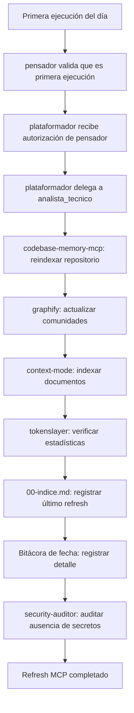
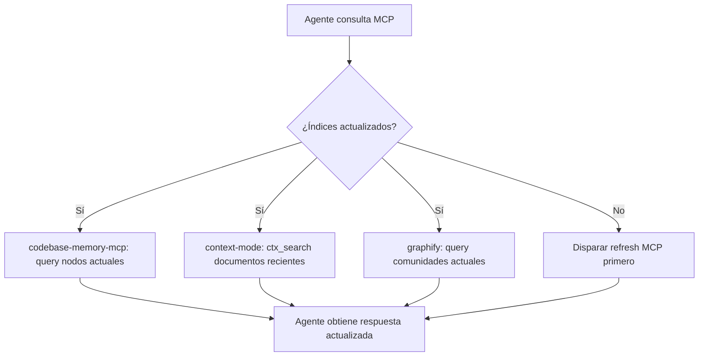

# Spec 033 — Refresh de conocimiento e índices de MCP en la primera ejecución del día

| Campo | Valor |
|---|---|
| **Slug** | `033-refresh-conocimiento-mcp` |
| **App** | `Agents_IA_TECH` (proyecto kit, sin `src/` — Art. X) |
| **Fecha** | 2026-11-01 |
| **Estado** | Especificada (aprobada para `plan.md`) |
| **Constitution aplicable** | `Documentacion/Agents_IA_TECH/.specify/constitution.md` v2.1.0 + Art. X + Art. V + Art. IX |
| **Artefactos hermanos** | `plan.md`, `tasks.md`, `analyze.md`, `threat-model.md`, `converge.md` |
| **Specs relacionados** | `032-actualizacion-knowledge-base` (hermano directo: actualización tras spec cerrada), `020-mcp-config-operativa` (define los 8 MCP hardcodeados) |
| **Absorbe los borradores** | Ninguno — especificación original |

---

## 1. Problema

Los MCP (Model Context Protocol) del proyecto — `codebase-memory-mcp`, `graphify`, `context-mode`, `markitdown`, `tokenslayer`, `github`, `playwright`, `context7` — requieren que sus índices y bases de conocimiento estén actualizados para ser útiles. Hoy no existe un procedimiento definido para refrescar ese conocimiento al inicio de cada jornada de trabajo. Como consecuencia:

1. Los agentes consultan índices desactualizados que no reflejan cambios recientes en specs, agentes, código o documentación.
2. `codebase-memory-mcp` puede devolver nodos obsoletos o faltar nodos nuevos agregados tras el cierre de specs.
3. `graphify` puede no detectar nuevas comunidades ni cambios en la estructura del grafo.
4. `context-mode` puede indexar documentos antiguos y no incluir specs recién validadas.
5. No hay trazabilidad de cuándo se refrescó por última vez el conocimiento de cada MCP.

Este problema se manifiesta cada mañana (o primera ejecución del día) cuando un agente empieza a trabajar sin saber si los índices de conocimiento reflejan el estado actual del proyecto.

---

## 2. Objetivo

Que la primera ejecución del día dispare automáticamente el refresh de conocimiento e índices de todos los MCP del proyecto, definiendo:

1. **Qué se refresca**: índices de `codebase-memory-mcp`, comunidades de `graphify`, documentos indexados de `context-mode`, y cualquier otro MCP registrado en `opencode.json`.
2. **Cuándo se refresca**: en la primera ejecución del día, antes de que cualquier agente realice consultas a los MCPs.
3. **Quién ejecuta**: `plataformador` (orquesta el refresh) + `analista_tecnico` (ejecuta el pipeline sin IA de entrada).
4. **Cómo se verifica**: los índices reflejan el estado actual del proyecto y son consultables vía MCPs; se registra el timestamp del último refresh.

---

## 3. Alcance

### 3.1 Dentro del alcance

- Definición del contrato de refresh de conocimiento MCP en la primera ejecución del día.
- Flujo de propagación: primera ejecución → `codebase-memory-mcp` → `graphify` → `context-mode` → registro en `00-indice.md`.
- Registro del último refresh en `00-indice.md` y en bitácora de fecha.
- Paridad de refresh entre `.github/` y `.opencode/` (mismos MCPs, mismos procedimientos).
- Uso obligatorio de MCPs como herramienta primaria (Regla 1b del AGENTS.md).
- No escritura de código de aplicación; solo actualización de índices de conocimiento.

### 3.2 Fuera del alcance

- Escritura de código de aplicación en `src/<App>/` o `tests/`.
- Modificación del contenido de specs ya cerradas.
- Creación de nuevos MCPs o modificación de MCPs existentes (eso es spec 015/020).
- Ejecución real de comandos en servidores remotos (eso es `solucionador`).
- Cualquier operación destructiva sobre datos o repositorios.
- Refresh de conocimiento en ejecución no matutina (eso queda como operación manual opcional).

---

## 4. Glosario

| Término | Definición |
|---|---|
| **Refresh de conocimiento MCP** | Proceso de actualizar los índices y bases de conocimiento de todos los MCP del proyecto al inicio de cada jornada. |
| **Primera ejecución del día** | La primera vez en un día calendario que un agente invoca cualquier MCP del proyecto. |
| **CodeBase** | Índice de `codebase-memory-mcp`: nodos y aristas del código y documentación del proyecto. |
| **Context** | Índice de `context-mode`: documentos indexados con búsqueda FTS5+BM25. |
| **Graphify** | Índice de `graphify`: grafo con detección de comunidades y queries persistentes. |
| **MCP registrado** | Cualquier servidor MCP declarado en `opencode.json` y citado por al menos un agente (Regla 1b). |
| **Último refresh** | Timestamp de la última actualización exitosa de los índices de todos los MCP. |
| **Fail-closed** | Ante error de verificación o registro ausente, el refresh no se da por exitoso. |
| **Sin IA de entrada** | Principio del `analista_tecnico`: las herramientas se ejecutan antes de usar IA; la IA solo actúa bajo demanda. |

---

## 5. Roles y dominios

| Agente | Rol en el refresh MCP | Escribe en | No escribe en | SSH |
|---|---|---|---|---|
| `plataformador` | Orquesta el refresh MCP en la primera ejecución del día; verifica que los índices reflejen el estado actual | `Documentacion/<App>/bitacoras/`, `00-indice.md` | Código de aplicación, `src/`, `scripts/` | No |
| `analista_tecnico` | Ejecuta el pipeline de refresh sin IA de entrada: `codebase-memory-mcp` → `graphify` → `context-mode` | `Documentacion/<App>/` (índices, memoria de análisis) | `src/`, `scripts/` | No |
| `pensador` | Valida que sea la primera ejecución del día antes de autorizar el refresh; autoriza la transición | `Documentacion/<App>/`, `.github/`, `.opencode/`, `.doc_agents/`, `README.md` | `src/`, `scripts/`, `tests/` | Solo lectura |
| `documentador` | Registra el último refresh en `00-indice.md` y en bitácora de fecha | `Documentacion/<App>/`, `00-indice.md` | `src/`, `scripts/` | No |
| `developer` | No participa en el refresh MCP | — | Todo el kit | No |
| `security-auditor` | Audita que el refresh no exponga secretos ni datos sensibles en los índices | `Documentacion/<App>/seguridad/` | `src/`, `scripts/` | No |

**Regla transversal**: ningún agente escribe credenciales, tokens ni secretos en los índices de MCP durante el refresh.

---

## 6. Matriz de permisos por operación

| Operación | Quién | Autorización | Registro |
|---|---|---|---|
| Refrescar índice de codebase-memory-mcp | `analista_tecnico` | No (dentro de su dominio) | Entrada en bitácora + `00-indice.md` |
| Refrescar comunidades de graphify | `analista_tecnico` | No (dentro de su dominio) | Entrada en bitácora + `00-indice.md` |
| Refrescar documentos de context-mode | `analista_tecnico` | No (dentro de su dominio) | Entrada en bitácora + `00-indice.md` |
| Orquestar refresh MCP | `plataformador` | Aprobación del `pensador` | `pendientes-implementacion.md` |
| Validar primera ejecución del día | `pensador` | No | Registro en `00-indice.md` |
| Registrar último refresh | `documentador` | No | `00-indice.md` |
| Auditar ausencia de secretos en índices | `security-auditor` | No | Informe de auditoría en `Documentacion/<App>/seguridad/` |

---

## 7. Historias de usuario

### US-01 — Refresh automático en primera ejecución del día

**Como** usuario, **quiero** que al iniciar la primera sesión del día se refresquen automáticamente los índices de todos los MCP, **para** que los agentes consulten información actualizada sin leer archivos directamente.

**Escenarios**

1. Primera ejecución del día → `pensador` valida que es la primera ejecución → `plataformador` orquesta el refresh → `analista_tecnico` ejecuta el pipeline → `00-indice.md` refleja el timestamp del último refresh.
2. Agente consulta "permisos de desarrollador" vía `codebase-memory-mcp` → obtiene nodos actualizados que reflejan el cierre de la spec 031.

### US-02 — No IA de entrada en el refresh

**Como** usuario, **quiero** que el pipeline de refresh MCP use herramientas (codebase-memory-mcp, graphify, context-mode) antes de usar IA, **para** ganar velocidad y eficiencia y evitar gastos de tokens innecesarios.

**Escenarios**

1. `analista_tecnico` ejecuta `codebase-memory-mcp.index_repository` para reindexar el repositorio, luego `graphify` para actualizar comunidades, luego `context-mode.ctx_index` para indexar documentos, y solo si falta información usa IA bajo demanda.

### US-03 — Registro trazable del último refresh

**Como** usuario, **quiero** que cada refresh MCP quede registrado con timestamp, MCP actualizados y resultado, **para** saber cuándo se actualizó por última vez el conocimiento.

**Escenarios**

1. Entrada en `00-indice.md`: `| 033 | 2026-11-01 08:00 | Refresh MCP: codebase-memory-mcp, graphify, context-mode | plataformador | OK |`
2. Bitácora de fecha con detalles de comandos ejecutados y resultados.

### US-04 — Paridad de harnesses

**Como** usuario, **quiero** que el refresh MCP sea idéntico en `.github/` y `.opencode/`, **para** que ambos arneses tengan los mismos índices de conocimiento.

**Escenarios**

1. `codebase-memory-mcp` indexa los mismos nodos en ambos arneses.
2. `context-mode` tiene los mismos documentos indexados en ambos arneses.

---

## 8. Requisitos funcionales

| ID | Requisito | Verificación |
|---|---|---|
| **FR-01** | La primera ejecución del día dispara el refresh de todos los MCP registrados. | `00-indice.md` refleja el timestamp del último refresh |
| **FR-02** | El refresh cubre todos los MCP de `opencode.json` declarados por al menos un agente. | VAL-07 = 0 (todos los MCP citados) |
| **FR-03** | `analista_tecnico` ejecuta el pipeline sin IA de entrada; IA solo bajo demanda. | Sección Enfoque de `analista_tecnico` |
| **FR-04** | Ningún agente escribe credenciales, tokens ni secretos en los índices de MCP. | `security-auditor` verifica ausencia de secretos |
| **FR-05** | El refresh se registra en `00-indice.md` con timestamp, MCPs actualizados y resultado. | Inspección de `00-indice.md` |
| **FR-06** | El refresh es idéntico en `.github/` y `.opencode/`. | Test de paridad de índices |
| **FR-07** | `plataformador` orquesta el refresh solo tras autorización del `pensador`. | Registro en `pendientes-implementacion.md` |
| **FR-08** | El refresh es fail-closed: si un MCP no responde, la operación no se da por exitosa. | Registro de errores en bitácora |
| **FR-09** | El refresh es idempotente: reejecutar el mismo día no duplica nodos ni documentos. | Repetir refresh y verificar conteo de nodos |
| **FR-10** | `graphify` detecta nuevas comunidades tras el refresh. | Query de comunidades en graphify |
| **FR-11** | `context-mode` indexa documentos para búsqueda FTS5+BM25 tras el refresh. | Query FTS en context-mode |
| **FR-12** | `codebase-memory-mcp` indexa nodos y aristas tras el refresh. | Query de nodos en codebase-memory-mcp |

---

## 9. Requisitos no funcionales

| ID | Requisito |
|---|---|
| **NFR-01** | **Determinismo**: dos refresh MCP sobre el mismo estado dan el mismo resultado en los índices. |
| **NFR-02** | **Portabilidad**: funciona en cualquier máquina y proyecto consumidor; no depende de rutas absolutas. |
| **NFR-03** | **Idempotencia**: reejecutar el refresh no duplica nodos ni documentos. |
| **NFR-04** | **Trazabilidad**: cada refresh deja registro con timestamp, agente, operación, alcance y resultado. |
| **NFR-05** | **Fail-closed**: ante error de verificación o registro ausente, el refresh no se da por exitoso. |
| **NFR-06** | **Bajo costo**: el refresh usa MCPs y herramientas deterministas; la IA solo bajo demanda. |
| **NFR-07** | **Legibilidad**: cada sección del contrato de refresh se entiende sin contexto externo; sin placeholders. |

---

## 10. Modelo de datos

### 10.1 Registro de refresh en `00-indice.md`

| Campo | Valor ejemplo |
|---|---|
| Spec | `033-refresh-conocimiento-mcp` |
| Fecha | `2026-11-01` |
| Hora | `08:00` |
| Agente | `plataformador` |
| MCPs actualizados | `codebase-memory-mcp`, `graphify`, `context-mode`, `markitdown`, `tokenslayer`, `github`, `playwright`, `context7` |
| Nodos indexados | `11399` |
| Resultado | `OK` |
| Bitácora | `Documentacion/Agents_IA_TECH/bitacoras/2026-11-01-refresh-mcp.md` |

### 10.2 Registro en bitácora de fecha

```markdown
# Bitácora: 2026-11-01 - Refresh MCP primera ejecución del día

## Operación
Refresh de conocimiento e índices de MCP en la primera ejecución del día.

## Ejecutor
`plataformador` (orquesta), `analista_tecnico` (ejecuta pipeline).

## Comandos ejecutados
1. `codebase-memory-mcp index_repository <root>`
2. `graphify extract --code-only <root>`
3. `context-mode ctx_index <docs>`
4. `tokenslayer get_stats` (verificación)

## Resultado
- CodeBase: 11399 nodos indexados, 0 errores
- Graphify: 4973 nodos, 467 comunidades, 0 errores
- Context: 9 documentos indexados, 0 errores
- 00-indice.md actualizado con timestamp del último refresh
```

---

## 11. Flujos

### 11.1 Flujo de refresh MCP en primera ejecución del día



### 11.2 Flujo de consulta a MCP tras refresh



---

## 12. Criterios de aceptación

| ID | Criterio | Verificación concreta |
|---|---|---|
| **CA-01** | La primera ejecución del día dispara refresh de todos los MCP. | `00-indice.md` refleja timestamp del último refresh |
| **CA-02** | Refresh cubre todos los MCP de `opencode.json`. | VAL-07 = 0 |
| **CA-03** | `analista_tecnico` ejecuta sin IA de entrada. | Sección Enfoque de `analista_tecnico` |
| **CA-04** | No hay credenciales, tokens ni secretos en índices de MCP. | `security-auditor` verifica ausencia |
| **CA-05** | Registro en `00-indice.md` con timestamp, MCPs, resultado. | Inspección de `00-indice.md` |
| **CA-06** | Refresh idéntico en `.github/` y `.opencode/`. | Test de paridad de índices |
| **CA-07** | `plataformador` orquesta solo con autorización de `pensador`. | Registro en `pendientes-implementacion.md` |
| **CA-08** | Fail-closed: si un MCP falla, el refresh no es exitoso. | Registro de errores en bitácora |
| **CA-09** | Idempotencia: reejecutar el mismo día no duplica nodos. | Repetir refresh y verificar conteo |
| **CA-10** | `graphify` detecta comunidades tras el refresh. | Query de comunidades en graphify |
| **CA-11** | `context-mode` indexa para búsqueda FTS5+BM25. | Query FTS en context-mode |
| **CA-12** | `codebase-memory-mcp` indexa nodos y aristas. | Query de nodos en codebase-memory-mcp |

**Estado medido**: CA-01..CA-12 pendientes de implementación. La spec 033 está en fase de especificación.

---

## 13. Casos borde

| Caso | Comportamiento esperado |
|---|---|
| Primera ejecución del día ya hubo refresh (ej. sesión previa) | No se reejecuta; se registra "ya refrescado hoy" en bitácora |
| MCP `codebase-memory-mcp` no disponible | Fail-closed (FR-08); no se da por exitoso; se registra error |
| Spec contiene credenciales o secretos | `security-auditor` bloquea la indexación (FR-04); se registra en bitácora de seguridad |
| Ejecución en horario no matutino | No se dispara automáticamente; queda como operación manual opcional |
| Proyecto consumidor sin `src/` | El refresh se hereda igual; `proyecto_tipo` decide el alcance (spec 030) |
| `graphify` ya tiene nodos del día | No se duplican (NFR-03 idempotencia) |

---

## 14. Riesgos

| ID | Riesgo | Prob. | Impacto | Mitigación |
|---|---|---|---|---|
| R-01 | Indexar secretos en índices MCP | Baja | Crítico | FR-04 + auditoría de `security-auditor` |
| R-02 | Duplicar nodos en reejecución del mismo día | Media | Medio | NFR-03 idempotencia + verificación de conteo |
| R-03 | MCP no disponible durante refresh | Media | Alto | FR-08 fail-closed + registro de errores |
| R-04 | Refresh solo en un arnés | Media | Alto | FR-06 + test de paridad de índices |
| R-05 | IA usada antes que herramientas en refresh | Baja | Medio | FR-03 + principio "sin IA de entrada" de `analista_tecnico` |
| R-06 | Ejecutar refresh en horario no matutino como automático | Baja | Bajo | FR-01 (solo primera ejecución del día) |

---

## 15. Dependencias y specs hermanos

| Spec | Relación |
|---|---|
| **032 — actualización de Knowledge Base** | Hermano directo. 032 actualiza KB tras cierre de una spec específica; 033 hace refresh diario de todos los MCP. No hay superposición; se complementan. |
| **020 — MCP config operativa** | Define los 8 MCP hardcodeados (`codebase-memory-mcp`, `graphify`, `context-mode`, `markitdown`, `tokenslayer`, `github`, `playwright`, `context7`). 033 los refresca todos en la primera ejecución del día. |
| **031 — permisos y dominio de agentes** | Define el contrato de agentes que usan los MCP. 033 depende de que 031 esté cerrada para saber qué agentes declaran qué MCP. |

---

## 16. Plan de verificación

```powershell
# 1. Verificar que sea la primera ejecución del día
# (timestamp en 00-indice.md del último refresh)

# 2. Ejecutar refresh de MCP
# codebase-memory-mcp → graphify → context-mode → tokenslayer

# 3. Verificar que 00-indice.md refleje el último refresh
Select-String -Path Documentacion/Agents_IA_TECH/00-indice.md -Pattern '033.*refresh'

# 4. Verificar paridad .github <-> .opencode
# Los mismos MCPs refrescan el mismo contenido en ambos arneses

# 5. Verificar ausencia de secretos en índices
security-auditor audita los índices de MCP
```

---

## 17. Trazabilidad con la Constitución

| Artículo | Cómo lo cumple 033 |
|---|---|
| Art. III — Test-First | Cada FR tiene verificación concreta; CA-01..CA-12 bloquean el cierre sin verificación |
| Art. IV/VII — Simplicidad | Un solo contrato de refresh MCP; sin capa nueva de runtime |
| Art. V — Seguridad | No se indexan secretos; `security-auditor` audita los índices |
| Art. IX — Integration-First | Verificación contra archivos reales y MCPs, no supuestos |
| Art. X — Kit sin `src/` | El dominio de refresh se declara explícitamente para cada tier |

---

## 18. Decisiones registradas

| ID | Decisión | Motivo |
|---|---|---|
| **D-01** | `plataformador` orquesta, `analista_tecnico` ejecuta el pipeline de refresh. | Separación de responsabilidades: `plataformador` decide y verifica; `analista_tecnico` ejecuta mecánica sin IA de entrada. |
| **D-02** | El refresh solo se dispara en la primera ejecución del día. | Evita reejecuciones innecesarias y gastos de tokens; coincide con el ciclo diario de trabajo. |
| **D-03** | Refresh cubre todos los 8 MCP de `opencode.json`. | Coherente con VAL-07 y Regla 1b: todo MCP registrado debe tener un agente declarante y ser mantenido. |
| **D-04** | El refresh se registra en `00-indice.md`. | Es el índice central del proyecto; fuente de verdad para todos los agentes. |
| **D-05** | Fail-closed ante fallo de cualquier MCP. | Evita dar por exitoso un refresh incompleto; coherente con NFR-05 de 031 y 032. |
