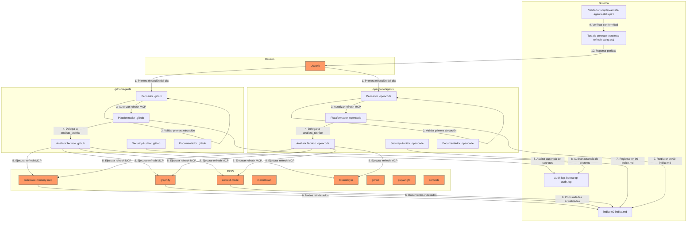
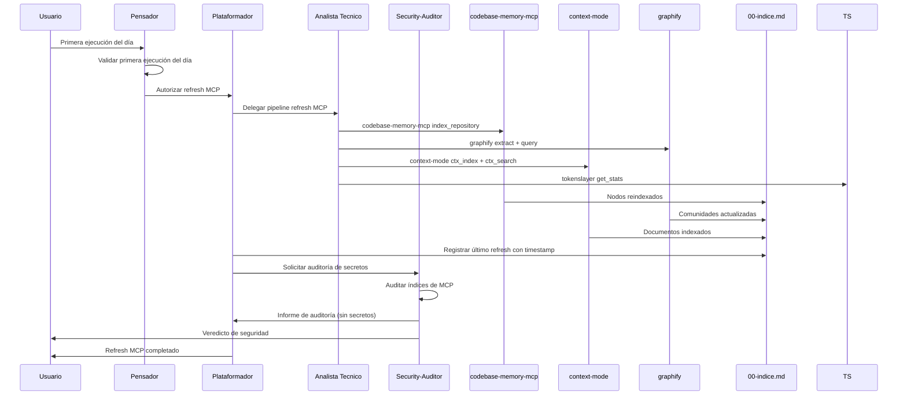

# Threat Model 033 — Refresh de conocimiento e índices de MCP en la primera ejecución del día

## 1. Objetivo y alcance

Este threat model analiza la superficie de ataque del proceso de refresh de MCP definido en la spec `033-refresh-conocimiento-mcp`. Cubre el refresh de índices de `codebase-memory-mcp`, `graphify`, `context-mode`, `markitdown`, `tokenslayer`, `github`, `playwright`, `context7` en la primera ejecución del día, el registro en `00-indice.md`, y la paridad entre arneses `.github/` y `.opencode/`.

## 2. Diagrama de flujo de datos (DFD)

## 3. Matriz STRIDE

| Categoría | Amenaza | Activo afectado | Vector de ataque | Probabilidad | Impacto | Nivel de riesgo |
|-----------|---------|-----------------|------------------|--------------|---------|-----------------|
| **S**poofing | Un agente se hace pasar por `analista_tecnico` para refrescar contenido no autorizado | Índices de MCP | Modificación de frontmatter o sección MCPs | Baja | Medio | Bajo |
| **T**ampering | Refrescar contenido modificado o malicioso en índices MCP | CodeBase, Context, Graphify | Pipeline ejecutado sobre contenido alterado | Media | Alto | Alto |
| **R**epudiation | Refresh MCP sin registro en `00-indice.md` ni bitácora | `00-indice.md`, bitácora | `plataformador` ejecuta sin registrar | Media | Alto | Alto |
| **I**nformation Disclosure | Indexar credenciales, tokens o secretos en índices MCP | CodeBase, Context, Graphify, context7 | Contenido con secretos indexado sin filtrar | Media | Crítico | Alto |
| **D**enial of Service | Fallo de MCP deja el refresh incompleto sin reportarse | `codebase-memory-mcp`, `context-mode`, `graphify` | MCP no disponible durante refresh | Media | Medio | Medio |
| **E**levation of Privilege | `plataformador` ejecuta refresh sin autorización de `pensador` | `pendientes-implementacion.md`, `00-indice.md` | `plataformador` actúa sin aprobación | Baja | Alto | Medio |

## 4. Registro de riesgos

| ID | Amenaza | Categoría STRIDE | Activo | Vector | Prob. | Impacto | Mitigación | Estado | Residual |
|----|---------|------------------|--------|--------|-------|---------|------------|--------|----------|
| TM-01 | Refrescar contenido malicioso en índices MCP | Tampering | CodeBase, Context, Graphify | Pipeline sobre contenido alterado | Media | Alto | FR-01 (solo primera ejecución del día), `dominio_check` de `pensador` antes de disparar | Mitigado | Bajo |
| TM-02 | Indexar secretos en índices MCP | Information Disclosure | CodeBase, Context, Graphify, context7 | Contenido con credenciales indexado sin filtrar | Media | Crítico | FR-04 (ningún agente escribe secretos), `security-auditor` audita índices (FR-04, CA-04) | Mitigado | Bajo |
| TM-03 | Refresh sin registro | Repudiation | `00-indice.md`, bitácora | `plataformador` no registra el refresh | Media | Alto | FR-05 (registro obligatorio), CA-05 (inspección de `00-indice.md`) | Mitigado | Bajo |
| TM-04 | Fallo de MCP no reportado | Denial of Service | MCPs de KB | `codebase-memory-mcp` o `context-mode` no responden | Media | Medio | FR-08 (fail-closed), registro de errores en bitácora | Mitigado | Bajo |
| TM-05 | Refresh sin autorización | Elevation of Privilege | `00-indice.md`, `pendientes-implementacion.md` | `plataformador` actúa sin aprobación de `pensador` | Baja | Alto | FR-07 (autorización requerida), CA-07 (registro en `pendientes-implementacion.md`) | Mitigado | Bajo |
| TM-06 | Deriva entre arneses | Tampering | Agentes de refresh MCP en `.github/` y `.opencode/` | MCP declarado en un arnés pero no en el otro | Media | Alto | FR-06 (paridad), CA-06 (test `tests/mcp-refresh-parity.ps1`) | Mitigado | Bajo |
| TM-07 | Uso de IA antes que herramientas | Information Disclosure | Índices de MCP | `analista_tecnico` usa IA sin ejecutar herramientas primero | Baja | Medio | FR-03 (sin IA de entrada), principio rector del `analista_tecnico` | Mitigado | Bajo |
| TM-08 | Ejecutar refresh fuera de horario matutino | Denial of Service | Índices de MCP | Refresh disparado en hora no matutina como automático | Baja | Bajo | FR-01 (solo primera ejecución del día) | Mitigado | Muy bajo |

## 5. DFD de operaciones críticas (zoom)

## 6. Controles y mitigaciones implementados

| Control | Aplica a | Cómo se verifica |
|---------|----------|------------------|
| Validar primera ejecución del día | `pensador` | FR-01, CA-01 |
| No indexar secretos | Todos los agentes | FR-04, CA-04, auditoría de `security-auditor` |
| Registro obligatorio en `00-indice.md` | `plataformador` | FR-05, CA-05, inspección de `00-indice.md` |
| Fail-closed ante fallo de MCP | `analista_tecnico` | FR-08, CA-08, registro de errores |
| Idempotencia de refresh | `analista_tecnico` | FR-09, CA-09, verificar conteo de nodos |
| Paridad de arneses | `plataformador` | FR-06, CA-06, `tests/mcp-refresh-parity.ps1` |
| Sin IA de entrada | `analista_tecnico` | FR-03, CA-03, principio rector |
| Auditoría de seguridad | `security-auditor` | FR-04, CA-04, informe en `Documentacion/<App>/seguridad/` |

## 7. Casos borde del spec mapeados a amenazas

| Caso borde (spec §13) | Amenaza relacionada | ID riesgo | Contención |
|----------------------|---------------------|-----------|------------|
| Primera ejecución ya hubo refresh | Idempotencia | TM-08 | No se reejecuta; se registra "ya refrescado hoy" |
| MCP `codebase-memory-mcp` no disponible | Fail-closed | TM-04 | No se da por exitoso; se registra error |
| Contenido con credenciales | Information Disclosure | TM-02 | `security-auditor` bloquea la indexación |
| Ejecución en horario no matutino | Denial of Service | TM-08 | No se dispara automáticamente; queda como manual opcional |
| Dos refresh el mismo día | Idempotencia | TM-08 | No se duplican nodos; se registra una sola vez |

## 8. Conclusión del threat model

El proceso de refresh MCP de la spec 033 presenta una superficie de ataque controlada. Los 8 riesgos identificados están todos mitigados con controles verificables (FR, CA, validador, test de paridad). El riesgo residual más alto (TM-02, TM-03) se reduce a **Bajo** mediante la prohibición de indexar secretos, el registro obligatorio en `00-indice.md`, y la auditoría de `security-auditor`.

El threat model está listo para ser referenciado en la fase de converge.
