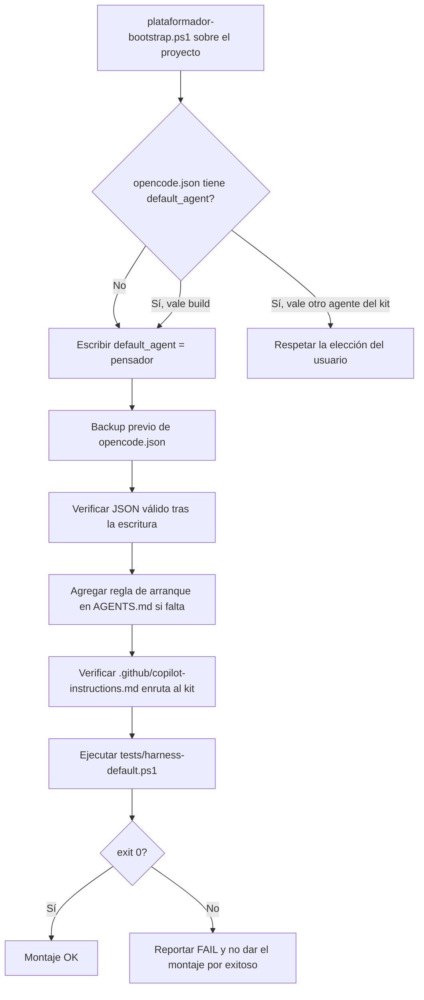
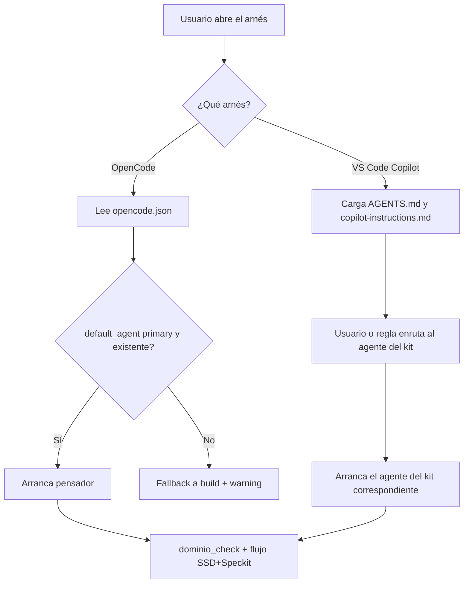
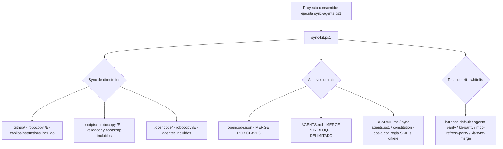

# Spec 034 — Arranque por defecto con agentes del kit

| Campo | Valor |
|---|---|
| **Slug** | `034-arranque-agentes-por-defecto` |
| **App** | `Agents_IA_TECH` (proyecto kit, sin `src/` — Art. X) |
| **Fecha** | 2026-11-01 |
| **Estado** | Especificada — aprobada para implementación por el usuario |
| **Constitution aplicable** | `Documentacion/Agents_IA_TECH/.specify/constitution.md` v2.1.0 + Art. III, IV/VII, V, IX, X |
| **Artefactos hermanos** | `plan.md`, `tasks.md`, `analyze.md`, `threat-model.md`, `converge.md` |
| **Specs relacionados** | `031-permisos-y-dominio-de-agentes` (define el bloque `permission` de cada agente), `020-mcp-config-operativa` (define `opencode.json`), `026` (unificación de implementadores) |
| **Decisión del usuario** | 2026-11-01: `pensador` como `default_agent`; respetar mecanismos nativos del arnés **y** mantener el flujo del kit idéntico entre `.github/` y `.opencode/` |

---

## 1. Problema

El kit se monta correctamente en disco pero **nunca declara con qué agente arranca cada arnés**. Consecuencias medidas hoy en este repositorio:

| Hecho verificado | Evidencia |
|---|---|
| `opencode.json` declara `"default_agent": "build"` | `opencode.json` línea 5 |
| `build` es un agente **incorporado** de OpenCode, no del kit | Documentación oficial de OpenCode (`default_agent`) |
| `.opencode/agents/` contiene los 13 agentes del kit y OpenCode sí los carga | `read` del directorio + docs (`.opencode/agents/*.md`) |
| Solo 7 de 13 agentes declaran `mode: primary` | `pensador`, `Agent-SSD`, `analista_tecnico`, `arquitecto`, `documentador`, `solucionador`, `upgrade_framework` |
| `.github/copilot-instructions.md` es un puntero de 9 líneas sin regla de arranque | Lectura del archivo |
| Existe una carpeta huérfana `.opencode/agents/pensador/spec.md` | `read` del directorio `.opencode/agents/pensador` |

Resultado: al abrir OpenCode o el chat de Copilot, el arnés usa **su** agente nativo. El usuario tiene que acordarse de seleccionar el agente del kit en cada sesión, y no hay ninguna regla que lo obligue. El flujo SSD+Speckit definido en el kit queda así dependiente de la memoria del operador, no del montaje.

Además, el modelo de permisos de `pensador` (spec 031) deniega `edit` fuera de `Documentacion/**`, `.github/**`, `.opencode/**` y `**README.md`. Ese dato es relevante para la decisión de arranque: si el `pensador` es el agente por defecto, la primera edición de `opencode.json` o de `src/` será rechazada y deberá delegarse.

---

## 2. Objetivo

Que al montar el kit en cualquier proyecto, cada arnés **arranque por defecto con un agente del kit** y lo haga **sin romper los mecanismos nativos** del arnés:

1. **OpenCode**: `default_agent` apunta a un agente del kit con `mode: primary` (`pensador`).
2. **VS Code Copilot**: la regla de arranque viaja en instrucciones *always-on* (`AGENTS.md` + `.github/copilot-instructions.md`), porque VS Code no expone un setting de agente por defecto para agentes custom.
3. **Bootstrap**: `scripts/plataformador-bootstrap.ps1` asegura el arranque en cada montaje, de forma idempotente y sin pisar una elección explícita del usuario.
4. **Verificación**: test de contrato + regla de validación que fallen si el arranque se degrada.

---

## 3. Alcance

### 3.1 Dentro del alcance

- Declarar `default_agent` en `opencode.json` con un agente del kit.
- Declarar la regla transversal de arranque en `AGENTS.md`.
- Enrutar `.github/copilot-instructions.md` al agente del kit sin duplicar reglas.
- Asegurar el arranque desde `scripts/plataformador-bootstrap.ps1` (idempotente, con backup previo).
- Test de contrato `tests/harness-default.ps1` con fixture negativo.
- Regla `VAL-10` en `scripts/validate-agents-skills.ps1`.
- Higiene: retirar `.opencode/agents/pensador/spec.md`.
- Documentar el arranque en `README.md`.

### 3.2 Fuera del alcance

- Modificar el bloque `permission` de los agentes (spec 031, ya cerrada).
- Crear un agente "router" nuevo (decisión D-02: YAGNI).
- Instalar o configurar MCPs (spec 020).
- Cambiar el pipeline SSD+Speckit (spec 025/031).
- Forzar un agente por defecto en el chat de VS Code: no existe ese ajuste documentado; se resuelve con instrucciones always-on.
- Ejecutar operaciones sobre servidores remotos.

---

## 4. Glosario

| Término | Definición |
|---|---|
| **Arranque por defecto** | Agente que el arnés usa cuando el usuario no especifica ninguno al iniciar la sesión. |
| **Agente del kit** | Agente definido en `.opencode/agents/<nombre>.md` y `.github/agents/<nombre>.agent.md`. |
| **Agente incorporado** | Agente nativo del arnés (`build`, `plan` en OpenCode; agentes base de Copilot). No pertenece al kit. |
| **`mode: primary`** | Modo de OpenCode que habilita al agente como agente de arranque. Un `default_agent` no-primary provoca fallback a `build`. |
| **Instrucción always-on** | Regla que el arnés carga en toda sesión sin intervención del usuario (`AGENTS.md`, `copilot-instructions.md`). |
| **Fallback silencioso** | Degradación de OpenCode a `build` cuando `default_agent` no existe o no es primary; emite warning pero la sesión continúa. |
| **Montaje del kit** | Ejecución de `scripts/plataformador-bootstrap.ps1` sobre un proyecto para instalar/sincronizar el kit. |
| **Mecanismo nativo** | Permisos (`permission`), modos (`primary`/`subagent`/`all`), aprobaciones de herramientas y descubrimiento de archivos propios de cada arnés. |

---

## 5. Roles y dominios

| Agente | Rol en esta spec | Escribe en | No escribe en |
|---|---|---|---|
| `pensador` | Especifica, orquesta y valida; autoriza la transición a implementación | `Documentacion/**`, `.github/**`, `.opencode/**`, `README.md` | `opencode.json`, `AGENTS.md`, `scripts/`, `tests/` (denegado por su `permission`) |
| `developer` | Implementa los cambios de configuración y el test de contrato | `opencode.json`, `AGENTS.md`, `scripts/`, `tests/` | `Documentacion/**` (salvo reporte) |
| `arquitecto` | Produce `analyze.md` y valida decisiones de arranque | `Documentacion/**` | Código y configuración |
| `security-auditor` | Produce `threat-model.md` y audita el riesgo de un default con permisos amplios | `Documentacion/**` | Código y configuración |
| `documentador` | Produce `converge.md` y actualiza `00-indice.md` y `README.md` | `Documentacion/**`, `README.md` | Código y configuración |
| `plataformador` | Mantiene `plataformador-bootstrap.ps1` y verifica el montaje | `scripts/` | `Documentacion/**` de otras apps |

**Regla de dominio**: ningún agente documental toca `opencode.json` ni `AGENTS.md`. Esos archivos entran por delegación al `developer`.

---

## 6. Matriz de decisión por arnés

| Arnés | ¿Tiene setting de agente por defecto? | Palanca usada | Motivo |
|---|---|---|---|
| **OpenCode** | Sí: `default_agent` en `opencode.json` (aplica a TUI, `opencode run`, desktop y GitHub Action) | `default_agent: "pensador"` | Es el mecanismo nativo documentado; exige `mode: primary` |
| **VS Code Copilot** | No hay setting documentado para agentes custom | `AGENTS.md` + `.github/copilot-instructions.md` (always-on) + selección en el dropdown de agentes | Los `.agent.md` se descubren solos, pero la selección es por sesión |
| **Monorepo / subcarpeta abierta** | Parcial: `chat.useCustomizationsInParentRepositories` (desactivado por defecto) | Documentar el setting en `README.md` | Sin él, VS Code no descubre `.github/agents/` del repo padre |
| **GitHub Action** | Hereda `default_agent` de `opencode.json` | Igual que OpenCode | El setting aplica a todas las interfaces |

---

## 7. Historias de usuario

### US-01 — Arranque con el agente del kit

**Como** usuario del kit, **quiero** que al abrir OpenCode la sesión arranque con `pensador` (y no con `build`), **para** que el flujo SSD+Speckit se aplique sin tener que seleccionar el agente a mano en cada sesión.

Escenarios:

1. Abro OpenCode tras el montaje → el agente activo es `pensador` → la primera petición pasa por `dominio_check`.
2. Abro OpenCode en un proyecto donde ya elegí otro agente del kit → el bootstrap **no** pisa mi elección (D-04).

### US-02 — Arranque en VS Code Copilot

**Como** usuario del kit, **quiero** que el chat de Copilot reciba la regla de enrutamiento al agente del kit, **para** que no dependa de que yo recuerde abrir el dropdown de agentes.

Escenarios:

1. Abro el chat sin seleccionar agente → las instrucciones always-on indican que debo enrutar por el agente del kit correspondiente.
2. Abro una subcarpeta del monorepo → el `README.md` documenta `chat.useCustomizationsInParentRepositories` para descubrir los agentes del repo padre.

### US-03 — Respeto de los mecanismos nativos

**Como** responsable del kit, **quiero** que el arranque no altere permisos, modos ni aprobaciones del arnés, **para** que el kit siga siendo portable y no rompa la seguridad del harness.

Escenarios:

1. `default_agent` apunta a un agente con `mode: primary` → no hay fallback.
2. El cambio de `default_agent` no modifica ningún bloque `permission` de ningún agente.
3. El frontmatter de cada arnés conserva sus campos nativos (`tools`/`user-invocable` en `.github`; `mode`/`temperature`/`permission` en `.opencode`).

### US-04 — Flujo idéntico entre arneses

**Como** usuario del kit, **quiero** que `.github/` y `.opencode/` declaren el mismo flujo (specify → plan → tasks → analyze → converge → implement) y el mismo punto de arranque, **para** que el comportamiento no dependa del arnés que use.

Escenarios:

1. La regla de arranque aparece con el mismo texto normativo en ambos arneses.
2. El test de contrato falla si un arnés pierde la regla de arranque.

---

## 8. Requisitos funcionales

| ID | Requisito | Verificación |
|---|---|---|
| **FR-01** | `opencode.json` declara `default_agent` con un agente del kit (`pensador`). | Lectura de `opencode.json` + `tests/harness-default.ps1` |
| **FR-02** | El valor de `default_agent` corresponde a un archivo `.opencode/agents/<nombre>.md` existente con `mode: primary`. | Script de contrato |
| **FR-03** | Si `default_agent` falta, apunta a un agente inexistente o no-primary, la verificación falla (no se acepta fallback silencioso). | `tests/harness-default.ps1` exit 1 |
| **FR-04** | `AGENTS.md` contiene la regla transversal de arranque aplicable a todos los harness. | Inspección de `AGENTS.md` |
| **FR-05** | `.github/copilot-instructions.md` enruta al agente del kit correspondiente sin duplicar el cuerpo de reglas. | Inspección del archivo + test de contrato |
| **FR-06** | La regla de arranque es equivalente en `.github/` y `.opencode/` (mismo agente, mismo criterio de enrutamiento). | Test de contrato (comparación de bloques) |
| **FR-07** | `scripts/plataformador-bootstrap.ps1` asegura `default_agent` en cada montaje de forma idempotente. | Ejecución del bootstrap en modo `-DryRun` |
| **FR-08** | El bootstrap solo escribe `default_agent` si falta o vale `build`; si vale otro agente del kit, lo respeta. | Revisión de código + `-DryRun` |
| **FR-09** | Ningún cambio de esta spec modifica bloques `permission` de agentes existentes. | `git diff` limitado a las claves declaradas |
| **FR-10** | `scripts/validate-agents-skills.ps1` incorpora `VAL-10` (arranque válido) como FAIL, no WARN. | Ejecución del validador |
| **FR-11** | Existe `tests/harness-default.ps1` con fixture negativo que detecta `default_agent: build`. | Ejecución del test |
| **FR-12** | Se retira `.opencode/agents/pensador/spec.md` (carpeta huérfana dentro de `agents/`). | `Test-Path` negativo |
| **FR-13** | `README.md` documenta el arranque por defecto y el setting `chat.useCustomizationsInParentRepositories`. | Inspección del README |
| **FR-14** | `scripts/sync-kit.ps1` aplica **merge por claves** sobre `opencode.json`: gestiona `$schema`, `instructions` y `default_agent`; preserva `mcp`, `model`, `small_model`, `permission`, `lsp` y cualquier clave desconocida. | `tests/kit-sync-merge.ps1` |
| **FR-15** | En el sync, `default_agent` se corrige si falta, vale `build` o apunta a un agente inexistente o no-primary; se preserva si es otro agente del kit con `mode: primary`; con `-Force` se sobrescribe con el valor del maestro. | `tests/kit-sync-merge.ps1` (4 casos) |
| **FR-16** | `AGENTS.md` se sincroniza por **bloque delimitado** (`<!-- KIT-BLOCK:START arranque-por-defecto -->` … `<!-- KIT-BLOCK:END arranque-por-defecto -->`): reemplaza el bloque si existe, migra la sección sin marcadores si ya estaba, y la agrega si no está. Nunca sobrescribe el resto del archivo. | `tests/kit-sync-merge.ps1` (3 casos) |
| **FR-17** | `sync-kit.ps1` copia una **whitelist** de tests del kit (`harness-default`, `agents-parity`, `kb-parity`, `mcp-refresh-parity`, `kit-sync-merge`) sin tocar el resto de `tests/`, que pertenece a las apps. | Manifiesto + `-DryRun` |
| **FR-18** | `.gitignore` cubre los backups que generan el bootstrap y el sync: `opencode.json.bak-*` y `AGENTS.md.bak-*`. | Inspección de `.gitignore` |
| **FR-19** | Existe `tests/kit-sync-merge.ps1` con fixtures temporales que verifica FR-14, FR-15 y FR-16 sin escribir en el repositorio. | Ejecución del test |

---

## 9. Requisitos no funcionales

| ID | Requisito |
|---|---|
| **NFR-01** | **Idempotencia**: ejecutar el bootstrap dos veces deja `opencode.json` con un único `default_agent` y sin duplicar claves. |
| **NFR-02** | **Preservación**: el bootstrap conserva el resto de `opencode.json` (bloque `mcp`, `model`, `permission`) sin reordenar ni perder claves. |
| **NFR-03** | **Portabilidad**: la regla no depende de rutas absolutas ni del nombre de la máquina. |
| **NFR-04** | **Trazabilidad**: el cambio queda registrado en `tasks.md`, `converge.md` y `00-indice.md`. |
| **NFR-05** | **Fail-closed**: si el arranque no se puede verificar, la verificación falla en vez de asumir éxito. |
| **NFR-06** | **No intrusión**: cero cambios en los bloques `permission` y `tools` de los agentes existentes. |
| **NFR-07** | **Legibilidad**: cada sección de esta spec se entiende sin contexto externo; sin placeholders. |

---

## 10. Modelo de datos

### 10.1 Clave `default_agent` en `opencode.json`

| Campo | Tipo | Valor esperado | Restricción |
|---|---|---|---|
| `default_agent` | string | `pensador` | Debe existir `.opencode/agents/pensador.md` y declarar `mode: primary` |

Estado inicial: `"default_agent": "build"` (agente incorporado).
Estado objetivo: `"default_agent": "pensador"` (agente del kit, primary).

### 10.2 Bloque de regla de arranque (texto normativo)

```markdown
## Arranque por defecto del arnés

- OpenCode arranca con `pensador` porque `opencode.json` declara `default_agent: pensador`.
- VS Code Copilot no tiene agente por defecto configurable: la sesión arranca con el agente
  del kit que corresponda a la tarea, según la matriz de enrutamiento de este archivo.
- Los agentes del kit respetan los mecanismos nativos del arnés (permission, mode,
  aprobaciones de herramientas). El kit no los sobrescribe.
- El flujo SSD+Speckit es idéntico en ambos arneses:
  specify → plan → tasks → analyze → converge → implement.
```

### 10.3 Salida del test de contrato

| Campo | Valor |
|---|---|
| Script | `tests/harness-default.ps1` |
| Exit 0 | `default_agent` es agente del kit + `mode: primary` + regla presente en ambos arneses |
| Exit 1 | `default_agent` ausente, `build`, agente inexistente o no-primary; o regla ausente en un arnés |
| Fixture negativo | Copia temporal con `default_agent: build`; el script debe detectarla |

---

## 11. Flujos

### 11.1 Montaje del kit y arranque



### 11.2 Arranque de sesión por arnés



---

## 12. Criterios de aceptación

| ID | Criterio | Verificación concreta |
|---|---|---|
| **CA-01** | `opencode.json` declara `default_agent: pensador`. | Lectura del archivo, línea de `default_agent` |
| **CA-02** | `pensador.md` existe en `.opencode/agents/` con `mode: primary`. | Script de contrato |
| **CA-03** | El test de contrato pasa en verde. | `tests/harness-default.ps1` exit 0 |
| **CA-04** | El fixture negativo (`build`) hace fallar el test. | Ejecución del fixture |
| **CA-05** | `AGENTS.md` contiene la sección de arranque por defecto. | Inspección del archivo |
| **CA-06** | `.github/copilot-instructions.md` enruta al agente del kit sin duplicar reglas. | Inspección del archivo |
| **CA-07** | El bootstrap asegura `default_agent` y respeta un agente del kit ya elegido. | `plataformador-bootstrap.ps1 -DryRun` |
| **CA-08** | Cero cambios en bloques `permission` de agentes existentes. | `git diff` acotado |
| **CA-09** | `VAL-10` activo en el validador. | `pwsh -NoProfile -File scripts/validate-agents-skills.ps1` |
| **CA-10** | `.opencode/agents/pensador/spec.md` ya no existe. | `Test-Path` negativo |
| **CA-11** | `README.md` documenta el arranque y `chat.useCustomizationsInParentRepositories`. | Inspección del README |
| **CA-12** | `sync-agents.ps1` propaga `default_agent` a un proyecto con `opencode.json` divergente, sin `-Force` y sin perder el bloque `mcp`. | `tests/kit-sync-merge.ps1` |
| **CA-13** | `sync-agents.ps1` actualiza la sección de arranque en un `AGENTS.md` local modificado, preservando el resto del archivo. | `tests/kit-sync-merge.ps1` |
| **CA-14** | Los tests de contrato del kit llegan al proyecto consumidor; el resto de `tests/` no se toca. | Manifiesto + `-DryRun` |
| **CA-15** | Los backups `opencode.json.bak-*` y `AGENTS.md.bak-*` quedan fuera de git. | Inspección de `.gitignore` |

**Estado medido al especificar**: CA-01 en estado inicial (`build`), CA-10 en estado inicial (archivo presente). El resto sin implementar.

---

## 13. Casos borde

| Caso | Comportamiento esperado |
|---|---|
| `default_agent` apunta a un agente no-primary | OpenCode cae a `build` con warning; el test de contrato falla (FR-03). |
| `default_agent` apunta a un agente inexistente | Igual que el caso anterior; se reporta el nombre faltante. |
| El usuario ya eligió otro agente del kit | El bootstrap respeta la elección y no la sobrescribe (D-04). |
| El usuario quiere volver a `build` | Debe hacerlo explícitamente tras el montaje; el README lo documenta como decisión consciente. |
| VS Code abierto en una subcarpeta del monorepo | `chat.useCustomizationsInParentRepositories = true` para descubrir los agentes del repo padre. |
| Arnés sin soporte de agentes custom | La regla always-on sigue aplicando; el arranque se degrada a documentación, no a fallo. |
| `opencode.json` es JSON inválido antes del cambio | El bootstrap no escribe y reporta WARN (NFR-02, fail-open en la escritura). |
| Dos agentes con `mode: primary` y mismo nombre en global y proyecto | Prevalece el de proyecto (`.opencode/agents/`), según el arnés. |

---

## 14. Riesgos

| ID | Riesgo | Prob. | Impacto | Mitigación |
|---|---|---|---|---|
| R-01 | Fricción operativa: `pensador` deniega `edit` fuera de docs y el usuario no puede editar `opencode.json` o `src/` al arrancar | Alta | Medio | `pensador` delega vía `task` (permitido); el README explica cómo cambiar de agente con el selector |
| R-02 | Fallback silencioso a `build` si el agente deja de ser primary | Media | Alto | FR-02 + VAL-10 + test de contrato |
| R-03 | Divergencia de la regla entre arneses | Media | Alto | FR-06 + test de contrato con fixture negativo |
| R-04 | El bootstrap pisa una elección explícita del usuario | Media | Medio | FR-08 + backup previo |
| R-05 | Corrupción de `opencode.json` por escritura no atómica | Baja | Alto | Backup + validación JSON tras escribir + no escribir si el JSON previo es inválido |
| R-06 | Incremento de superficie de privilegio por un default con permisos amplios | Baja | Alto | El default elegido (`pensador`) es el más restrictivo del kit; FR-09 y NFR-06 prohíben ampliar permisos |

---

## 15. Dependencias y specs hermanos

| Spec | Relación |
|---|---|
| **031 — permisos y dominio de agentes** | Define el bloque `permission` de cada agente. 034 **no lo modifica**; solo declara cuál arranca. |
| **020 — MCP config operativa** | Define la estructura de `opencode.json`. 034 agrega una clave de primer nivel, sin tocar `mcp`. |
| **033 — refresh de conocimiento MCP** | Se ejecuta en la primera sesión del día; esa primera sesión será la del agente por defecto. Sin conflicto. |
| **026 — unificación de implementadores** | Determinó que existe un solo `developer`; por eso el arranque no puede delegar a `api-developer`/`frontend-developer`. |

---

## 16. Plan de verificación

| Paso | Comando / acción | Resultado esperado |
|---|---|---|
| 1 | Leer `opencode.json` | `"default_agent": "pensador"` |
| 2 | Leer `.opencode/agents/pensador.md` | `mode: primary` presente |
| 3 | `pwsh -NoProfile -File tests/harness-default.ps1` | exit 0 |
| 4 | Fixture negativo con `build` | exit 1 (detecta la degradación) |
| 5 | `pwsh -NoProfile -File scripts/validate-agents-skills.ps1` | `FAIL: 0` y `VAL-10` en OK |
| 6 | `plataformador-bootstrap.ps1 -DryRun` | reporta el estado de `default_agent` sin escribir |
| 7 | `git diff` sobre bloques `permission` | sin cambios |
| 8 | `Test-Path .opencode/agents/pensador/spec.md` | `False` |

---

## 17. Trazabilidad con la Constitución

| Artículo | Cómo lo cumple 034 |
|---|---|
| Art. III — Test-First | Cada FR tiene verificación concreta; el test de contrato y `VAL-10` bloquean el cierre |
| Art. IV/VII — Simplicidad | Una clave en `opencode.json` y una regla en `AGENTS.md`; no se crea agente nuevo ni capa de runtime |
| Art. V — Seguridad | No se amplían permisos; el default es el agente más restrictivo del kit |
| Art. IX — Integration-First | Verificación contra los archivos reales y contra el comportamiento documentado de cada arnés |
| Art. X — Kit sin `src/` | El kit no tiene `src/`; la spec declara dominio por agente y no asume estructura de aplicación |

---

## 18. Decisiones registradas

| ID | Decisión | Motivo |
|---|---|---|
| **D-01** | `pensador` es el `default_agent` de OpenCode. | Decisión explícita del usuario (2026-11-01). Es el orquestador del kit y el agente más restrictivo. |
| **D-02** | No se crea un agente "router" nuevo. | YAGNI: `pensador` ya cumple la función de enrutamiento. Un agente extra duplicaría mantenimiento en dos arneses. |
| **D-03** | La regla de arranque vive en `AGENTS.md`, con puntero desde `copilot-instructions.md`. | `AGENTS.md` es la fuente de verdad única declarada; el puntero evita duplicación. |
| **D-04** | El bootstrap solo escribe `default_agent` si falta o vale `build`. | Respetar la elección explícita del usuario y mantener idempotencia. |
| **D-05** | No se tocan permisos en esta spec. | El modelo de permisos es de la spec 031; mezclarlo rompería la trazabilidad y ampliaría el riesgo. |
| **D-06** | VS Code no recibe un "default agent" forzado. | No existe setting documentado; la alternativa real es instrucción always-on + selección en el dropdown. |
| **D-07** | `opencode.json` se sincroniza por **merge de claves**, no por copia ni por SKIP. | El archivo tiene claves de dos dueños distintos: el kit (`$schema`, `instructions`, `default_agent`) y el proyecto (`mcp` resuelto localmente, `model`, `permission`, `lsp`). Copiar pisa al proyecto; SKIP deja al kit sin propagar. |
| **D-08** | `AGENTS.md` se sincroniza por **bloque delimitado**, no por archivo completo. | `AGENTS.md` es fuente de verdad del kit pero cada proyecto puede tener contenido propio; el bloque delimitado permite actualizar lo del kit sin destruir lo local. |
| **D-09** | Con `-Force`, `default_agent` se sobrescribe con el valor del maestro. | `-Force` significa "el maestro manda". Sin `-Force`, se preserva una elección válida del usuario (D-04). |

---

## 19. Política de propagación por los scripts de actualización

El cambio de arranque no debe depender de una edición manual: tiene que llegar a los proyectos consumidores por el camino de sincronización.

### 19.1 Camino de actualización



### 19.2 Matriz de política por archivo

| Archivo | Dueño de cada parte | Política |
|---|---|---|
| `.github/`, `scripts/`, `.opencode/` | Kit completo | `robocopy /E` (sobrescribe) |
| `opencode.json` | Mixto | Merge por claves |
| `AGENTS.md` | Mixto | Merge por bloque delimitado |
| `README.md`, `sync-agents.ps1`, `upgrade_framework.ps1`, `constitution.md` | Kit completo, pero el proyecto puede haberlos adaptado | Copia con regla SKIP actual (se mantiene) |
| `tests/` | Del proyecto, salvo la whitelist del kit | Whitelist explícita de 5 archivos |
| `Documentacion/<App>/` | Del proyecto | Nunca se toca |

### 19.3 Regla de `default_agent` durante el sync

| Estado en el proyecto | Acción sin `-Force` | Acción con `-Force` |
|---|---|---|
| Clave ausente | Escribir `pensador` | Escribir `pensador` |
| `build` | Escribir `pensador` + WARN | Escribir `pensador` |
| Agente del kit con `mode: primary` | **Preservar** + INFO | Escribir `pensador` |
| Agente inexistente o no-primary | Escribir `pensador` + WARN | Escribir `pensador` |
| JSON local inválido | No escribir + WARN | No escribir + WARN |

### 19.4 Marcadores del bloque de `AGENTS.md`

```markdown
<!-- KIT-BLOCK:START arranque-por-defecto -->
## Arranque por defecto del arnés

... contenido normativo ...
<!-- KIT-BLOCK:END arranque-por-defecto -->
```

| Situación en el proyecto | Acción |
|---|---|
| Marcadores presentes | Reemplazar el contenido entre marcadores con el del maestro |
| Sección presente sin marcadores | Migrar: reemplazar desde el encabezado hasta el siguiente `^## ` (o EOF) y envolver con marcadores |
| Sección ausente | Agregar el bloque al final + WARN |
| Marcadores presentes pero desordenados o sin cierre | No escribir + WARN (fail-closed) |
| `AGENTS.md` local ausente | Copiar el del maestro |

### 19.5 Defecto bloqueante detectado durante el análisis

El camino de sync de archivos de raíz **no funciona hoy** en el maestro, por dos motivos encadenados:

| # | Defecto | Evidencia | Efecto |
|---|---|---|---|
| B-01 | `scripts/sync-kit.ps1` llama a `Compare-KitFileContent` (L641) sin definirla ni hacer dot-source de `scripts/sync-kit-lib.ps1`, que es el único archivo donde existe | `grep` de `Compare-KitFileContent` en `scripts/`: solo `sync-kit-lib.ps1` L19 (definición) y L176 (uso interno); en `sync-kit.ps1` solo L641 (llamada) | Con `$ErrorActionPreference = "Stop"` (L44), la llamada lanza `CommandNotFoundException`, el `try` externo la captura (L699) y el sync **aborta** en el primer archivo de raíz existente. Ningún archivo de raíz se sincroniza |
| B-02 | Aunque se hiciera el dot-source, el contrato no coincide: `sync-kit.ps1` compara contra las cadenas `'Equal'` / `'EolOnly'`, y la librería devuelve `$true` / `$false` | `sync-kit.ps1` L642-647 vs. `sync-kit-lib.ps1` L32-43 | Toda comparación caería en la rama `else` → `[SKIP]` siempre. El sync nunca escribiría un archivo de raíz |

Consecuencia: el arreglo de propagación (FR-14..FR-17) sería código muerto si se agregara sin corregir B-01/B-02. Por eso la implementación incluye un comparador local en `sync-kit.ps1`.

**Regla de convivencia con la spec 029:** el comparador local se llama `Compare-KitFileState` (nombre distinto de `Compare-KitFileContent`) y devuelve `'Equal' | 'EolOnly' | 'Different'`, que es exactamente el contrato que el motor ya esperaba. No se modifica `sync-kit-lib.ps1` ni se agrega el dot-source que la 029 planifica en su T003: cuando la 029 se implemente, reemplaza este comparador por el suyo con normalización EOL completa, sin conflicto de nombres y sin cambiar el contrato del motor.
