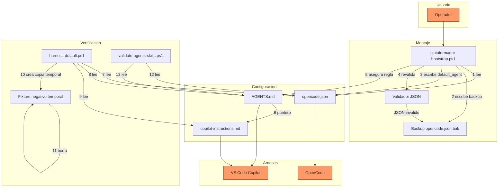

# Threat Model 034 — Arranque por defecto con agentes del kit

## 1. Objetivo y alcance

Analiza la superficie de ataque del cambio que hace que cada arnés arranque con un agente del kit en lugar de su agente incorporado. Cubre: la clave `default_agent` en `opencode.json`, la regla de arranque en `AGENTS.md`, el puntero de enrutamiento en `.github/copilot-instructions.md`, la función `Ensure-OpenCodeDefaultAgent` del bootstrap, el test de contrato y la regla `VAL-10` del validador.

Queda fuera: los bloques `permission` de los agentes (spec 031), la configuración de MCPs (spec 020) y el pipeline SSD+Speckit (spec 025).

## 2. Activos protegidos

| Activo | Por qué importa |
|---|---|
| `opencode.json` | Configuración del arnés: contiene `mcp` resuelto localmente y podría contener credenciales por `{env:...}` |
| Frontmatter de agentes | Define `permission`, `mode` y `tools`: es el control de acceso del kit |
| `AGENTS.md` | Fuente de verdad de reglas; un cambio silencioso altera el comportamiento de todos los agentes |
| `scripts/validate-agents-skills.ps1` | Gate de calidad; un gate degradado deja pasar defectos sin avisar |
| `scripts/plataformador-bootstrap.ps1` | Instalador con capacidad de escritura sobre todos los proyectos |
| `00-indice.md` | Registro de trazabilidad del proyecto |

## 3. Diagrama de flujo de datos

## 4. Matriz STRIDE

| Categoría | Amenaza | Activo | Vector | Prob. | Impacto |
|---|---|---|---|---|---|
| **S**poofing | Un agente se declara `pensador` en `.opencode/agents/` con cuerpo distinto al legítimo y pasa a ser el default | Frontmatter de agentes | Archivo duplicado con el mismo nombre | Baja | Alto |
| **T**ampering | Edición manual de `default_agent` a un agente con permisos amplios para saltar el gate del `pensador` | `opencode.json` | Cambio directo de la clave | Media | Alto |
| **T**ampering | El bootstrap reescribe `opencode.json` y corrompe el bloque `mcp` | Configuración del arnés | Escritura no atómica o serialización incorrecta | Baja | Alto |
| **T**ampering | El sync sobrescribe `opencode.json` por copia íntegra (comportamiento pre-034: SKIP silencioso de archivos de raíz) y pisa el `mcp` local del proyecto | `opencode.json` del proyecto | Regla todo-o-nada del sync sin merge | Media | Alto |
| **T**ampering | La edición **textual** del JSON (regex sobre `$schema`/`instructions`/`default_agent`) reemplaza un tramo incorrecto y deja el archivo corrupto o con la clave mal escrita | `opencode.json` | Patrón regex sobre el string, no re-serialización | Media | Alto |
| **R**epudiation | Cambio de `default_agent` sin registro en `00-indice.md` ni en `converge.md` | Trazabilidad | Cambio de configuración fuera del ciclo SSD | Media | Medio |
| **I**nformation Disclosure | El backup `opencode.json.bak-*` queda en el árbol de trabajo y se commitea con secretos | Credenciales | Backup no ignorado por git | Media | Alto |
| **D**enial of Service | `default_agent` apunta a un agente no-primary: OpenCode cae a `build` con warning y el flujo del kit no se aplica | Arranque del kit | Valor inválido no detectado | Media | Medio |
| **D**enial of Service | El `pensador` como default deniega `edit` y `bash` fuera de su dominio y el operador queda bloqueado | Productividad | Permisos del agente por defecto | Alta | Medio |
| **E**levation of Privilege | El bootstrap, ejecutado con permisos de escritura amplios, es inducido a escribir en un `opencode.json` de un proyecto ajeno | Configuración de terceros | Ruta de proyecto manipulada | Baja | Alto |

## 5. Registro de riesgos

| ID | Amenaza | STRIDE | Mitigación implementada | Residual |
|---|---|---|---|---|
| TM-01 | Suplantación de agente del kit | Spoofing | `VAL-01` (paridad de conteo entre arneses) + `VAL-02` (frontmatter parseable) + `VAL-03` (claves obligatorias); el nombre del archivo es el nombre del agente | Bajo |
| TM-02 | Cambio de `default_agent` para saltar el gate | Tampering | `VAL-10` con severidad **FAIL** (no WARN): el gate falla si el valor no es un agente del kit con `mode: primary` | Bajo |
| TM-03 | Corrupción de `opencode.json` durante el montaje | Tampering | Backup previo + validación JSON posterior + no escribir si el JSON de entrada es inválido (fail-open en la escritura, fail-closed en la verificación) | Bajo |
| TM-04 | Backup con secretos versionado | Information Disclosure | `.gitignore` cubre `opencode.json.bak-*` y `AGENTS.md.bak-*` (bloque 034, `git diff .gitignore`); los backups del bootstrap y del sync quedan fuera de `git status` | **Bajo (cerrado)** |
| TM-05 | Fallback silencioso a `build` | Denial of Service | Test de contrato + `VAL-10` + fixture negativo que reproduce exactamente la degradación | Bajo |
| TM-06 | Bloqueo operativo por permisos del default | Denial of Service | Documentado en `README.md` (cómo cambiar de agente); `pensador` conserva `task: allow` para delegar | Bajo |
| TM-07 | Escritura del bootstrap en proyecto ajeno | Elevation of Privilege | La función opera solo sobre `$RootPath` recibido; no escribe si no existe `opencode.json` | Bajo |
| TM-08 | Cambio de configuración sin trazabilidad | Repudiation | Registro en `converge.md`, `analyze.md` y `00-indice.md`; el cambio de una línea es visible en `git diff` | Bajo |
| TM-09 | Rely en el SKIP silencioso de archivos de raíz (comportamiento pre-034) | Tampering | `opencode.json` y `AGENTS.md` dejan de ser SKIP y viajan por **merge**: por claves (opencode.json) y por bloque delimitado (AGENTS.md), con `[MERGE]` antes de la rama SKIP; `robocopy /E` sigue cubriendo los directorios | Bajo |
| TM-10 | Edición textual del JSON deja el archivo corrupto o con clave mal escrita | Tampering | La edición es textual (regex) a propósito para no reordenar claves; se mitiga con **validación final del JSON resultante** (si no valida → restaura el backup) y con **fail-closed** (si el destino no parsea antes de editar → no se escribe nada) | Bajo |
| TM-11 | Fallo del sync por llamada a función inexistente (defecto B-01/B-02) | Denial of Service | El comparador de raíz ahora es `Compare-KitFileState`, local y con el contrato `'Equal' | 'EolOnly' | 'Different'` que el motor espera; fijado por los escenarios 1a-1d de `tests/kit-sync-merge.ps1` y por parseo (`PARSE-OK`) | Bajo |

## 6. Controles verificados

| Control | Verificación ejecutada | Resultado |
|---|---|---|
| El default es un agente del kit con `mode: primary` | `VAL-10` | OK |
| La degradación a `build` se detecta | Fixture negativo de `tests/harness-default.ps1` | Detectada |
| No se ampliaron permisos | `git diff --stat` sobre el árbol | 0 cambios en frontmatter de agentes |
| El bootstrap no corrompe el JSON | 6 casos aislados (build, clave ausente, otro agente, JSON inválido, sin archivo, `-DryRun`) | 6/6 correctos |
| El gate no quedó degradado por el cambio | `VAL-04` tras el fix de `Get-CanonicalTiers` | 5 tiers exactos |
| El sync no aborta en los archivos de raíz (B-01/B-02) | `tests/kit-sync-merge.ps1` escenarios 1a-1d + `Parser::ParseFile` sobre `sync-kit.ps1` | 4/4 correctos; `PARSE-OK` |
| `AGENTS.md` local no es sobrescrito por el sync | `tests/kit-sync-merge.ps1` escenarios 5c/5d y 6c | las secciones propias se conservan |
| Edición textual no deja JSON inválido | `tests/kit-sync-merge.ps1` 2a (resultado JSON válido) + validación final + restore del backup en `Merge-OpenCodeConfig` | JSON válido; fallo → restore |
| Los backups del sync quedan fuera de git | `.gitignore` (bloque 034) + `git status` tras ejecutar los tests | sin backups en el árbol; TM-04 cerrado |

## 7. Riesgo residual abierto

**TM-04 (cerrado en esta ampliación).** El `.gitignore` ahora cubre `opencode.json.bak-*` y `AGENTS.md.bak-*` (bloque 034, visible en `git diff .gitignore`). Los backups que generan el bootstrap y el sync quedan fuera de `git status`. Residual tras cierre: **Bajo**.

**Riesgos nuevos de la mitad de propagación (TM-09 a TM-11, todos residual Bajo):**
- **TM-09** (SKIP silencioso de raíz): eliminado por diseño D-07/D-08: `opencode.json` y `AGENTS.md` viajan por merge.
- **TM-10** (edición textual del JSON): mitigado con validación final del JSON + restore del backup + fail-closed sobre el JSON de entrada inválido.
- **TM-11** (aborto por función inexistente, defectos B-01/B-02): mitigado con `Compare-KitFileState` local y fijado por test + parseo.

## 8. Conclusión

El cambio reduce la superficie de ataque respecto del estado anterior: reemplaza un agente incorporado por el agente más restrictivo del kit y agrega un gate (`VAL-10`) que falla si el arranque se degrada. La mitad de propagación cierra la asimetría "el gate detecta pero no repara": el sync ahora propaga `default_agent` y la sección de arranque por merge (no por SKIP), con fail-closed y restauración de backups ante fallos. **TM-04 queda cerrado**; los riesgos mitigados quedan en residual **Bajo**. No queda riesgo residual Medio abierto en esta spec.
