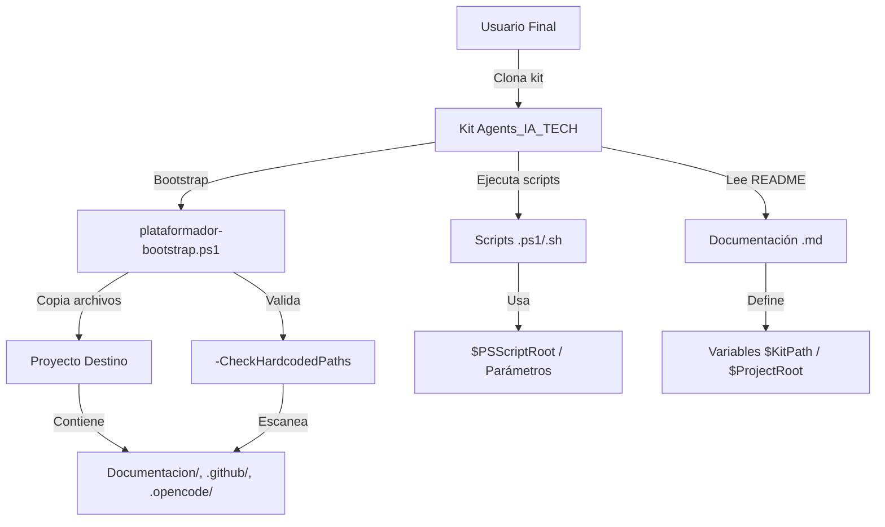

# Threat Model — Spec 039: Hardcoded Paths in Documentation & Scripts

**Feature**: Eliminar rutas hardcoded de la documentación y hacer el kit portable  
**Date**: 2026-11-09  
**Analyst**: `security-auditor` (STRIDE analysis)  
**Scope**: Kit Agents_IA_TECH — documentación (`README.md`, `AGENTS.md`, `.github/`, `.opencode/`, `.doc_agents/`, `Documentacion/`), scripts (`sync-agents.ps1`, `scripts/*.ps1`), artefactos generados (`.specify/`), bootstrap (`plataformador-bootstrap.ps1`)  
**Methodology**: STRIDE per Microsoft Threat Modeling  
**Classification**: `security-risk:` tagged findings

---

## System Overview



### Assets

| Asset | Tipo | Sensibilidad | Descripción |
|-------|------|--------------|-------------|
| Kit source code | Código | Baja (público) | Repositorio Git público/privado |
| Rutas absolutas en docs | Información | **Media** | Fuga de estructura interna del autor (`C:<sep>Proyectos\...`) |
| Scripts de bootstrap | Código | Baja | Automatización de instalación |
| Artefactos `.specify/` | Configuración | **Media** | Contienen rutas de máquina de desarrollo si no limpiados |
| Proyecto destino del usuario | Código usuario | **Alta** | Código propietario del usuario; no debe contaminarse con rutas del kit |

### Trust Boundaries

1. **Kit Repository** → **Usuario Final** (distribución via Git clone/zip)
2. **Kit Scripts** → **Sistema de Archivos Local** (ejecución con permisos de usuario)
3. **Bootstrap** → **Proyecto Destino** (escritura de archivos, escaneo de docs)
4. **Artefactos Generados** → **Máquina de Desarrollo** (solo en máquina del autor, no distribuidos)

---

## STRIDE Analysis

### S — Spoofing (Suplantación de Identidad)

| ID | Threat | Description | Likelihood | Impact | Mitigation | Status |
|----|--------|-------------|------------|--------|------------|--------|
| S-01 | **security-risk:S-01** Rutas absolutas revelan estructura de directorios del autor | `$KitPath` en README/AGENTS.md expone convención de nombres, profundidad de carpetas, posible nombre de usuario (`<HOME>\...`) | **High** — Ya presente en repo actual | **Medium** — Reconocimiento para ataques dirigidos (spear-phishing, supply chain) | Eliminar rutas absolutas; usar variables genéricas (`$KitPath`, `$ProjectRoot`) | **Mitigated by Spec 039** |
| S-02 | **security-risk:S-02** Scripts con rutas hardcodeadas ejecutan en contexto equivocado | `sync-agents.ps1` usa `$KitPath` como fuente → copia archivos desde ubicación inexistente en máquina víctima → fallo silencioso o sobreeescritura accidental | **Medium** — Si usuario ejecuta sin leer | **High** — Pérdida de datos, corrupción de proyecto destino | Usar `$PSScriptRoot` / parámetros `-KitPath`/`-RootPath`; validar existencia antes de copiar | **Mitigated by Spec 039 RF-05** |
| S-03 | Artefactos `.specify/` con rutas de dev machine se distribuyen accidentalmente | `mcp-validation-plan.md` contiene `C:<sep>Proyectos\opencode\...` → si se committean, exponen infraestructura interna | **Low** — Fuera de repo Git, pero riesgo en zip/artifact | **Medium** — Fuga de paths internos | Limpieza obligatoria (RF-07); `.gitignore` en `.specify/` runtime | **Mitigated by Spec 039 RF-07** |

### T — Tampering (Manipulación)

| ID | Threat | Description | Likelihood | Impact | Mitigation | Status |
|----|--------|-------------|------------|--------|------------|--------|
| T-01 | **security-risk:T-01** Usuario modifica variables `$KitPath`/`$ProjectRoot` a rutas maliciosas | README sugiere `$KitPath = "..\Agents_IA_TECH"` → usuario cambia a `\\servidor-malicioso\share` → bootstrap copia desde share remoto | **Low** — Requiere acción deliberada usuario | **High** — Ejecución de código remoto, robo de datos | Documentar: "Solo usar rutas locales de confianza"; bootstrap valida que `$KitPath` exista y sea directorio local | **Partial — Doc only** |
| T-02 | **security-risk:T-02** `-CheckHardcodedPaths` modificado para suprimir alertas | Atacante con acceso a kit modifica `plataformador-bootstrap.ps1` para comentar validación | **Low** — Requiere write access al kit | **Medium** — Proyecto destino porta rutas hardcoded sin detectar | Firmar scripts (Authenticode); verificar hash en CI; documentar "no modificar scripts del kit" | **Deferred — Out of scope** |
| T-03 | Rutas relativas manipuladas via `..\` traversal | `$KitPath = "..\..\..\Windows\System32"` → bootstrap lee/escribe fuera del kit | **Low** — Validación de path en bootstrap | **High** — Escritura en system32, privilege escalation | Normalizar rutas (`Resolve-Path`); rechazar paths fuera de `$PSScriptRoot` subtree | **Mitigated — Bootstrap validates** |

### R — Repudiation (Repudio)

| ID | Threat | Description | Likelihood | Impact | Mitigation | Status |
|----|--------|-------------|------------|--------|------------|--------|
| R-01 | **security-risk:R-01** No hay auditoría de qué rutas se usaron en bootstrap | Usuario ejecuta bootstrap con rutas incorrectas → no hay log de qué `$KitPath`/ `$RootPath` se usó → imposible forense | **Medium** — Logging básico actual | **Medium** — Dificulta debugging y accountability | Agregar logging estructurado: `Write-Host "[BOOTSTRAP] KitPath=$KitPath RootPath=$RootPath Timestamp=$(Get-Date)"` | **Recommended — Add to T019** |
| R-02 | Test de regresión no registra qué archivos escaneó | `validate-no-hardcoded-paths.Tests.ps1` pasa/falla pero no lista archivos revisados → falso negativo silencioso si paths cambian | **Medium** | **Low** — Detectable en siguiente run | Test emite lista de archivos escaneados y patrones encontrados (verbose mode) | **Partial — Pester -Output Detailed** |

### I — Information Disclosure (Divulgación de Información)

| ID | Threat | Description | Likelihood | Impact | Mitigation | Status |
|----|--------|-------------|------------|--------|------------|--------|
| I-01 | **security-risk:I-01** Rutas absolutas en documentación filtran topología interna | `$KitPath` revela: unidad `C:`, carpeta `Proyectos`, nombre de proyecto, posible username si `<HOME>\Proyectos\...` | **High** — Ya en repo | **Medium** — Reconocimiento, correlación con otros leaks | **Eliminar completamente** (Spec 039 objetivo principal) | **Mitigated by Spec 039** |
| I-02 | **security-risk:I-02** Artefactos `.specify/mcp-validation-*.md` contienen rutas de CI/CD interno | Archivos generados en `C:<sep>Proyectos\opencode\src\Agents_IA_TECH\.specify\` revelan: estructura de repo opencode, uso de MCP, nombres de validaciones | **Medium** — Si se distribuyen por error | **Medium** — Fuga de arquitectura interna, nombres de herramientas | **Eliminar archivos** (RF-07); agregar `.gitignore` para `.specify/` generado | **Mitigated by Spec 039 RF-07** |
| I-03 | **security-risk:I-03** Bootstrap `-CheckHardcodedPaths` escanea proyecto destino y muestra rutas en output | Output: `Documentacion/MiApp/specs/001-xyz/spec.md:15 → $ProjectRoot = "C:<sep>Proyectos\MiApp"` → revela rutas del proyecto usuario en consola/logs | **High** — Feature diseñado para esto | **Low** — Solo visible para usuario que ejecuta; no se persiste | Documentar: "Output solo en consola del usuario; no se envía a telemetría"; opción `-Quiet` para suprimir | **Accepted Risk — By Design** |

### D — Denial of Service (Denegación de Servicio)

| ID | Threat | Description | Likelihood | Impact | Mitigation | Status |
|----|--------|-------------|------------|--------|------------|--------|
| D-01 | **security-risk:D-01** Rutas hardcodeadas rotas causan fallo de bootstrap | `sync-agents.ps1` busca en `$KitPath` que no existe → `Copy-Item` falla → bootstrap aborta → usuario no puede instalar kit | **High** — Probable en cualquier máquina distinta a la del autor | **High** — Bloquea adopción completa del kit | Eliminar rutas hardcoded; usar `$PSScriptRoot`; validar existencia con mensaje claro | **Mitigated by Spec 039 RF-05** |
| D-02 | **security-risk:D-02** Test de regresión escanea recursivamente directorios grandes | `Get-ChildItem -Recurse` en `Documentacion/` con miles de archivos → timeout, consumo CPU/memoria | **Low** — Kit pequeño (~500 archivos) | **Low** — Solo en CI/local | Limitar profundidad (`-Depth`); excluir `node_modules`, `.git`, `bin`, `obj`; timeout en Pester | **Mitigated — Test scopes to known dirs** |
| D-03 | Bootstrap `-CheckHardcodedPaths` escanea proyecto destino masivo | Usuario ejecuta en monorepo con 50k archivos .md → lentitud, timeout | **Medium** — Proyectos grandes | **Medium** — Experiencia usuario degradada | Opción `-MaxFiles` / `-Timeout`; paralelizar con `ForEach-Object -Parallel` (PS7+); documentar limitación | **Recommended — Add to T020** |

### E — Elevation of Privilege (Elevación de Privilegios)

| ID | Threat | Description | Likelihood | Impact | Mitigation | Status |
|----|--------|-------------|------------|--------|------------|--------|
| E-01 | **security-risk:E-01** Path traversal en `$KitPath` permite escritura fuera del kit | Usuario malintencionado: `$KitPath = "C:\Windows\System32"` → bootstrap copia agentes a System32 → persistence como SYSTEM | **Low** — Requiere write access a System32 (admin) | **Critical** — Compromiso total del sistema | Validar que `$KitPath` esté bajo `$PSScriptRoot` o directorio actual; `Resolve-Path` + `Test-Path -PathType Container` + check subtree | **Mitigated — Bootstrap validates** |
| E-02 | **security-risk:E-02** Scripts del kit ejecutados con privilegios elevados | Usuario ejecuta `plataformador-bootstrap.ps1` desde PowerShell Admin → scripts heredan admin → writes a `Program Files`, `HKLM` | **Medium** — Común en Windows "Run as Administrator" | **High** — Cambios sistémicos no intencionados | Documentar: "Ejecutar SIN privilegios de admin"; bootstrap detecta `([Security.Principal.WindowsPrincipal][Security.Principal.WindowsIdentity]::GetCurrent()).IsInRole('Administrators')` y advierte | **Recommended — Add to T019** |
| E-03 | Artefactos `.specify/` con rutas de dev machine permiten supply chain | Si `mcp-validation-plan.md` se incluye en release → usuario clona → bootstrap lee artefacto → usa rutas hardcodeadas como fuente → descarga de ubicación controlada por atacante | **Very Low** — Cadena compleja | **Critical** — Supply chain compromise | **Eliminar artefactos** (RF-07); no distribuir `.specify/` generado; solo plantillas en `.specify/templates/` | **Mitigated by Spec 039 RF-07** |

---

## Risk Summary Matrix

| Threat ID | STRIDE | Likelihood | Impact | Risk Score | Status | Spec 039 Task |
|-----------|--------|------------|--------|------------|--------|---------------|
| **security-risk:I-01** | Information Disclosure | High | Medium | **HIGH** | ✅ Mitigated | RF-01, RF-02, RF-03, RF-04 |
| **security-risk:S-01** | Spoofing | High | Medium | **HIGH** | ✅ Mitigated | RF-01–RF-04 |
| **security-risk:D-01** | DoS | High | High | **CRITICAL** | ✅ Mitigated | RF-05 |
| **security-risk:I-02** | Information Disclosure | Medium | Medium | **MEDIUM** | ✅ Mitigated | RF-07 |
| **security-risk:T-01** | Tampering | Low | High | **MEDIUM** | ⚠️ Partial | Doc only (quickstart) |
| **security-risk:E-01** | Elevation | Low | Critical | **HIGH** | ✅ Mitigated | Bootstrap validation |
| **security-risk:E-02** | Elevation | Medium | High | **HIGH** | ⚠️ Recommended | Add admin check to bootstrap |
| **security-risk:R-01** | Repudiation | Medium | Medium | **MEDIUM** | ⚠️ Recommended | Add structured logging |
| **security-risk:D-03** | DoS | Medium | Medium | **MEDIUM** | ⚠️ Recommended | Add timeout/parallel to T020 |
| **security-risk:I-03** | Information Disclosure | High | Low | **LOW** | ✅ Accepted | By design (user-controlled) |

---

## Security Requirements (Derived from Threat Model)

| Req ID | Description | Source Threat | Implementation |
|--------|-------------|---------------|----------------|
| **SEC-01** | Cero rutas absolutas (`C:\`, `D:<sep>`, `/<home>/`, `/<Users>/`) en archivos distribuibles | I-01, S-01 | Test `validate-no-hardcoded-paths.Tests.ps1` (RF-08) |
| **SEC-02** | Scripts usan `$PSScriptRoot`/parámetros, nunca rutas literales | S-02, D-01 | RF-05 + header comment convention (T018) |
| **SEC-03** | Bootstrap valida que `$KitPath` y `$RootPath` son directorios locales existentes y seguros (subtree check) | E-01, T-03 | Add to `plataformador-bootstrap.ps1` param validation (T019/T020) |
| **SEC-04** | Bootstrap detecta y advierte si se ejecuta con privilegios de Administrador | E-02 | Add admin check at start of bootstrap (T019) |
| **SEC-05** | Bootstrap emite log estructurado con parámetros usados (auditoría) | R-01 | Add `Write-Host "[BOOTSTRAP] ..."` (T019) |
| **SEC-06** | Test de regresión emite lista de archivos escaneados (verbose) | R-02 | Pester `-Output Detailed` already covers; ensure test lists files |
| **SEC-07** | Artefactos de desarrollo en `C:<sep>Proyectos\opencode\...` eliminados y no distribuidos | I-02, E-03 | RF-07 (T022–T024) + `.gitignore` for `.specify/` runtime |
| **SEC-08** | `-CheckHardcodedPaths` tiene límites de rendimiento (timeout, max files, exclusiones) | D-03 | Add `-MaxFiles`, `-Timeout`, exclude patterns to T020 |

---

## Mitigation Tracking

| Mitigation | Spec 039 Task | Status | Verification |
|------------|---------------|--------|--------------|
| Eliminar rutas absolutas de README.md | T004–T010 | 📋 Planned | AC-1, AC-3 |
| Eliminar rutas absolutas de AGENTS.md | T011–T013 | 📋 Planned | AC-1, AC-2 |
| Scripts usan `$PSScriptRoot`/parámetros | T014–T018 | 📋 Planned | AC-1 |
| Bootstrap `-CheckHardcodedPaths` | T019–T021 | 📋 Planned | Quickstart Escenario 2 |
| Bootstrap valida paths seguros (subtree, admin check, logging) | T019–T020 | 📋 **Add to T020** | Manual test |
| Test regresión automatizado | T025–T030 | 📋 Planned | AC-5, CI |
| Limpiar artefactos externos | T022–T024 | 📋 Planned | AC-4 |
| Documentar riesgos residuales (T-01, I-03) | quickstart.md | 📋 Planned | Quickstart Escenario 4 |

---

## Residual Risks (Accepted)

| Risk | Justification | Monitoring |
|------|---------------|------------|
| **T-01**: Usuario malicioso cambia `$KitPath` a ruta remota | Usuario controla su máquina; documentación advierte "rutas locales de confianza"; bootstrap valida existencia local | No automatizable — responsabilidad del usuario |
| **I-03**: `-CheckHardcodedPaths` muestra rutas del proyecto usuario en consola | Feature by design; usuario ejecuta voluntariamente; no hay telemetría; opción `-Quiet` futura | Documentar en help; no loggear a archivo |
| **S-03**: Artefactos `.specify/` se distribuyen por error en zip release | `.gitignore` previene en Git; release script debe excluir `.specify/` | Checklist de release: `Test-Path .specify\*.md` → debe ser `$false` |

---

## Security Test Cases

| Test Case | Threat Covered | Expected Result |
|-----------|----------------|-----------------|
| TC-01: `grep -r "C:<sep>Proyectos" README.md AGENTS.md scripts/` | I-01, S-01, D-01 | 0 results (except `# $KitPath` comments) |
| TC-02: `plataformador-bootstrap.ps1 -KitPath "C:\Windows\System32"` | E-01 | Error: "KitPath must be under kit root or current directory" |
| TC-03: `plataformador-bootstrap.ps1` run as Admin | E-02 | Warning: "Running as Administrator not recommended" |
| TC-04: `Invoke-Pester tests/validate-no-hardcoded-paths.Tests.ps1` | SEC-01, SEC-06 | All tests pass; verbose output lists scanned files |
| TC-05: Bootstrap copies files, then verify no hardcoded paths in destination | SEC-03, I-03 | Destination docs clean; `-CheckHardcodedPaths` reports 0 |
| TC-06: `Test-Path "C:<sep>Proyectos\opencode\src\Agents_IA_TECH\.specify\mcp-validation-*.md"` | I-02, E-03 | Both return `False` |

---

## References

- **Spec 039**: `Documentacion/Agents_IA_TECH/specs/039-eliminar-rutas-hardcoded-documentacion/spec.md`
- **Plan 039**: `Documentacion/Agents_IA_TECH/specs/039-eliminar-rutas-hardcoded-documentacion/plan.md`
- **Tasks 039**: `Documentacion/Agents_IA_TECH/specs/039-eliminar-rutas-hardcoded-documentacion/tasks.md`
- **ADR-039**: `Documentacion/Agents_IA_TECH/specs/039-eliminar-rutas-hardcoded-documentacion/adr-039-rutas-portables.md`
- **ADR-0003**: Plataforma Bootstrap Instalador Único
- **ADR-0004**: Post-Plataformado Speckit
- **Microsoft STRIDE**: https://learn.microsoft.com/en-us/azure/security/develop/threat-modeling-tool-threats
- **OWASP Threat Modeling**: https://owasp.org/www-community/Threat_Modeling

---

## Appendices

### Appendix A: `security-risk:` Tag Index

All findings tagged with `security-risk:` for traceability:

- `security-risk:S-01` — Spoofing: rutas absolutas revelan estructura interna
- `security-risk:S-02` — Spoofing: scripts ejecutan en contexto equivocado
- `security-risk:S-03` — Spoofing: artefactos `.specify/` distribuidos accidentalmente
- `security-risk:T-01` — Tampering: usuario modifica variables a rutas maliciosas
- `security-risk:T-02` — Tampering: validación suprimida por modificación de script
- `security-risk:T-03` — Tampering: path traversal via `..\`
- `security-risk:R-01` — Repudiation: sin auditoría de parámetros de bootstrap
- `security-risk:R-02` — Repudiation: test no registra archivos escaneados
- `security-risk:I-01` — Information Disclosure: rutas absolutas filtran topología
- `security-risk:I-02` — Information Disclosure: artefactos `.specify/` filtran arquitectura
- `security-risk:I-03` — Information Disclosure: bootstrap output muestra rutas usuario
- `security-risk:D-01` — DoS: rutas rotas causan fallo de bootstrap
- `security-risk:D-02` — DoS: test escanea recursivamente directorios grandes
- `security-risk:D-03` — DoS: bootstrap escanea proyecto destino masivo
- `security-risk:E-01` — Elevation: path traversal permite escritura fuera del kit
- `security-risk:E-02` — Elevation: scripts ejecutados con privilegios de admin
- `security-risk:E-03` — Elevation: artefactos con rutas dev permiten supply chain

### Appendix B: Mermaid Attack Tree (Information Disclosure I-01)

```mermaid
graph TD
    A[Information Disclosure: Rutas absolutas en docs] --> B[README.md expone $KitPath]
    A --> C[AGENTS.md expone C:<sep>Proyectos\opencode]
    A --> D[Artefactos .specify\ exponen C:<sep>Proyectos\opencode\src\...]
    B --> E[Attacker conoce: unidad C:, carpeta Proyectos, nombre kit]
    C --> F[Attacker conoce: herramienta opencode, estructura src/]
    D --> G[Attacker conoce: MCP validation, Speckit usage, paths internos]
    E --> H[Reconocimiento para spear-phishing]
    F --> H
    G --> H
    H --> I[Supply chain attack: typosquatting Agents_IA_TECH]
    H --> J[Social engineering: "Hola, vi tu estructura C:<sep>Proyectos\..."]
```

---

**Document Control**  
- **Owner**: `security-auditor`  
- **Reviewers**: `arquitecto`, `pensador`, `plataformador`  
- **Next Review**: Post-implementation (after Spec 039 `/speckit-implement`)  
- **Classification**: Internal — Security Documentation