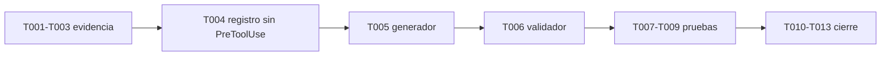

# Plan 045 — Retirar `PreToolUse` del hook `context-mode`

**Spec**: `spec.md` v2.0.0 · **Branch**: `045-retirar-pretooluse-hook-context-mode` · **Fecha**: 2026-11-11

---

## 1. Resumen

La retirada de `PreToolUse` ya está aplicada **en el archivo**, pero el archivo es un artefacto generado y el validador exige lo contrario. Este plan cierra el circuito en tres piezas:

1. **Registro** (`.github/hooks/context-mode.json`): sin `PreToolUse`. Ya aplicado; se conserva como evidencia el `.bak-20261109`.
2. **Generador** (`Ensure-ContextHooks`): deja de emitir `PreToolUse`. Es la pieza que hace la decisión reproducible.
3. **Validador** (`scripts/validar-mcps.ps1`): deja de exigir `PreToolUse` y pasa a exigir su ausencia (guard de regresión).

Sin (2) y (3), la 045 es una edición manual que el propio kit revierte.

---

## 2. Contexto técnico

| Dato | Valor | Fuente |
|---|---|---|
| Arnés afectado | VS Code Copilot | comandos `context-mode hook vscode-copilot <etapa>` |
| Paquete | `context-mode 2.1.0` | `package.json` global |
| Umbral de lectura | `16384` bytes, constante compilada | `hook.mjs` |
| Configurabilidad | ninguna (`CM_HOOK` solo controla fallos del hook) | `hook.mjs` |
| Etapas que pueden denegar | solo `PreToolUse` | `hook.mjs` |
| Registro versionado | sí | `git ls-files` |
| Registro generado | sí | `Ensure-ContextHooks`, bootstrap L1436-1477 |
| Validador que lo exige | sí | `validar-mcps.ps1` L230-235 |

### 2.1 Estado actual verificado (2026-11-11)

```json
{
  "hooks": {
    "PostToolUse":  [ { "type": "command", "command": "context-mode hook vscode-copilot posttooluse" } ],
    "SessionStart": [ { "type": "command", "command": "context-mode hook vscode-copilot sessionstart" } ]
  }
}
```

```
[FAIL] Falta hook 'PreToolUse' en .github/hooks/context-mode.json
Resultado: HAY FALLOS.
```

Las dos líneas anteriores son el problema completo: el registro ya aplica la decisión y el validador la declara incumplimiento.

---

## 3. Constitution check

| Principio | Aplicación en esta spec | Veredicto |
|---|---|---|
| I. Modular Agent Design | El cambio queda en dos funciones con responsabilidad única (`Ensure-ContextHooks`, bloque 3 de `validar-mcps`) | PASS |
| II. Orchestrator Pattern | `pensador` especifica y delega; la escritura de código va a `developer` | PASS |
| III. Specification-Driven Development | Ciclo completo: spec → plan → tasks → analyze → converge, con AC verificables | PASS |
| IV. Copilot/Opencode Compatibility | Solo se toca el registro de VS Code Copilot; OpenCode no declara este hook | PASS |
| V. Observability | El validador pasa a señalar la reaparición de `PreToolUse`, no su ausencia | PASS |
| VI. proyect_ext | No aplica: no se agregan dependencias externas | N/A justificado |
| VII. Restricción de paths por tier | Docs en `Documentacion/`; código delegado | PASS |
| VIII. Fail-Open | El hook nunca fue un control de seguridad; retirar `PreToolUse` no elimina una barrera de protección | PASS |
| IX. Contenido completo | Los cinco artefactos se escriben con contenido real y verificable | PASS |

---

## 4. Decisiones de diseño

| ID | Decisión | Alternativas descartadas | Motivo |
|---|---|---|---|
| D1 | Retirar **solo** `PreToolUse`; conservar `SessionStart` y `PostToolUse` | Retirar el registro completo | `SessionStart` inyecta contexto y `PostToolUse` resume salidas: aportan valor y no bloquean |
| D2 | La política vive en `Ensure-ContextHooks`, no en el archivo | Dejar el archivo editado a mano | Es un artefacto generado; `-Force` o un clon nuevo lo restauran (regla de oro del kit) |
| D3 | El validador exige la **ausencia** de `PreToolUse` | Borrar el bloque de hooks del validador | Un validador que no vigila la decisión permite que vuelva sin que nadie lo note |
| D4 | No re-habilitar hasta que el umbral sea configurable | Subir el umbral por parche al paquete | Parchear `node_modules` es estado local no reproducible |
| D5 | El `.bak-20261109` se conserva versionado | Borrarlo tras el cambio | Es la evidencia del estado anterior y el origen del rollback |
| D6 | Renombrar la spec a `045-retirar-pretooluse-hook-context-mode` | Mantener `...-lecturas-bloqueadas` | El slug debe nombrar la decisión, no el síntoma |

### 4.1 Contrato de `Ensure-ContextHooks` (post-T005)

```powershell
$hooksJson = [ordered]@{
    hooks = [ordered]@{
        PostToolUse  = @(@{ type = "command"; command = "context-mode hook vscode-copilot posttooluse" })
        SessionStart = @(@{ type = "command"; command = "context-mode hook vscode-copilot sessionstart" })
    }
}
```

Invariantes:

| Invariante | Verificación |
|---|---|
| No contiene la clave `PreToolUse` | `$hooksJson.hooks.Contains('PreToolUse') -eq $false` |
| Conserva `PostToolUse` y `SessionStart` | ambas claves presentes |
| El JSON resultante es válido | `ConvertFrom-Json` sobre la salida |
| Idempotente | dos corridas producen el mismo archivo |
| No pisa un registro existente sin `-Force` | comportamiento actual preservado |

Comentario obligatorio en el código (para que nadie lo revierta "por completitud"):

```powershell
# [045] PreToolUse se retira por decision (spec 045): context-mode 2.x deniega
# Read > 16 KB con umbral fijo (16384). No re-habilitar sin cumplir la
# condicion de la spec (umbral configurable o > tamano maximo de la doc).
```

### 4.2 Contrato de `validar-mcps.ps1` (post-T006)

| Comprobación | Esperado | Mensaje |
|---|---|---|
| El archivo existe | PASS | `hooks de context-mode presentes` |
| `PreToolUse` **no** está | PASS | `PreToolUse retirado por decisión (spec 045)` |
| `PreToolUse` **sí** está | FAIL | `PreToolUse reapareció: la política de la spec 045 prohíbe denegar lecturas` |
| `PostToolUse` y `SessionStart` presentes | PASS | `Hook '<etapa>' configurado` |
| Falta `PostToolUse` o `SessionStart` | FAIL | `Falta hook '<etapa>'` |

El mensaje de fallo debe nombrar la spec para que el diagnóstico sea inmediato.

---

## 5. Estrategia de verificación

La verificación se apoya en un principio: **lo que se afirma sobre el generador se prueba ejecutándolo**, en un directorio temporal, nunca leyendo el archivo del proyecto.

### 5.1 Regla de oro

Ninguna tarea de generación se cierra sin **probar la salida del generador** en un directorio temporal. No se valida leyendo el archivo del proyecto.

### 5.2 Pruebas

| ID | Prueba | Método | Cubre |
|---|---|---|---|
| P1 | El registro del repo no declara `PreToolUse` | `ConvertFrom-Json` + propiedad | AC-1 |
| P2 | El registro es JSON válido | `ConvertFrom-Json` | AC-2 |
| P3 | El respaldo conserva las 3 etapas | lectura del `.bak-20261109` | AC-3 |
| P4 | El generador, en temporal vacío, emite el registro sin `PreToolUse` | copiar `scripts/`, ejecutar bootstrap, leer la salida | AC-6 |
| P5 | El generador con `-Force` **no** reintroduce `PreToolUse` | sembrar el `.bak` como registro y ejecutar con `-Force` | AC-6, AC-9 |
| P6 | El validador no falla por `PreToolUse` ausente | `validar-mcps.ps1` sobre el repo | AC-7 |
| P7 | El validador falla si `PreToolUse` reaparece | sembrar el `.bak` en un temporal con `scripts/` y ejecutar | AC-7 |
| P8 | Portabilidad intacta | `Invoke-Pester tests/validate-no-hardcoded-paths.Tests.ps1` | AC-8 |

P4-P7 se implementan como `tests/hooks-context-mode.Tests.ps1` (Pester), con el mismo patrón que `tests/generacion-opencode.Tests.ps1` de la 046: temporal, bootstrap real, validación de la salida.

### 5.3 Verificación manual (no automatizable)

| AC | Cómo |
|---|---|
| AC-4 | Recargar la ventana del arnés y abrir un `.md` > 16 KB; debe leerse sin `deny` |

Se registra como pendiente mientras no se ejecute, sin marcarla cumplida.

---

## 6. Riesgos del plan

| Riesgo | Mitigación |
|---|---|
| El bootstrap con `-Force` pisa el registro con la versión vieja | T005 elimina la clave del generador; P5 lo prueba |
| El validador se "arregla" borrando el bloque de hooks | D3: se invierte la aserción, no se elimina |
| Alguien reintroduce `PreToolUse` "para completar el registro" | Comentario en el generador + guard del validador + P7 |
| Se confunde este cambio con el de `validar-mcps.ps1` sobre versiones | §3.2 de la spec lo excluye; se registra como H3 y no se toca aquí |
| El cambio de validador afecta a otros MCP | Se modifica solo el bloque 3 (hooks), no los bloques 1, 2 ni 4 |

---

## 7. Orden de ejecución



| Fase | Contenido | Estado |
|---|---|---|
| 0 | Evidencia y línea base | hecho |
| 1 | Registro sin `PreToolUse` | hecho (+ `.bak-20261109`) |
| 2 | Generador y validador (código) | **pendiente**, delegado a `developer` |
| 3 | Pruebas de la salida generada | pendiente |
| 4 | Cierre documental y AC-4 | parcial |

---

## 8. Archivos del cambio

| Archivo | Acción | Responsable |
|---|---|---|
| `.github/hooks/context-mode.json` | ya modificado (sin `PreToolUse`) | aplicado 2026-11-09 |
| `.github/hooks/context-mode.json.bak-20261109` | sin cambios (evidencia) | aplicado 2026-11-09 |
| `scripts/plataformador-bootstrap.ps1` (`Ensure-ContextHooks`) | quitar `PreToolUse` + comentario de decisión | `developer` |
| `scripts/validar-mcps.ps1` (bloque 3) | invertir la aserción de `PreToolUse` | `developer` |
| `tests/hooks-context-mode.Tests.ps1` | nuevo (P4-P7) | `developer` |
| `Documentacion/Agents_IA_TECH/specs/045-.../{spec,plan,tasks,analyze,converge}.md` | nuevos | `pensador` |
| `Documentacion/Agents_IA_TECH/00-indice.md` | actualizar sección 045 | `pensador` |
| `Documentacion/Agents_IA_TECH/pendientes-implementacion.md` | actualizar fila 045 y tareas | `pensador` |
| `CHANGELOG.md` | actualizar ruta del artefacto en 1.2.0 | `pensador` |

---

## 9. Definición de terminado

La 045 se cierra cuando:

1. P1-P8 en verde.
2. AC-4 verificado tras recarga del arnés (o declarado pendiente con causa explícita).
3. `Ensure-ContextHooks` y el registro del repo producen **el mismo** JSON (AC-9).
4. `pendientes-implementacion.md` refleja el estado real, sin `[x]` sin evidencia.
